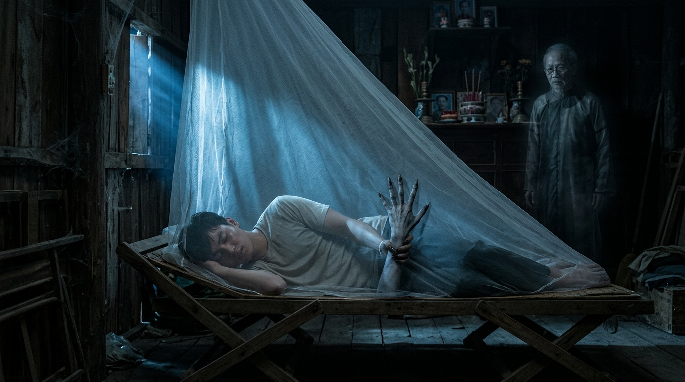

# Căn Nhà Âm Dương: Oan Hồn Dưới Gốc Mít — Phim Ma Kể Chuyện Điện Ảnh (15 Cảnh × 6 Clips × 10s = 90 Clips / 15 Phút | Google Flow Omni 10s)

Dự án **Phim Ma Kể Chuyện Điện Ảnh 15 Phút** (**15 Cảnh × 6 Clips × 10 giây = 90 Clips = 900 giây / 15 phút**, tỉ lệ **16:9 Cinema 24fps**, model **`omni_flash` 10s**) đã được tối ưu hóa toàn diện theo **10 Tiêu Chuẩn Điện Ảnh Kinh Dị Dân Gian Bắc Bộ**:
- **1. Nhất Quán Giọng Người Dẫn Chuyện (`VOICE_LOCK_NARRATOR_CNHADG` — Ưu Tiên Cao Nhất):** Duy nhất 1 giọng Nam trung niên 42–48 tuổi chuẩn miền Bắc (`~108–110 Hz` deep warm low-baritone, hơi khàn nhẹ tự nhiên, vang lồng ngực, phong cách kể chuyện ma đêm khuya, tốc độ chuẩn **`125–145 từ/phút`**), điều chỉnh cảm xúc theo mạch truyện (`CALM_MYSTERIOUS` → `RISING_DREAD` → `CONTROLLED_URGENCY`).
- **2. Tối Ưu Độ Dài Thoại & Lời Dẫn (`12–18 từ tiếng Việt / clip 10s`):** 100% trong tổng số 90 clips có độ dài câu nói từ **16–18 từ tiếng Việt** (`~7.5s–8.5s` ở tốc độ 125–145 WPM), kết thúc tự nhiên trước giây `8.8s`, không bao giờ bị cắt chữ hay đọc vội.
- **3. Cấu Trúc Prompt Chuẩn 9 Phần (`[1. FORMAT & MODEL]` → `[9. CONTINUITY & QUALITY RULES]`):** Loại bỏ hoàn toàn chỉ dẫn trùng lặp và xung đột góc máy (không trộn flycam với gimbal mặt đất), khóa chặt `media_id` nhân vật trên Google Flow Project `3b955883-7851-42fe-a986-5ef82b4912e5` và mô tả rõ `START FRAME` / `END FRAME`.

---

## PHẦN 1: BẢNG KHÓA NHÂN VẬT & GIỌNG ĐỌC (`CHARACTER & VOICE LOCK`)

| Tag | Nhân Vật | Google Flow `media_id` | Độ Tuổi | Mã Khóa Giọng (`VOICE_LOCK`) | Hồ Sơ Giọng Chuẩn Miền Bắc |
|---|---|---|---|---|---|
| **`@Binh`** | **Nguyễn Hòa Bình** | `a1a78643-ce72-4217-86c7-b53b927e637a` | 21 | `VOICE_LOCK_BINH_CNHADG` | 21-year-old native Standard Northern Vietnamese young male voice (~135 Hz tenor-baritone), trembling, anxious, guilt-ridden and breathless in horror moments (giọng nam trẻ 21 tuổi chuẩn miền Bắc, run rẩy, nghẹn ngào). |
| **`@BaPhuong`** | **Bà Phượng** | `a17f2e3b-8272-4cff-8de0-1c3ec43a11b1` | 50 | `VOICE_LOCK_PHUONG_CNHADG` | 50-year-old native Standard Northern Vietnamese maternal female voice (~205 Hz warm mezzo), tearful, choked with heartache and maternal worry (giọng nữ trung niên 50 tuổi chuẩn miền Bắc, ấm áp, lo âu). |
| **`@OngQuan`** | **Ông Quân** | `e845a88f-7cd2-4b8f-9fa3-e75e7e337674` | 55 | `VOICE_LOCK_QUAN_CNHADG` | 55-year-old native Standard Northern Vietnamese male baritone voice (~105 Hz stern baritone), gravelly, authoritative, hot-tempered at first then deeply remorseful (giọng nam trung niên 55 tuổi chuẩn miền Bắc, trầm đanh, uy nghiêm). |
| **`@OngBay`** | **Ông Bảy** | `10e5cdcf-3dd1-4b41-b999-21922b65de89` | 60 | `VOICE_LOCK_BAY_CNHADG` | 60-year-old native Standard Northern Vietnamese rural elderly male voice (~115 Hz rustic baritone), candid, grounded, hushed when warning of ghosts (giọng bác nông dân 60 tuổi chuẩn miền Bắc, mộc mạc, ấm áp). |
| **`@VongCuXa`** | **Vong Cụ Xá** | `f8d1ff26-6134-4fa4-8c0f-13e8405e5f64` | 80 | `VOICE_LOCK_CUXA_CNHADG` | 80-year-old native Standard Northern Vietnamese spectral elderly male voice (~98 Hz aged resonant bass-baritone), hoarse, slow, echoing with ancestral sorrow (giọng cụ già 80 tuổi chuẩn miền Bắc, khàn đục, vọng âm). |
| **`@VongLa`** | **Vong Gốc Mít** | `0c2ade1f-c1cd-4c93-98e2-697231a54887` | 28 | `VOICE_LOCK_VONGLA_CNHADG` | Chilling echoing Standard Northern Vietnamese spectral whisper reverberating from all directions in the dark (giọng ma vọng lạnh lẽo chuẩn miền Bắc từ bốn phía). |
| **`Narrator`** | **Người Dẫn Chuyện** | *(Off-Screen VO)* | 42–48 | `VOICE_LOCK_NARRATOR_CNHADG` | Nam 42–48 tuổi chuẩn Bắc, deep warm low-baritone (~108–110 Hz), slightly husky, 125–145 WPM. |

---

## PHẦN 2: KỊCH BẢN CHI TIẾT 15 CẢNH — 90 CLIPS × 10 GIÂY (ĐÃ TỐI ƯU 12–18 TỪ/CLIP)

### Cảnh 01 (`00:00–01:00` | 6 Clips × 10s): Chuyến Xe Khách Đêm Khuya & Món Nợ Bốn Trăm Triệu
- **Không gian & Đạo cụ:** Lone sleeper coach bus crawling along a misty Northern Vietnamese rural highway and the dimly lit window seat inside the bus cabin (plus brief phone cutaway to @BaPhuong's kitchen). | *Props:* Sleeper coach bus window streaked with rain, worn plush passenger seat, black backpack, glowing smartphone screen showing a liquidated trading account.

- **Clip 1 ([`canh-01/clip-1.md`](canh-01/clip-1.md) | `00:00–00:10` | `VO` | `CALM_MYSTERIOUS` | On-screen: `@Binh`):** Opening aerial shot gliding over dark, fog-shrouded Northern Vietnamese rice paddies at midnight and descending toward the rain-streaked window of a lone sleeper coach bus where @Binh sits huddled.
  - *Camera Plan:* `24mm stabilized aerial drone slow descending push-in`
  - *Lời dẫn / Thoại (18 từ):* "Ôm món nợ bốn trăm triệu không lối thoát, Bình bỏ trốn về căn nhà hoang ông nội."
  - *Sound Design:* Tiếng động cơ xe khách rầm rì trầm đục xuyên màn mưa đêm và tiếng gió rít ngoài cánh đồng.
- **Clip 2 ([`canh-01/clip-2.md`](canh-01/clip-2.md) | `00:10–00:20` | `VO` | `RISING_DREAD` | On-screen: `@Binh`):** Inside the dimly lit sleeper bus cabin, @Binh clutches his black backpack tightly against his chest as passing amber highway streetlights sweep across his pale, hollow-eyed face.
  - *Camera Plan:* `35mm stabilized gimbal slow creeping push-in`
  - *Lời dẫn / Thoại (18 từ):* "Nhưng Bình đâu biết sau vụ tai nạn sáu mạng người, căn nhà đã thành nơi ma trú."
  - *Sound Design:* Tiếng gạt nước mưa đều đặn của xe khách và tiếng thở nặng nhọc đầy bất an của @Binh.
- **Clip 3 ([`canh-01/clip-3.md`](canh-01/clip-3.md) | `00:20–00:30` | `LIPSYNC:@Binh` | `RISING_DREAD` | On-screen: `@Binh`):** The smartphone inside @Binh's grey hoodie pocket vibrates; @Binh flinches, pulls out the phone, cups his hand over his mouth, and whispers anxiously into the receiver.
  - *Camera Plan:* `50mm stabilized medium close-up shot`
  - *Lời dẫn / Thoại (18 từ):* "Con nghe đây mẹ ơi… Con đang trên xe về quê, mẹ đừng gọi nhiều người ta nghe."
  - *Sound Design:* Tiếng chuông rung rè rè trên ghế nệm và giọng thì thầm sợ sệt của @Binh giữa khoang xe tối.
- **Clip 4 ([`canh-01/clip-4.md`](canh-01/clip-4.md) | `00:30–00:40` | `LIPSYNC:@BaPhuong` | `RISING_DREAD` | On-screen: `@BaPhuong`):** On the other end of the call in a dim city kitchen, @BaPhuong grips the edge of a wooden table under a weak yellow bulb, tears brimming in her eyes as she warns her son.
  - *Camera Plan:* `50mm stabilized medium close-up slow push-in`
  - *Lời dẫn / Thoại (18 từ):* "Bố mày chưa biết đâu… Nhưng chủ nợ sắp tới rồi, về quê phải cẩn thận con nhé!"
  - *Sound Design:* Tiếng nấc nghẹn ngào của người mẹ qua điện thoại hòa tiếng quạt điện cũ quay lạch cạch.
- **Clip 5 ([`canh-01/clip-5.md`](canh-01/clip-5.md) | `00:40–00:50` | `VO` | `RISING_DREAD` | On-screen: `@Binh`):** Back in his dark sleeper bus seat, @Binh lowers the smartphone and stares at a screenshot of his liquidated online trading account glowing red, burying his face in his shaking hands.
  - *Camera Plan:* `35mm stabilized over-the-shoulder tilt-down push-in`
  - *Lời dẫn / Thoại (18 từ):* "Tất cả bắt nguồn từ bẫy tiền ảo… chỉ sau một đêm mất trắng, nợ lãi chồng chất."
  - *Sound Design:* Tiếng tút tắt cuộc gọi khô khốc và tiếng hơi thở hối hận nghẹn đắng của @Binh.
- **Clip 6 ([`canh-01/clip-6.md`](canh-01/clip-6.md) | `00:50–01:00` | `VO` | `RISING_DREAD` | On-screen: `@Binh`):** @Binh switches off his phone screen and leans his forehead against the freezing wet bus glass, watching his hollow reflection as the coach plunges deeper into rural night fog.
  - *Camera Plan:* `35mm stabilized slow dolly pull-back`
  - *Lời dẫn / Thoại (18 từ):* "Không dám nhìn mặt bố, Bình đánh liều về quê mà chẳng ngờ đang bước vào cõi âm."
  - *Sound Design:* Tiếng bánh xe khách cán qua vũng nước mưa rào rạt và tiếng gió đêm hun hút.

---

### Cảnh 02 (`01:00–02:00` | 6 Clips × 10s): Bến Xe Thị Xã, Quán Cơm Bụi & Cánh Cổng Sắt Dưới Gốc Mít Cổ Thụ
- **Không gian & Đạo cụ:** Dusty provincial bus drop-off, roadside rice stall, narrow concrete village lane flanked by bamboo groves, and the rusted black iron gate under the ancient jackfruit tree. | *Props:* Black backpack, low plastic table and cold rice plate at the roadside stall, smartphone SMS, narrow concrete path between rice paddies, iron hoe, rusted black iron gate, gnarled ancient jackfruit tree.

- **Clip 1 ([`canh-02/clip-1.md`](canh-02/clip-1.md) | `01:00–01:10` | `VO` | `CALM_MYSTERIOUS` | On-screen: `@Binh`):** Under pale late-afternoon sun at a dusty provincial bus stop, the coach pulls away and @Binh steps onto the gravel shoulder with his black backpack, letting out a long, exhausted breath.
  - *Camera Plan:* `28mm stabilized gimbal tracking shot`
  - *Lời dẫn / Thoại (18 từ):* "Hơn hai giờ chiều xe thả Bình xuống thị xã nhỏ, nơi đất khách cậu mới thở phào."
  - *Sound Design:* Tiếng còi xe khách xa dần trên quốc lộ và tiếng gió chiều thổi bụi lạo xạo dưới chân.
- **Clip 2 ([`canh-02/clip-2.md`](canh-02/clip-2.md) | `01:10–01:20` | `VO` | `CALM_MYSTERIOUS` | On-screen: `@Binh`):** @Binh sits alone at a low plastic table in a roadside eatery, staring down at a text message showing his mother just transferred her last five hundred thousand dong beside a plate of cold rice.
  - *Camera Plan:* `50mm stabilized medium close-up push-in`
  - *Lời dẫn / Thoại (17 từ):* "Ngồi quán cơm bụi nhìn năm trăm nghìn cuối cùng mẹ chuyển, sống mũi Bình cay xè."
  - *Sound Design:* Tiếng tin nhắn điện thoại báo 'ting' nhẹ nhàng và tiếng muỗng chạm đĩa sứ khô khốc.
- **Clip 3 ([`canh-02/clip-3.md`](canh-02/clip-3.md) | `01:20–01:30` | `VO` | `CALM_MYSTERIOUS` | On-screen: `@Binh`):** @Binh slips the phone into his hoodie pocket, stares briefly at his trembling thin hands, then rises with his backpack to walk down the narrow concrete road leading into his grandfather's village.
  - *Camera Plan:* `35mm stabilized gimbal slow tracking shot`
  - *Lời dẫn / Thoại (18 từ):* "Cậu định ẩn náu ở quê ít ngày… nhưng khi hỏi nhà cụ Xá, ai cũng biến sắc."
  - *Sound Design:* Tiếng ghế nhựa kéo nhẹ trên nền xi măng và tiếng bước chân đơn độc của @Binh.
- **Clip 4 ([`canh-02/clip-4.md`](canh-02/clip-4.md) | `01:30–01:40` | `VO` | `RISING_DREAD` | On-screen: `@Binh`):** @Binh walks alone along the narrow concrete lane between two darkening afternoon rice paddies as cold wind bends the overarching old bamboo groves with a hollow, eerie creak.
  - *Camera Plan:* `28mm stabilized gimbal following shot`
  - *Lời dẫn / Thoại (18 từ):* "Con đường về thôn hẹp dần giữa đồng chiều vắng, rợp bóng tre già âm u lạnh lẽo."
  - *Sound Design:* Tiếng thân tre già cọ vào nhau 'kẽo kẹt… kẽo kẹt' trong gió chiều lạnh buốt.
- **Clip 5 ([`canh-02/clip-5.md`](canh-02/clip-5.md) | `01:40–01:50` | `LIPSYNC:@OngBay` | `RISING_DREAD` | On-screen: `@Binh, @OngBay`):** Meeting @OngBay carrying an iron hoe by the village path, @Binh stops to ask directions; @OngBay points toward the towering jackfruit tree at the end of the lane with a wary squint.
  - *Camera Plan:* `35mm stabilized two-shot slow push-in`
  - *Lời dẫn / Thoại (18 từ):* "Nhà cuối xóm có gốc mít bỏ hoang hai mươi năm rồi… nhà nặng âm khí, có ma!"
  - *Sound Design:* Tiếng gió thổi xào xạc qua đồng lúa và giọng cảnh báo trầm khàn của bác nông dân già.
- **Clip 6 ([`canh-02/clip-6.md`](canh-02/clip-6.md) | `01:50–02:00` | `VO` | `RISING_DREAD` | On-screen: `@Binh`):** Following the pointed path, @Binh halts before a peeling, rusted black iron gate; inside the weed-choked yard, a gnarled ancient jackfruit tree looms over the dark three-bay tiled house.
  - *Camera Plan:* `35mm stabilized gimbal slow creeping push-in`
  - *Lời dẫn / Thoại (17 từ):* "Đứng trước cổng sắt rỉ và gốc mít cổ thụ, luồng khí lạnh làm Bình rùng mình."
  - *Sound Design:* Tiếng lá mít khô xào xạc trong gió chiều tà và tiếng bản lề cổng sắt rỉ sét rên khẽ.

---

### Cảnh 03 (`02:00–03:00` | 6 Clips × 10s): Ông Bảy Hàng Xóm & Lời Kể Rợn Tóc Gáy Về Vụ Lật Xe Lúc Ba Giờ Sáng
- **Không gian & Đạo cụ:** Rusted iron gate under the ancient jackfruit tree, the village lane, and @OngBay's warm-lit porch looking out toward the dark highway curve before Cụ Xá's gate. | *Props:* Vintage Phượng Hoàng bicycle, rusted iron gate bars, hot green tea cups on a wooden table, misty highway curve outside the gate, gnarled jackfruit tree roots.

- **Clip 1 ([`canh-03/clip-1.md`](canh-03/clip-1.md) | `02:00–02:10` | `LIPSYNC:@OngBay` | `RISING_DREAD` | On-screen: `@Binh, @OngBay`):** As @Binh stands gripping the rusted iron gate bars, @OngBay rolls up right behind him pushing an old Phượng Hoàng bicycle, eyeing the young stranger with sharp suspicion.
  - *Camera Plan:* `35mm stabilized medium tracking shot`
  - *Lời dẫn / Thoại (18 từ):* "Này cậu thanh niên lạ mặt kia, đứng rình mò gì trước cổng nhà người ta thế hả?!"
  - *Sound Design:* Tiếng phanh xe đạp Phượng Hoàng kêu 'kít' trên đường bê tông và giọng hỏi dò xét của @OngBay.
- **Clip 2 ([`canh-03/clip-2.md`](canh-03/clip-2.md) | `02:10–02:20` | `LIPSYNC:@Binh` | `CALM_MYSTERIOUS` | On-screen: `@Binh, @OngBay`):** @Binh releases the iron gate and bows his head politely to explain who he is; hearing the name of his late neighbor's grandson, @OngBay's stern face softens and he pats @Binh's shoulder warmly.
  - *Camera Plan:* `35mm stabilized two-shot`
  - *Lời dẫn / Thoại (18 từ):* "Dạ cháu là Bình, cháu nội cụ Xá, con trai bố Quân trên phố về thăm nhà ạ!"
  - *Sound Design:* Tiếng thở phào nhẹ nhõm và tiếng tay @OngBay vỗ bộp ấm áp lên vai áo @Binh.
- **Clip 3 ([`canh-03/clip-3.md`](canh-03/clip-3.md) | `02:20–02:30` | `VO` | `CALM_MYSTERIOUS` | On-screen: `@Binh, @OngBay`):** @OngBay walks his bicycle side by side with @Binh away from the rusted iron gate toward his own modest three-bay tiled house at the head of the lane as dusk settles.
  - *Camera Plan:* `28mm stabilized gimbal side-tracking shot`
  - *Lời dẫn / Thoại (18 từ):* "Nhận ra cháu nội cụ Xá, ông Bảy mừng rỡ dẫn Bình về nhà mình nghỉ qua đêm."
  - *Sound Design:* Tiếng líp xe đạp kêu lạch cạch đều đặn và tiếng côn trùng chiều tối bắt đầu râm ran.
- **Clip 4 ([`canh-03/clip-4.md`](canh-03/clip-4.md) | `02:30–02:40` | `VO` | `RISING_DREAD` | On-screen: `@Binh, @OngBay`):** On @OngBay's warm-lit porch, while @Binh sits sipping hot green tea at a wooden table, @OngBay stands near the corner pillar listening to his wife's hushed warning with a troubled frown.
  - *Camera Plan:* `35mm stabilized medium push-in`
  - *Lời dẫn / Thoại (18 từ):* "Nghe chồng bảo mai cho Bình sang nhà hoang, vợ ông Bảy tái mặt kéo ra nhắc khẽ."
  - *Sound Design:* Tiếng chén sứ đặt nhẹ lên khay gỗ và tiếng thì thầm lo âu từ góc hiên nhà.
- **Clip 5 ([`canh-03/clip-5.md`](canh-03/clip-5.md) | `02:40–02:50` | `VO` | `RISING_DREAD` | On-screen: `@OngBay`):** From his porch, @OngBay stares out through the thickening night fog toward the sharp highway curve right in front of Cụ Xá's rusted gate and the looming black jackfruit tree.
  - *Camera Plan:* `35mm stabilized over-the-shoulder push-in`
  - *Lời dẫn / Thoại (18 từ):* "Mười ba năm trước lúc ba giờ sáng, xe rước dâu lật trước cổng làm sáu người chết."
  - *Sound Design:* Tiếng gió đêm rít lạnh qua rặng tre và tiếng vọng mơ hồ như tiếng phanh xe cháy đường.
- **Clip 6 ([`canh-03/clip-6.md`](canh-03/clip-6.md) | `02:50–03:00` | `VO` | `RISING_DREAD` | On-screen: `@VongLa`):** The camera pushes slowly through the ground fog beneath the gnarled ancient jackfruit tree outside the rusted iron gate, where the tall, skeletal silhouette of @VongLa stands staring into the abandoned house.
  - *Camera Plan:* `35mm stabilized slow creeping push-in`
  - *Lời dẫn / Thoại (18 từ):* "Những oan hồn không siêu thoát đã kéo vào căn nhà bỏ không ấy trú ngụ bao năm."
  - *Sound Design:* Tiếng lá mít rụng xào xạc trên cỏ ướt và tiếng thở dài âm u vọng ra từ gốc cây cổ thụ.

---

### Cảnh 04 (`03:00–04:00` | 6 Clips × 10s): Phá Khóa Dọn Nhà Hoang & Cuộc Gọi Tuyệt Vọng Từ Mẹ
- **Không gian & Đạo cụ:** Overgrown brick courtyard under the jackfruit tree, rusted iron gate, and the dusty, empty three-bay tiled house interior without an ancestral altar. | *Props:* Bamboo broom, iron hoe breaking the rusted padlock, rotting jackfruit leaves and weeds in the courtyard, cobwebs, empty peeling-plaster main room, ringing smartphone.

- **Clip 1 ([`canh-04/clip-1.md`](canh-04/clip-1.md) | `03:00–03:10` | `VO` | `CALM_MYSTERIOUS` | On-screen: `@Binh`):** Morning sunlight burns away the night mist under the jackfruit tree as @Binh walks up to the rusted iron gate carrying a bamboo broom while roosters crow across the village.
  - *Camera Plan:* `28mm stabilized gimbal tracking shot`
  - *Lời dẫn / Thoại (18 từ):* "Nắng sớm trong trẻo xua tan sương đêm, làm những lời đồn ma quỷ tối qua tạm lắng."
  - *Sound Design:* Tiếng gà gáy sáng vang vọng khắp xóm làng và tiếng chim sẻ chuyền cành ríu rít.
- **Clip 2 ([`canh-04/clip-2.md`](canh-04/clip-2.md) | `03:10–03:20` | `VO` | `CALM_MYSTERIOUS` | On-screen: `@Binh, @OngBay`):** At the iron gate, @OngBay wedges the wooden handle of his iron hoe into the rusted padlock beside @Binh and wrenches downward, snapping the 20-year-old lock open with a sharp metallic crack.
  - *Camera Plan:* `35mm stabilized medium close-up shot`
  - *Lời dẫn / Thoại (18 từ):* "Ông Bảy dùng cán cuốc bẩy gãy ổ khóa rỉ, mở toang cánh cổng khóa hai mươi năm."
  - *Sound Design:* Tiếng ổ khóa sắt rỉ gãy 'RẮC!' đanh gọn và tiếng cổng sắt mở 'kẹt… ẹt' nặng nề.
- **Clip 3 ([`canh-04/clip-3.md`](canh-04/clip-3.md) | `03:20–03:30` | `VO` | `CALM_MYSTERIOUS` | On-screen: `@Binh`):** Inside the open gate, @Binh sweeps away thick layers of rotting brown jackfruit leaves, weeds, and cobwebs across the mossy brick courtyard beneath the sprawling tree canopy.
  - *Camera Plan:* `28mm stabilized gimbal panning shot`
  - *Lời dẫn / Thoại (18 từ):* "Suốt ba tiếng phát cỏ quét mạng nhện, sân gạch rêu phong dưới gốc mít mới lộ ra."
  - *Sound Design:* Tiếng chổi tre quét lá khô 'sột soạt' đều đặn trên nền gạch Bát Tràng cổ.
- **Clip 4 ([`canh-04/clip-4.md`](canh-04/clip-4.md) | `03:30–03:40` | `VO` | `CALM_MYSTERIOUS` | On-screen: `@Binh`):** @Binh steps across the wooden threshold into the bare, peeling-plaster main room; slanted afternoon sunbeams cut through roof tile gaps illuminating thick dust motes where no ancestral altar stands.
  - *Camera Plan:* `35mm stabilized gimbal slow push-in`
  - *Lời dẫn / Thoại (17 từ):* "Bước vào gian nhà trống huơ không nén hương ấm, lòng Bình chợt chùng xuống lạnh lẽo."
  - *Sound Design:* Tiếng bước chân vang vọng trong căn phòng trống rỗng và tiếng gió lùa qua khe ngói cũ.
- **Clip 5 ([`canh-04/clip-5.md`](canh-04/clip-5.md) | `03:40–03:50` | `LIPSYNC:@BaPhuong` | `CONTROLLED_URGENCY` | On-screen: `@BaPhuong`):** A shrill ringtone shatters the silence; on the other end in the city, @BaPhuong cowers in a dark room corner clutching her phone with both hands, sobbing in sheer panic.
  - *Camera Plan:* `50mm stabilized tight close-up push-in`
  - *Lời dẫn / Thoại (18 từ):* "Bình ơi! Bố mày biết hết chuyện nợ rồi! Ông ấy đang điên tiết tìm mày khắp nơi!"
  - *Sound Design:* Tiếng khóc nức nở hoảng loạn của @BaPhuong qua điện thoại hòa tiếng đồ đạc đổ vỡ xa xa.
- **Clip 6 ([`canh-04/clip-6.md`](canh-04/clip-6.md) | `03:50–04:00` | `VO` | `RISING_DREAD` | On-screen: `@Binh`):** Hearing the line go dead, @Binh lowers his phone with a lifeless arm, slides his back down the peeling damp lime wall onto the cold brick floor, and buries his head in his knees.
  - *Camera Plan:* `35mm stabilized slow crane-down pull-back`
  - *Lời dẫn / Thoại (18 từ):* "Cuộc gọi tắt phụt cắt đứt hy vọng cuối… Bình gục xuống giữa căn nhà ma lạnh ngắt."
  - *Sound Design:* Tiếng điện thoại chạm nền gạch và tiếng thở dài tuyệt vọng giữa căn nhà hoang.

---

### Cảnh 05 (`04:00–05:00` | 6 Clips × 10s): Đêm Đầu Tiên Một Mình & Vết Bầm Năm Ngón Tay Lúc Rạng Sáng
- **Không gian & Đạo cụ:** Dimly lit main room of the abandoned house with a creaking folding cot inside a thin white mosquito net under a 15W yellow filament bulb, opening onto the sunlit morning porch. | *Props:* Creaking metal folding cot, thin white mosquito net (màn tuyn trắng), dim 15W yellow filament bulb, dark five-finger bruise on @Binh's left wrist.

- **Clip 1 ([`canh-05/clip-1.md`](canh-05/clip-1.md) | `04:00–04:10` | `VO` | `CALM_MYSTERIOUS` | On-screen: `@Binh`):** On his first night alone under the dim, sickly yellow glow of a 15W filament bulb, @Binh lies curled on a creaking folding cot inside a thin white mosquito net, pulling his blanket tight.
  - *Camera Plan:* `35mm stabilized gimbal slow push-in`
  - *Lời dẫn / Thoại (18 từ):* "Đêm đầu tiên ngủ một mình dưới ánh đèn vàng vọt, Bình kéo chăn cố tự trấn an."
  - *Sound Design:* Tiếng ếch nhái kêu râm ran ngoài ruộng đêm và tiếng giường xếp kêu cót két khẽ.
- **Clip 2 ([`canh-05/clip-2.md`](canh-05/clip-2.md) | `04:10–04:20` | `VO` | `RISING_DREAD` | On-screen: `@Binh, @VongLa`):** The camera lowers slowly from the dark ceiling beams toward the white mosquito net where @Binh dozes; the shadows thicken, and the tall gaunt figure of @VongLa circles silently right outside the net.
  - *Camera Plan:* `35mm stabilized high-angle slow crane-down shot`
  - *Lời dẫn / Thoại (17 từ):* "Khi cơn mê man vừa tới… ngay ngoài lớp màn mỏng có bóng người đi quanh giường!"
  - *Sound Design:* Tiếng bước chân trần ướt lạnh lướt nhẹ trên nền gạch và tiếng vải màn khẽ rung.
- **Clip 3 ([`canh-05/clip-3.md`](canh-05/clip-3.md) | `04:20–04:30` | `LIPSYNC:@Binh` | `CONTROLLED_URGENCY` | On-screen: `@Binh, @VongLa`):** From the edge of the mosquito net, @VongLa's freezing bony hand clamps down onto @Binh's left wrist; @Binh's eyes fly wide open and he thrashes against sleep paralysis, crying out in terror.
  - *Camera Plan:* `50mm stabilized close-up shot`
  - *Lời dẫn / Thoại (17 từ):* "Ai đó?! Bỏ cái tay lạnh buốt ra ngay… Cứu tôi với, ai ngoài đó bỏ ra!!"
  - *Sound Design:* Tiếng giường xếp rung bần bật và tiếng kêu cứu nghẹn đặc trong cổ họng của @Binh.
- **Clip 4 ([`canh-05/clip-4.md`](canh-05/clip-4.md) | `04:30–04:40` | `VO` | `RISING_DREAD` | On-screen: `@Binh`):** Morning sunbeams slant through the wooden window bars across the folding cot; @Binh bolts upright drenched in cold sweat and freezes as he looks down at a dark purple five-finger bruise on his left wrist.
  - *Camera Plan:* `35mm stabilized medium close-up push-in`
  - *Lời dẫn / Thoại (17 từ):* "Choàng tỉnh khi trời sáng, Bình chết lặng nhìn vết bầm tím năm ngón trên cổ tay!"
  - *Sound Design:* Tiếng thở dốc gấp gáp của @Binh lúc tỉnh giấc và tiếng chim buổi sớm ngoài hiên.
- **Clip 5 ([`canh-05/clip-5.md`](canh-05/clip-5.md) | `04:40–04:50` | `LIPSYNC:@OngBay` | `CALM_MYSTERIOUS` | On-screen: `@Binh, @OngBay`):** Hearing @OngBay's warm voice calling from the gate, @Binh pushes aside the net and hurries out onto the sunlit porch lifting his wrist to show him, only to find the skin completely unblemished.
  - *Camera Plan:* `35mm stabilized tracking shot`
  - *Lời dẫn / Thoại (18 từ):* "Bình ơi! Dậy chưa cháu? Rửa mặt đi rồi sang nhà bác ăn bát cháo cho ấm bụng!"
  - *Sound Design:* Tiếng gọi hồn hậu của @OngBay ngoài cổng sắt và tiếng cửa gỗ mở ra nắng sớm.
- **Clip 6 ([`canh-05/clip-6.md`](canh-05/clip-6.md) | `04:50–05:00` | `VO` | `RISING_DREAD` | On-screen: `@Binh, @VongLa`):** @Binh stands on the bright porch rubbing his now-clean left wrist in confusion, while the camera pulls slowly backward into the dark room corner behind him where @VongLa watches before fading away.
  - *Camera Plan:* `35mm stabilized slow dolly pull-back into interior`
  - *Lời dẫn / Thoại (18 từ):* "Ra nắng sớm vết bầm biến mất… nhưng trong góc tối sau lưng, bóng ma vẫn dõi theo."
  - *Sound Design:* Tiếng gió lạnh thoáng qua trong góc phòng tối tương phản với tiếng nắng sớm ngoài sân.

---

### Cảnh 06 (`05:00–06:00` | 6 Clips × 10s): Chuyện Rượu Đêm Của Ông Tư — Bóng Ma Xin Thuốc Lá Dưới Gốc Mít
- **Không gian & Đạo cụ:** Green village rice paddies, @OngBay's porch table at night, and the fog-shrouded roots of the ancient jackfruit tree outside the rusted iron gate. | *Props:* Green tea cups and rice wine glasses on @OngBay's porch, flickering lighter flame, crumpled cigarette pack on mossy jackfruit roots, rusted iron gate at midnight.

- **Clip 1 ([`canh-06/clip-1.md`](canh-06/clip-1.md) | `05:00–05:10` | `VO` | `CALM_MYSTERIOUS` | On-screen: `@Binh, @OngBay`):** Under peaceful late-afternoon sunshine, @Binh walks alongside @OngBay down a lush green rice paddy embankment, his pale face relaxing slightly in the quiet rural breeze.
  - *Camera Plan:* `28mm stabilized gimbal side-tracking shot`
  - *Lời dẫn / Thoại (18 từ):* "Hai ngày tiếp theo trôi qua êm ả, Bình theo ông Bảy ra đồng vơi nỗi ám ảnh."
  - *Sound Design:* Tiếng lúa xanh rì rào trong gió chiều và tiếng bước chân nhẹ nhàng trên bờ đê đất.
- **Clip 2 ([`canh-06/clip-2.md`](canh-06/clip-2.md) | `05:10–05:20` | `VO` | `CALM_MYSTERIOUS` | On-screen: `@Binh, @OngBay`):** Back on @OngBay's tiled porch at dusk, @Binh sits at the wooden table lifting a steaming cup of green tea with @OngBay, a faint relieved smile touching his lips.
  - *Camera Plan:* `35mm stabilized medium two-shot`
  - *Lời dẫn / Thoại (17 từ):* "Ngồi uống chén chè xanh nơi hiên hàng xóm, Bình thoáng nghĩ hay cứ ở quê mãi."
  - *Sound Design:* Tiếng rót nước chè nóng vào chén sứ và tiếng chim chiều bay về tổ ngoài vườn.
- **Clip 3 ([`canh-06/clip-3.md`](canh-06/clip-3.md) | `05:20–05:30` | `VO` | `RISING_DREAD` | On-screen: `@Binh, @OngBay`):** As night falls over the porch wine table under a yellow bulb, @OngBay leans in close to @Binh and points with a trembling finger toward the dark jackfruit tree down the lane.
  - *Camera Plan:* `35mm stabilized slow push-in`
  - *Lời dẫn / Thoại (18 từ):* "Nhưng tối ấy bên bàn rượu, ông Bảy ghé tai kể chuyện ông Tư gặp ma gốc mít."
  - *Sound Design:* Tiếng chén rượu chạm bàn khẽ và giọng kể trầm thấp rợn tóc gáy giữa đêm quê.
- **Clip 4 ([`canh-06/clip-4.md`](canh-06/clip-4.md) | `05:30–05:40` | `VO` | `RISING_DREAD` | On-screen: `@VongLa`):** In a chilling nighttime vision under the fog-drenched ancient jackfruit tree, @VongLa crouches among the gnarled roots and slowly lifts an ash-grey face with two pitch-black, eyeless sockets in a lighter's spark.
  - *Camera Plan:* `50mm stabilized close-up slow push-in`
  - *Lời dẫn / Thoại (18 từ):* "Đêm đó ông Tư bật lửa mời thuốc… trước mặt là khuôn mặt trắng bệch không con ngươi!"
  - *Sound Design:* Tiếng bật lửa 'xoẹt' trong sương đêm và tiếng gió rít lạnh buốt qua tán mít cổ thụ.
- **Clip 5 ([`canh-06/clip-5.md`](canh-06/clip-5.md) | `05:40–05:50` | `VO` | `RISING_DREAD` | On-screen: `@VongLa`):** @VongLa stretches a wide, silent grin and melts backward into the rough bark of the ancient jackfruit trunk, leaving a crumpled cigarette pack resting alone on the wet mossy roots.
  - *Camera Plan:* `35mm stabilized slow dolly pull-back`
  - *Lời dẫn / Thoại (17 từ):* "Thứ đó nhoẻn miệng cười rồi tan vào cây, để lại bao thuốc trên rễ mít lạnh."
  - *Sound Design:* Tiếng cười khúc khích vọng âm lạnh gáy rồi tắt lịm trong tiếng lá mít rơi.
- **Clip 6 ([`canh-06/clip-6.md`](canh-06/clip-6.md) | `05:50–06:00` | `VO` | `RISING_DREAD` | On-screen: `@Binh`):** Late that night, @Binh walks alone through the rusted iron gate right past that very jackfruit tree, his eyes darting anxiously up at the pitch-black canopy rustling overhead.
  - *Camera Plan:* `35mm stabilized gimbal following shot`
  - *Lời dẫn / Thoại (17 từ):* "Đêm khuya bước qua đúng gốc mít ấy về nhà, sống lưng Bình lạnh như chà đá."
  - *Sound Design:* Tiếng bước chân @Binh vội vã qua cổng sắt và tiếng cành mít kẽo kẹt ngay trên đầu.

---

### Cảnh 07 (`06:00–07:00` | 6 Clips × 10s): Đêm Thứ Ba — Chiếc Xoong Nhôm Rơi Chói Tai & Bóng Trắng Ngoài Cửa Sổ
- **Không gian & Đạo cụ:** Dark adjoining kitchen and the folding cot inside the abandoned three-bay house, bordered by a wooden barred window facing the jackfruit yard. | *Props:* Dented aluminum saucepan (xoong nhôm) fallen on the brick floor, smartphone flashlight, flickering 15W filament bulb, wooden window bars, five black-nailed fingers gripping the sill.

- **Clip 1 ([`canh-07/clip-1.md`](canh-07/clip-1.md) | `06:00–06:10` | `VO` | `CONTROLLED_URGENCY` | On-screen: `@Binh`):** On the third night inside the dark house, @Binh is half-asleep on his folding cot when an ear-splitting metallic crash echoes from the adjoining kitchen, jolting him wide awake.
  - *Camera Plan:* `35mm stabilized medium close-up push-in`
  - *Lời dẫn / Thoại (18 từ):* "Đêm thứ ba khi Bình vừa chợp mắt, dưới bếp tối bỗng vang tiếng xoong rơi chói tai!"
  - *Sound Design:* Tiếng xoong nhôm rơi 'CHOANG!!' vang dội trên nền gạch giữa đêm khuya tĩnh mịch.
- **Clip 2 ([`canh-07/clip-2.md`](canh-07/clip-2.md) | `06:10–06:20` | `LIPSYNC:@Binh` | `RISING_DREAD` | On-screen: `@Binh`):** @Binh steps cautiously into the dark kitchen shining his smartphone flashlight onto the brick floor: an aluminum saucepan that hung on a high wall nail now lies spinning on the tiles as he crouches.
  - *Camera Plan:* `35mm stabilized tracking tilt-down shot`
  - *Lời dẫn / Thoại (17 từ):* "Chắc là chuột thôi… chỉ là con chuột chạy qua làm rơi cái xoong nhôm xuống đất."
  - *Sound Design:* Tiếng xoong nhôm lăn vòng tròn trên gạch và giọng tự trấn an run rẩy của @Binh.
- **Clip 3 ([`canh-07/clip-3.md`](canh-07/clip-3.md) | `06:20–06:30` | `VO` | `CONTROLLED_URGENCY` | On-screen: `@Binh, @VongLa`):** As @Binh stands up to hang the aluminum saucepan back on the wall nail, the overhead filament bulb sparks and goes pitch black; right behind @Binh's neck looms the pale figure of @VongLa.
  - *Camera Plan:* `35mm stabilized medium shot slow push-in`
  - *Lời dẫn / Thoại (18 từ):* "Tay cậu vừa chạm chiếc đinh trên tường, bóng đèn bỗng nổ lách tách rồi tắt tối đen!"
  - *Sound Design:* Tiếng dây tóc bóng đèn nổ 'XẸT!' rồi chìm vào im lặng chết chóc.
- **Clip 4 ([`canh-07/clip-4.md`](canh-07/clip-4.md) | `06:30–06:40` | `VO` | `CONTROLLED_URGENCY` | On-screen: `@Binh, @VongLa`):** In the freezing blue-black darkness, a plume of icy white breath from @VongLa exhales directly against the back of @Binh's neck making his hair stand on end, before the overhead bulb flickers back on.
  - *Camera Plan:* `50mm stabilized tight over-the-shoulder close-up`
  - *Lời dẫn / Thoại (18 từ):* "Giữa bóng tối đặc quánh, hơi thở lạnh như băng phả thẳng vào gáy khiến Bình cứng đờ!"
  - *Sound Design:* Tiếng thở khàn đục lạnh buốt phả sát gáy và tiếng bóng đèn nhấp nháy bật sáng lại.
- **Clip 5 ([`canh-07/clip-5.md`](canh-07/clip-5.md) | `06:40–06:50` | `VO` | `CONTROLLED_URGENCY` | On-screen: `@Binh, @VongLa`):** With the light back on, @Binh sets the pan hastily on the wooden shelf, but as he glances toward the barred wooden window beside him, @VongLa's legless white figure glides right past the bars.
  - *Camera Plan:* `35mm stabilized quick panning push-in`
  - *Lời dẫn / Thoại (17 từ):* "Đèn vừa sáng lại, Bình liếc qua cửa sổ thì thấy bóng trắng lướt qua chấn song!"
  - *Sound Design:* Tiếng xoong đặt vội lên kệ gỗ và tiếng gió lạnh lướt 'vù' qua song cửa sổ.
- **Clip 6 ([`canh-07/clip-6.md`](canh-07/clip-6.md) | `06:50–07:00` | `VO` | `RISING_DREAD` | On-screen: `@Binh, @VongLa`):** @Binh scrambles back onto his folding cot and pulls the blanket completely over his head, while the camera pulls back toward the barred wooden window where @VongLa's five black-nailed fingers grip the sill.
  - *Camera Plan:* `35mm stabilized slow dolly pull-back toward window`
  - *Lời dẫn / Thoại (17 từ):* "Bình phóng lên giường trùm chăn, không biết ngoài cửa năm móng tay đen đang bấu chặt!"
  - *Sound Design:* Tiếng chăn trùm vội và tiếng móng tay cào khẽ lên bệ cửa sổ gỗ kèm tiếng cười khúc khích.

---

### Cảnh 08 (`07:00–08:00` | 6 Clips × 10s): Đêm Thứ Tư Kinh Hoàng — Bàn Tay Xám Ngoét Thò Qua Lớp Màn
- **Không gian & Đạo cụ:** Moonlit interior of the abandoned house where crooked jackfruit branch shadows fall across @Binh's folding cot and thin white mosquito net. | *Props:* Thin white mosquito net, folding cot, cold blue moonlight through wooden window bars, ash-grey corpse hand with five long black nails piercing the net, permanent dark bruise on @Binh's left wrist.

- **Clip 1 ([`canh-08/clip-1.md`](canh-08/clip-1.md) | `07:00–07:10` | `VO` | `RISING_DREAD` | On-screen: `@Binh`):** Night Four at 02:45 AM: cold blue crescent moonlight pierces the ancient jackfruit tree outside, casting twisted claw-like branch shadows through the barred window onto @Binh's mosquito-netted cot.
  - *Camera Plan:* `28mm stabilized gimbal slow creeping push-in`
  - *Lời dẫn / Thoại (18 từ):* "Đêm thứ tư kinh hoàng… ánh trăng lạnh xuyên tán mít hắt bóng cành cây như quỷ dữ."
  - *Sound Design:* Tiếng gió đêm rít qua tán mít cổ thụ và tiếng cành cây cọ vào mái ngói âm u.
- **Clip 2 ([`canh-08/clip-2.md`](canh-08/clip-2.md) | `07:10–07:20` | `VO` | `RISING_DREAD` | On-screen: `@Binh`):** Pushing close to the thin white mosquito net in the dim light, @Binh suddenly snaps his dark-circled eyes open, paralyzed by the sensation of unseen eyes staring down at him from inches away.
  - *Camera Plan:* `50mm stabilized close-up slow push-in`
  - *Lời dẫn / Thoại (18 từ):* "Đúng hai giờ bốn lăm sáng, Bình mở choàng mắt vì cảm giác có kẻ nhìn sát mặt."
  - *Sound Design:* Tiếng nhịp tim đập thình thịch dồn dập trong lồng ngực và tiếng hơi thở nghẹn lại.
- **Clip 3 ([`canh-08/clip-3.md`](canh-08/clip-3.md) | `07:20–07:30` | `LIPSYNC:@Binh` | `CONTROLLED_URGENCY` | On-screen: `@Binh, @VongLa`):** Seen from @Binh's low perspective through the translucent white mosquito net mesh, the tall, contorted dark silhouette of @VongLa looms right against the cot edge, bowing its head to stare at him.
  - *Camera Plan:* `35mm stabilized low-angle POV shot through net`
  - *Lời dẫn / Thoại (17 từ):* "A… ai… Ai đang đứng lù lù ngay bên ngoài tấm màn trắng của tôi thế kia?!"
  - *Sound Design:* Giọng lắp bắp lạc đi vì khiếp đảm của @Binh giữa căn phòng lạnh ngắt.
- **Clip 4 ([`canh-08/clip-4.md`](canh-08/clip-4.md) | `07:30–07:40` | `VO` | `CONTROLLED_URGENCY` | On-screen: `@Binh, @VongLa`):** @VongLa stands silent outside the mesh; suddenly, a shriveled, ash-grey corpse hand with five long pitch-black fingernails pierces straight through the mosquito net fabric reaching toward @Binh.
  - *Camera Plan:* `50mm stabilized macro close-up push-in`
  - *Lời dẫn / Thoại (18 từ):* "Không một tiếng đáp… bàn tay xác chết xám ngoét với năm móng đen thò xuyên qua màn!"
  - *Sound Design:* Tiếng vải màn tuyn rách 'xoạt' rất khẽ khi bàn tay xương xẩu đâm xuyên vào trong.
- **Clip 5 ([`canh-08/clip-5.md`](canh-08/clip-5.md) | `07:40–07:50` | `LIPSYNC:@VongLa` | `CONTROLLED_URGENCY` | On-screen: `@Binh, @VongLa`):** @VongLa's freezing corpse hand slams down and vises around @Binh's left wrist; @Binh chokes silently with bulging eyes as @VongLa's hollow-eyed pale face presses against the net to whisper.
  - *Camera Plan:* `50mm stabilized tight close-up shot`
  - *Lời dẫn / Thoại (17 từ):* "Đi đi… Cút khỏi căn nhà này ngay… Đây không phải chỗ của người sống chúng mày!"
  - *Sound Design:* Giọng ma vọng lạnh buốt từ bốn phía hòa tiếng khớp xương cổ tay @Binh bị bóp nghẹt.
- **Clip 6 ([`canh-08/clip-6.md`](canh-08/clip-6.md) | `07:50–08:00` | `VO` | `CONTROLLED_URGENCY` | On-screen: `@Binh`):** The grey hand withdraws into the dark and @Binh jolts upright gasping for breath; lifting his trembling left arm, the dark purple five-finger bruise is now burned deep into his flesh and does not fade.
  - *Camera Plan:* `35mm stabilized medium close-up push-in`
  - *Lời dẫn / Thoại (18 từ):* "Bình choàng tỉnh đẫm mồ hôi… vết bầm năm ngón tay nay tím đen, không tan biến nữa!"
  - *Sound Design:* Tiếng thở hắt kinh hoàng của @Binh khi nhìn vết bầm tím đen hằn sâu trên cổ tay.

---

### Cảnh 09 (`08:00–09:00` | 6 Clips × 10s): Vết Bầm Không Tan & Nỗi Tuyệt Vọng Không Chốn Dung Thân
- **Không gian & Đạo cụ:** Mossy Bát Tràng brick courtyard and stone porch steps beneath the overcast canopy of the ancient jackfruit tree. | *Props:* Unfading dark purple five-finger bruise on @Binh's left wrist, wooden walking stick, bolted dusty window shutters, smartphone.

- **Clip 1 ([`canh-09/clip-1.md`](canh-09/clip-1.md) | `08:00–08:10` | `LIPSYNC:@Binh` | `CONTROLLED_URGENCY` | On-screen: `@Binh, @OngBay`):** At dawn the next morning, @Binh rushes out into the brick courtyard pale as a sheet, rolls up his grey hoodie sleeve, and thrusts the dark five-finger bruise right in front of @OngBay.
  - *Camera Plan:* `35mm stabilized tracking shot`
  - *Lời dẫn / Thoại (18 từ):* "Bác Bảy ơi cứu cháu! Đêm qua có bàn tay người chết thò qua màn bóp tay cháu!"
  - *Sound Design:* Tiếng bước chân chạy hớt hải trên sân gạch và giọng kêu cứu hoảng loạn của @Binh.
- **Clip 2 ([`canh-09/clip-2.md`](canh-09/clip-2.md) | `08:10–08:20` | `LIPSYNC:@OngBay` | `RISING_DREAD` | On-screen: `@Binh, @OngBay`):** @OngBay knits his silver brows tightly, holding @Binh's forearm to inspect the unmistakable dark five-finger handprint under the morning light, his rustic voice dropping low and grave.
  - *Camera Plan:* `50mm stabilized two-shot push-in`
  - *Lời dẫn / Thoại (18 từ):* "Lạy hồn… Vết bầm năm ngón rõ thế này không đùa được! Để bác vào kiểm tra xem!"
  - *Sound Design:* Tiếng thở dài kinh ngạc của @OngBay và tiếng gió sớm xào xạc trên tán mít.
- **Clip 3 ([`canh-09/clip-3.md`](canh-09/clip-3.md) | `08:20–08:30` | `VO` | `CALM_MYSTERIOUS` | On-screen: `@Binh, @OngBay`):** @OngBay walks along the veranda and interior of the three-bay house with @Binh, checking every wooden window bar and door bolt — all remain tightly latched and covered in undisturbed thick dust.
  - *Camera Plan:* `28mm stabilized gimbal following shot`
  - *Lời dẫn / Thoại (17 từ):* "Ông Bảy kiểm tra khắp chốt cửa và chấn song, tuyệt nhiên không có dấu cạy cửa."
  - *Sound Design:* Tiếng gậy gỗ gõ nhẹ kiểm tra từng chấn song cửa sổ và chốt cửa gỗ lim.
- **Clip 4 ([`canh-09/clip-4.md`](canh-09/clip-4.md) | `08:30–08:40` | `VO` | `CALM_MYSTERIOUS` | On-screen: `@Binh, @OngBay`):** @OngBay stops in the brick courtyard, glances warily up at the dark jackfruit tree canopy, then pats @Binh's shoulder with an evasive, sympathetic look to keep the boy from panicking further.
  - *Camera Plan:* `35mm stabilized medium two-shot`
  - *Lời dẫn / Thoại (17 từ):* "Sợ cậu hoảng loạn, ông Bảy gượng bảo do nằm mê… nhưng ánh mắt không giấu nổi."
  - *Sound Design:* Tiếng lá mít rụng xuống sân gạch và tiếng thở dài ái ngại của người hàng xóm già.
- **Clip 5 ([`canh-09/clip-5.md`](canh-09/clip-5.md) | `08:40–08:50` | `LIPSYNC:@Binh` | `RISING_DREAD` | On-screen: `@Binh`):** Once @OngBay leaves, @Binh sits alone on the mossy stone porch step pressing his phone to his ear to call his mother, his voice cracking with fear and utter helplessness.
  - *Camera Plan:* `50mm stabilized medium close-up push-in`
  - *Lời dẫn / Thoại (18 từ):* "Mẹ ơi… Căn nhà ông nội thật sự đáng sợ lắm… nhưng giờ con biết đi đâu mẹ…"
  - *Sound Design:* Giọng nghẹn ngào bất lực của @Binh trên bậc thềm đá vắng lặng.
- **Clip 6 ([`canh-09/clip-6.md`](canh-09/clip-6.md) | `08:50–09:00` | `VO` | `RISING_DREAD` | On-screen: `@Binh`):** @Binh lowers his phone, hugs his knees on the cold stone step, and turns his head to stare deep into the shadowed interior of the main hall, his fear hardening into desperate resolve.
  - *Camera Plan:* `35mm stabilized slow dolly push-in`
  - *Lời dẫn / Thoại (18 từ):* "Về phố thì chủ nợ chờ, ở lại thì ma vây… đường cùng biến sợ thành liều lĩnh."
  - *Sound Design:* Tiếng gió lạnh từ trong gian nhà tối thổi ra hiên và ánh mắt kiên định dần của @Binh.

---

### Cảnh 10 (`09:00–10:00` | 6 Clips × 10s): Đêm Thứ Năm — Vong Hồn Ông Nội Hiện Hình Trong Góc Phòng
- **Không gian & Đạo cụ:** Freezing moonlit main room of the ancestral house where the old family altar once stood against the bare peeling lime wall. | *Props:* Bare peeling lime wall where the altar used to be, visible white breath vapor in freezing air, cold moonlight beam through the window.

- **Clip 1 ([`canh-10/clip-1.md`](canh-10/clip-1.md) | `09:00–09:10` | `VO` | `RISING_DREAD` | On-screen: `@Binh`):** As the fifth night falls over the main hall, @Binh leaves the mosquito net untied and sits with his back braced against the cold lime wall, hugging his knees and staring wide-eyed into the dark.
  - *Camera Plan:* `35mm stabilized gimbal slow push-in`
  - *Lời dẫn / Thoại (17 từ):* "Đêm thứ năm Bình quyết không ngủ, ngồi tựa tường nhìn bóng tối chờ gặp người âm."
  - *Sound Design:* Tiếng đồng hồ tích tắc rất khẽ và tiếng gió đêm rít qua khe cửa gỗ.
- **Clip 2 ([`canh-10/clip-2.md`](canh-10/clip-2.md) | `09:10–09:20` | `VO` | `RISING_DREAD` | On-screen: `@Binh, @VongCuXa`):** At 1:00 AM, the room temperature plunges below freezing; @Binh's breath plumes into white mist as from the dark corner where the ancestral altar once stood, the translucent figure of @VongCuXa materializes.
  - *Camera Plan:* `35mm stabilized slow creeping push-in`
  - *Lời dẫn / Thoại (18 từ):* "Đúng một giờ sáng, hơi thở Bình phả khói trắng… từ góc thờ cũ, bóng già hiện lên."
  - *Sound Design:* Tiếng không khí đóng băng lạnh buốt và tiếng ho khàn đục của một cụ già vọng ra từ góc tối.
- **Clip 3 ([`canh-10/clip-3.md`](canh-10/clip-3.md) | `09:20–09:30` | `LIPSYNC:@VongCuXa` | `CALM_MYSTERIOUS` | On-screen: `@Binh, @VongCuXa`):** Dressed in a faded brown áo bà ba tunic, @VongCuXa turns slowly under the cold moonlight slanting through the window; @Binh gasps in shock as he recognizes the gentle, gaunt face of his late grandfather.
  - *Camera Plan:* `50mm stabilized medium close-up push-in`
  - *Lời dẫn / Thoại (16 từ):* "Bình đấy ư… Cháu nội của ông… Đừng sợ, lại đây ngồi với ông nào con…"
  - *Sound Design:* Giọng cụ già 80 tuổi trầm khàn, ấm mà vọng âm xa xăm giữa gian nhà lạnh.
- **Clip 4 ([`canh-10/clip-4.md`](canh-10/clip-4.md) | `09:30–09:40` | `LIPSYNC:@VongCuXa` | `CALM_MYSTERIOUS` | On-screen: `@Binh, @VongCuXa`):** @VongCuXa gazes sadly at the bare, incense-less plaster wall with hollow eyes, his hoarse Northern voice echoing softly through the empty ancestral room.
  - *Camera Plan:* `50mm stabilized close-up shot`
  - *Lời dẫn / Thoại (18 từ):* "Ngày ông mất, bố mày rước bát hương đi nhưng quên rước vong… để hồn ông bơ vơ."
  - *Sound Design:* Tiếng thở dài nặng nỗi tủi phận của vong hồn người ông giữa bốn bức tường trống trải.
- **Clip 5 ([`canh-10/clip-5.md`](canh-10/clip-5.md) | `09:40–09:50` | `LIPSYNC:@Binh` | `CALM_MYSTERIOUS` | On-screen: `@Binh, @VongCuXa`):** @Binh crawls across the cold brick tiles and falls to his knees before @VongCuXa's translucent form, tears streaming down his face in overwhelming grief and remorse.
  - *Camera Plan:* `35mm stabilized medium shot slow push-in`
  - *Lời dẫn / Thoại (18 từ):* "Ông nội ơi… Cháu và bố trên phố thật sự không biết ông phải lạnh lẽo thế này!"
  - *Sound Design:* Tiếng đầu gối @Binh chạm nền gạch và tiếng khóc nghẹn ngào hối lỗi của người cháu nội.
- **Clip 6 ([`canh-10/clip-6.md`](canh-10/clip-6.md) | `09:50–10:00` | `VO` | `CALM_MYSTERIOUS` | On-screen: `@Binh, @VongCuXa`):** @VongCuXa explains he had sent the spirit under the jackfruit tree only because he feared @Binh came to sell the ancestral land, then fades into the blue moonlight leaving @Binh kneeling in vow.
  - *Camera Plan:* `35mm stabilized slow dolly pull-back`
  - *Lời dẫn / Thoại (18 từ):* "Cụ Xá bảo chính cụ sai vong gốc mít dọa, rồi dặn Bình gọi bố về chuộc lỗi."
  - *Sound Design:* Tiếng gió đêm dịu lại và âm vang thanh nhẹ khi bóng ông nội tan dần vào ánh trăng.

---

### Cảnh 11 (`10:00–11:00` | 6 Clips × 10s): Cuộc Gọi Cho Bố & Cái Tát Nảy Lửa Giữa Sân Quê
- **Không gian & Đạo cụ:** Mossy stone porch steps and brick courtyard of the ancestral rural house (with phone cutaway to @OngQuan in the city). | *Props:* Smartphone, rusted iron gate opening in afternoon sun, mossy brick courtyard tiles.

- **Clip 1 ([`canh-11/clip-1.md`](canh-11/clip-1.md) | `10:00–10:10` | `VO` | `CALM_MYSTERIOUS` | On-screen: `@Binh`):** At dawn after his tearful encounter with his grandfather's spirit, @Binh steps out onto the pale sunlit porch steps, takes a deep steadying breath, and dials his father's phone number.
  - *Camera Plan:* `35mm stabilized gimbal push-in`
  - *Lời dẫn / Thoại (18 từ):* "Trắng đêm suy nghĩ sau khi gặp ông, vừa rạng sáng Bình đã lấy can đảm gọi bố."
  - *Sound Design:* Tiếng chim sớm hót ngoài vườn và tiếng bấm số điện thoại dứt khoát của @Binh.
- **Clip 2 ([`canh-11/clip-2.md`](canh-11/clip-2.md) | `10:10–10:20` | `LIPSYNC:@OngQuan` | `CONTROLLED_URGENCY` | On-screen: `@OngQuan`):** In a bright city room by a window, @OngQuan stands flushed with fury, clenching his fist as he roars into the smartphone pressed against his ear.
  - *Camera Plan:* `50mm stabilized medium close-up shot`
  - *Lời dẫn / Thoại (18 từ):* "Thằng nghịch tử! Mày nợ bốn trăm triệu rồi còn dám lôi vong ông nội ra lừa bố?!"
  - *Sound Design:* Giọng quát đanh thép như sấm rền của người cha vang dội căn phòng.
- **Clip 3 ([`canh-11/clip-3.md`](canh-11/clip-3.md) | `10:20–10:30` | `LIPSYNC:@Binh` | `CONTROLLED_URGENCY` | On-screen: `@Binh`):** Out on the rural porch steps, @Binh drops straight to his knees on the brick tiles with tears rolling down his cheeks, speaking into the phone with unwavering sincerity.
  - *Camera Plan:* `50mm stabilized close-up push-in`
  - *Lời dẫn / Thoại (18 từ):* "Bố đánh gãy chân con cũng được… nhưng con van bố hãy về quê xin lỗi ông nội!"
  - *Sound Design:* Tiếng đầu gối @Binh quỳ xuống thềm gạch và giọng van xin nghẹn đắng từ tận đáy lòng.
- **Clip 4 ([`canh-11/clip-4.md`](canh-11/clip-4.md) | `10:30–10:40` | `VO` | `CALM_MYSTERIOUS` | On-screen: `@Binh`):** The phone line disconnects abruptly; @Binh lowers the handset into his lap and remains seated quietly on the mossy stone porch steps, keeping his eyes fixed on the rusted iron gate under the jackfruit tree.
  - *Camera Plan:* `35mm stabilized slow pull-back`
  - *Lời dẫn / Thoại (18 từ):* "Tiếng máy cúp cái rập… Bình vẫn ngồi yên nơi hiên, sẵn sàng chịu đòn chờ cha về."
  - *Sound Design:* Tiếng gió chiều thổi lá mít xào xạc qua khoảng sân gạch tĩnh lặng.
- **Clip 5 ([`canh-11/clip-5.md`](canh-11/clip-5.md) | `10:40–10:50` | `VO` | `RISING_DREAD` | On-screen: `@Binh, @OngQuan, @BaPhuong`):** As late afternoon sun slants through the jackfruit tree, the iron gate swings wide open: @OngQuan strides furiously across the brick courtyard toward @Binh, followed closely by an anxious @BaPhuong.
  - *Camera Plan:* `28mm stabilized gimbal tracking shot`
  - *Lời dẫn / Thoại (17 từ):* "Chiều ấy ông Quân cùng bà Phượng về tới cổng, mắt người cha long lên nhìn con."
  - *Sound Design:* Tiếng cổng sắt mở toang 'XOẢNG!' và tiếng giày bước dồn dập trên sân gạch.
- **Clip 6 ([`canh-11/clip-6.md`](canh-11/clip-6.md) | `10:50–11:00` | `LIPSYNC:@Binh` | `CONTROLLED_URGENCY` | On-screen: `@Binh, @OngQuan, @BaPhuong`):** @OngQuan swings his hand and slaps @Binh hard across the face, knocking him to the courtyard bricks; as @BaPhuong rushes to hold her husband's arm weeping, @Binh kneels straight up and bows to the ground.
  - *Camera Plan:* `35mm stabilized medium three-shot`
  - *Lời dẫn / Thoại (18 từ):* "Con xin chịu hết mọi hình phạt… nhưng tối nay bố hãy ngủ lại nhà một đêm thôi!"
  - *Sound Design:* Tiếng cái tát 'CHÁT!' nảy lửa giữa sân quê, tiếng khóc của mẹ và lời khẩn cầu của @Binh.

---

### Cảnh 12 (`11:00–12:00` | 6 Clips × 10s): Giấc Mơ Đẫm Nước Mắt Của Ông Quân & Nén Hương Tạ Tội Trước Mộ Cha
- **Không gian & Đạo cụ:** Main room wooden bed at night, misty village rice-field cemetery at dawn, newly installed mahogany altar in the main room, and brick shrine under the jackfruit tree. | *Props:* Wooden bed in main room, mossy stone grave in misty rice field, burning incense sticks, newly carved mahogany ancestral altar (tủ thờ gỗ gụ), bronze incense burner and portrait of Cụ Xá, small brick shrine under the jackfruit tree.

- **Clip 1 ([`canh-12/clip-1.md`](canh-12/clip-1.md) | `11:00–11:10` | `VO` | `CALM_MYSTERIOUS` | On-screen: `@OngQuan, @BaPhuong, @Binh`):** Night falls over the ancestral house: @OngQuan lies stern-faced on a wooden bed placed in the center of the dark main room, while @BaPhuong and @Binh sit quietly awake at a side table.
  - *Camera Plan:* `35mm stabilized gimbal slow push-in`
  - *Lời dẫn / Thoại (18 từ):* "Đêm ấy ông Quân nằm ngay gian chính, tuyên bố sáng mai sẽ đưa con về thành phố."
  - *Sound Design:* Tiếng côn trùng đêm kêu rả rích ngoài vườn và tiếng thở nặng nề trong gian nhà tối.
- **Clip 2 ([`canh-12/clip-2.md`](canh-12/clip-2.md) | `11:10–11:20` | `VO` | `CALM_MYSTERIOUS` | On-screen: `@OngQuan, @VongCuXa`):** Under cold silver moonlight, the camera pushes close to @OngQuan's sleeping face: his brows knit in deep anguish and hot tears stream from his closed eyes as @VongCuXa stands silently beside the bed.
  - *Camera Plan:* `50mm stabilized close-up slow push-in`
  - *Lời dẫn / Thoại (18 từ):* "Không ai biết ông Quân mơ thấy gì… chỉ thấy người cha sắt đá khóc nấc trong đêm."
  - *Sound Design:* Tiếng nấc nghẹn trầm đục của người cha trong giấc ngủ hòa tiếng gió đêm dịu nhẹ.
- **Clip 3 ([`canh-12/clip-3.md`](canh-12/clip-3.md) | `11:20–11:30` | `VO` | `CALM_MYSTERIOUS` | On-screen: `@OngQuan`):** At dawn in the white mist of the village rice-field cemetery, a red-eyed @OngQuan kneels alone in the wet grass before Cụ Xá's mossy stone grave, bowing deeply as he plants burning incense.
  - *Camera Plan:* `35mm stabilized slow push-in in morning mist`
  - *Lời dẫn / Thoại (18 từ):* "Tờ mờ sáng, ông Quân lặng lẽ ra nghĩa trang làng, quỳ gục hàng giờ trước mộ cha."
  - *Sound Design:* Tiếng gió đồng sớm thổi qua làn khói hương trầm và tiếng nấc nghẹn hối hận của @OngQuan.
- **Clip 4 ([`canh-12/clip-4.md`](canh-12/clip-4.md) | `11:30–11:40` | `VO` | `CALM_MYSTERIOUS` | On-screen: `@OngQuan, @Binh`):** Returning to the ancestral house, @OngQuan rolls up his shirt sleeves and works side by side with @Binh to carry a newly carved mahogany ancestral altar cabinet into the center of the main room.
  - *Camera Plan:* `28mm stabilized gimbal tracking shot`
  - *Lời dẫn / Thoại (18 từ):* "Trở về nhà, ông Quân cùng Bình tự tay kê chiếc tủ thờ gỗ gụ vào gian giữa."
  - *Sound Design:* Tiếng chân tủ gỗ gụ đặt vững chãi xuống nền gạch và tiếng hai bố con phối hợp nhịp nhàng.
- **Clip 5 ([`canh-12/clip-5.md`](canh-12/clip-5.md) | `11:40–11:50` | `LIPSYNC:@OngQuan` | `CALM_MYSTERIOUS` | On-screen: `@OngQuan, @BaPhuong, @Binh`):** @OngQuan reverently places Cụ Xá's portrait and bronze incense burner onto the new mahogany altar, lights three sticks of sandalwood incense, and kneels before @BaPhuong and @Binh in choked remorse.
  - *Camera Plan:* `35mm stabilized medium slow push-in`
  - *Lời dẫn / Thoại (18 từ):* "Bố ơi… Con bất hiếu để hồn bố lạnh lẽo… nay con rước bố về lại gian thờ!"
  - *Sound Design:* Tiếng diêm quẹt thắp hương và giọng khấn nghẹn ngào đẫm nước mắt của @OngQuan.
- **Clip 6 ([`canh-12/clip-6.md`](canh-12/clip-6.md) | `11:50–12:00` | `VO` | `CALM_MYSTERIOUS` | On-screen: `@OngQuan, @Binh`):** Out beneath the ancient jackfruit tree by the front gate, @OngQuan and @Binh finish building a small, solemn brick shrine where fragrant incense smoke curls upward to soothe the wandering spirits.
  - *Camera Plan:* `35mm stabilized gimbal slow pull-back`
  - *Lời dẫn / Thoại (18 từ):* "Dưới gốc mít trước cổng, ông Quân còn dựng ngôi miếu nhỏ cầu siêu cho sáu vong hồn."
  - *Sound Design:* Tiếng chuông tụng kinh cầu siêu ngân vang ấm áp hòa làn khói hương dưới tán mít.

---

### Cảnh 13 (`12:00–13:00` | 6 Clips × 10s): Bốn Mươi Chín Ngày Ăn Chay Cầu Siêu & Ngôi Miếu Nhỏ Dưới Gốc Mít
- **Không gian & Đạo cụ:** Warm, incense-filled three-bay ancestral house, sunlit brick courtyard, small brick shrine beneath the jackfruit tree, and refurbished stone grave in the green rice field. | *Props:* Mahogany altar glowing with oil lamps and sandalwood incense, bamboo broom, fresh fruit offering plate and burning incense at the jackfruit brick shrine, refurbished stone grave.

- **Clip 1 ([`canh-13/clip-1.md`](canh-13/clip-1.md) | `12:00–12:10` | `VO` | `CALM_MYSTERIOUS` | On-screen: `@OngQuan, @BaPhuong, @Binh`):** In the peaceful morning light, @OngQuan in a simple white shirt lights fresh incense at the mahogany altar inside, while out on the sunny porch @BaPhuong and @Binh sweep the clean courtyard.
  - *Camera Plan:* `28mm stabilized gimbal panning shot`
  - *Lời dẫn / Thoại (18 từ):* "Suốt bốn chín ngày, ông Quân ở quê ăn chay hương khói, sưởi ấm ngôi nhà lạnh lẽo."
  - *Sound Design:* Tiếng chổi quét sân nhẹ nhàng dưới nắng sớm và mùi hương trầm thanh tịnh lan tỏa.
- **Clip 2 ([`canh-13/clip-2.md`](canh-13/clip-2.md) | `12:10–12:20` | `VO` | `CALM_MYSTERIOUS` | On-screen: `@OngQuan`):** In the golden afternoon sunlight beneath the ancient jackfruit tree, @OngQuan reverently places a plate of fresh fruit and lights incense at the small brick shrine, the air now peaceful and warm.
  - *Camera Plan:* `35mm stabilized slow push-in`
  - *Lời dẫn / Thoại (18 từ):* "Ngôi miếu nhỏ dưới gốc mít đỏ nhang mỗi tối, để những vong hồn lỡ bước có chốn."
  - *Sound Design:* Tiếng lá mít xanh rì rào êm ả trong nắng chiều và tiếng khói hương bay nhẹ.
- **Clip 3 ([`canh-13/clip-3.md`](canh-13/clip-3.md) | `12:20–12:30` | `VO` | `CALM_MYSTERIOUS` | On-screen: `@OngQuan, @Binh`):** On the forty-ninth night inside the main worship hall, @OngQuan and @Binh sit side by side with clasped hands before Cụ Xá's warm oil-lamp altar as fragrant incense smoke curls peacefully upward.
  - *Camera Plan:* `35mm stabilized medium two-shot push-in`
  - *Lời dẫn / Thoại (18 từ):* "Đêm thứ bốn chín, cả căn nhà tỏa sinh khí ấm áp, không còn bóng đen lạnh lẽo."
  - *Sound Design:* Tiếng đèn dầu cháy êm dịu trên bàn thờ và nhịp thở bình an của hai cha con.
- **Clip 4 ([`canh-13/clip-4.md`](canh-13/clip-4.md) | `12:30–12:40` | `VO` | `CALM_MYSTERIOUS` | On-screen: `@OngQuan, @Binh`):** Seen from outside the jackfruit tree looking across the brick courtyard at night, warm golden light glows through all the wooden windows of the three-bay house where @OngQuan and @Binh talk.
  - *Camera Plan:* `28mm stabilized dolly slow pull-back through gate`
  - *Lời dẫn / Thoại (18 từ):* "Nhìn từ ngoài cổng vào, lần đầu sau hai mươi năm, nhà cụ Xá sáng ánh đèn ấm."
  - *Sound Design:* Tiếng chuông chùa làng ngân vang thanh tịnh từ phía xa trong đêm quê yên bình.
- **Clip 5 ([`canh-13/clip-5.md`](canh-13/clip-5.md) | `12:40–12:50` | `LIPSYNC:@OngQuan` | `CALM_MYSTERIOUS` | On-screen: `@OngQuan, @BaPhuong, @Binh`):** The next morning on the sunlit porch, @OngQuan rests a forgiving hand on @Binh's shoulder and turns to @BaPhuong with a calm, compassionate expression.
  - *Camera Plan:* `35mm stabilized medium three-shot`
  - *Lời dẫn / Thoại (18 từ):* "Bà đưa thằng Bình về phố trả nợ trước đi… Tôi ở lại lo trọn lễ cho cụ."
  - *Sound Design:* Giọng nói trầm ấm, bao dung của người cha giữa hiên nhà ngập nắng ban mai.
- **Clip 6 ([`canh-13/clip-6.md`](canh-13/clip-6.md) | `12:50–13:00` | `VO` | `CALM_MYSTERIOUS` | On-screen: `@OngQuan`):** @OngQuan stands with clasped hands bowing solemnly before Cụ Xá's newly refurbished stone grave surrounded by lush green rice paddies swaying in the morning breeze.
  - *Camera Plan:* `35mm stabilized slow crane-up shot`
  - *Lời dẫn / Thoại (18 từ):* "Biến cố tưởng chừng tuyệt vọng ấy lại kéo người cha lầm lỗi về giữ trọn đạo hiếu."
  - *Sound Design:* Tiếng gió đồng thổi rì rào qua cánh đồng lúa xanh và tiếng chim hót thanh bình.

---

### Cảnh 14 (`13:00–14:00` | 6 Clips × 10s): Món Nợ Được Hoàn Trả & Mâm Cơm Đoàn Tụ Nơi Quê Nội
- **Không gian & Đạo cụ:** Sunlit porch of the three-bay ancestral house and the peaceful brick shrine under the green jackfruit tree. | *Props:* Laptop and university readmission letter on the porch wooden table, steaming wooden tray of traditional Vietnamese family dishes, small white porcelain wine cup, burning incense at the jackfruit shrine.

- **Clip 1 ([`canh-14/clip-1.md`](canh-14/clip-1.md) | `13:00–13:10` | `VO` | `CALM_MYSTERIOUS` | On-screen: `@Binh`):** On a bright year-end morning on the ancestral porch, @Binh sits at the wooden table opening his laptop to read an official police notice announcing the bust of the crypto scam ring and recovery of funds.
  - *Camera Plan:* `35mm stabilized medium push-in`
  - *Lời dẫn / Thoại (18 từ):* "Ở hiền gặp lành… cuối năm công an phá ổ lừa đảo, thu hồi tiền trả cho Bình."
  - *Sound Design:* Tiếng gió cuối năm se lạnh ngoài hiên và tiếng thở phào hạnh phúc của @Binh.
- **Clip 2 ([`canh-14/clip-2.md`](canh-14/clip-2.md) | `13:10–13:20` | `VO` | `CALM_MYSTERIOUS` | On-screen: `@Binh`):** Beside the laptop on the porch table, @Binh lifts his official university readmission letter in both hands, smiling brightly with gratitude after months of darkness.
  - *Camera Plan:* `50mm stabilized close-up push-in`
  - *Lời dẫn / Thoại (18 từ):* "Trả dứt được món nợ, Bình được trường nhận lại học năm cuối, mở ra cuộc đời mới."
  - *Sound Design:* Tiếng giấy báo nhập học khẽ rung trong tay @Binh và tiếng nắng ấm ngoài sân.
- **Clip 3 ([`canh-14/clip-3.md`](canh-14/clip-3.md) | `13:20–13:30` | `VO` | `CALM_MYSTERIOUS` | On-screen: `@OngQuan, @BaPhuong, @Binh`):** @Binh closes his laptop as @BaPhuong carries a steaming wooden tray of traditional dishes out onto the porch; @OngQuan, @BaPhuong, and @Binh gather warmly around the family meal.
  - *Camera Plan:* `28mm stabilized gimbal tracking shot`
  - *Lời dẫn / Thoại (18 từ):* "Những ngày cuối năm se lạnh, cả nhà quây quần bên mâm cơm đoàn viên nơi quê nội."
  - *Sound Design:* Tiếng bát đũa chạm nhau ấm cúng và tiếng cười nói hiền hòa của ba người trong gia đình.
- **Clip 4 ([`canh-14/clip-4.md`](canh-14/clip-4.md) | `13:30–13:40` | `LIPSYNC:@OngQuan` | `CALM_MYSTERIOUS` | On-screen: `@OngQuan, @BaPhuong, @Binh`):** At the family meal table, @OngQuan pours a small cup of clear rice wine and sets it before @Binh, looking at his son with stern yet deeply loving eyes.
  - *Camera Plan:* `50mm stabilized medium close-up shot`
  - *Lời dẫn / Thoại (18 từ):* "Đời người ai chẳng có lúc lầm lỡ… quan trọng là biết quay đầu sống trọn chữ hiếu."
  - *Sound Design:* Tiếng rót rượu vào chén sứ nhỏ và giọng dặn dò trầm ấm của @OngQuan.
- **Clip 5 ([`canh-14/clip-5.md`](canh-14/clip-5.md) | `13:40–13:50` | `VO` | `CALM_MYSTERIOUS` | On-screen: `@Binh`):** After the afternoon meal, @Binh walks across the clean brick courtyard to the ancient jackfruit tree by the gate and respectfully plants three fragrant burning incense sticks into the small brick shrine.
  - *Camera Plan:* `35mm stabilized gimbal following shot`
  - *Lời dẫn / Thoại (18 từ):* "Chiều muộn, Bình ra thắp hương miếu gốc mít, cảm ơn biến cố giúp gia đình tỉnh ngộ."
  - *Sound Design:* Tiếng bước chân khoan thai trên sân gạch sạch sẽ và mùi hương trầm dịu ngọt.
- **Clip 6 ([`canh-14/clip-6.md`](canh-14/clip-6.md) | `13:50–14:00` | `VO` | `CALM_MYSTERIOUS` | On-screen: `@Binh, @OngQuan, @BaPhuong`):** From the small shrine beneath the jackfruit tree, the camera cranes slowly upward revealing the clean three-bay tiled house and courtyard where @Binh joins @OngQuan and @BaPhuong on the warm-lit porch.
  - *Camera Plan:* `24mm stabilized crane-up pull-back`
  - *Lời dẫn / Thoại (18 từ):* "Ngôi nhà từng bị gọi là nhà ma… nay đã thực sự thành chốn dương thịnh âm an."
  - *Sound Design:* Tiếng gió chiều êm ả qua tán mít xanh tốt và âm thanh ấm cúng nơi hiên nhà.

---

### Cảnh 15 (`14:00–15:00` | 6 Clips × 10s): Đêm Trăng Thanh Tịnh — Dương Thịnh Âm An & Lời Nhắn Cõi Âm
- **Không gian & Đạo cụ:** Tranquil full-moonlit courtyard, glowing brick shrine under the ancient jackfruit tree, and warm-lit ancestral worship hall nestled among Northern Vietnamese rice fields. | *Props:* Three glowing red incense sticks in the brick shrine under the jackfruit tree, warm yellow altar lamps inside the three-bay house, silver full moon over rice paddies.

- **Clip 1 ([`canh-15/clip-1.md`](canh-15/clip-1.md) | `14:00–14:10` | `VO` | `CALM_MYSTERIOUS` | On-screen: `@Binh`):** Under a tranquil full moon, the camera glides slowly toward the ancient jackfruit tree and the small brick shrine where three incense sticks just lit by @Binh glow bright red in the night.
  - *Camera Plan:* `35mm stabilized gimbal slow push-in`
  - *Lời dẫn / Thoại (18 từ):* "Quý vị thân mến… có những nỗi tủi phận người khuất mà người sống vô tình lãng quên."
  - *Sound Design:* Tiếng dế kêu đêm trăng thanh bình và tiếng gió nhẹ thổi hồng đốm hương nơi ngôi miếu.
- **Clip 2 ([`canh-15/clip-2.md`](canh-15/clip-2.md) | `14:10–14:20` | `VO` | `CALM_MYSTERIOUS` | On-screen: `@VongCuXa`):** Silver moonlight filters through the jackfruit leaves onto the clean brick courtyard; beside the porch pillar, the gentle translucent figure of @VongCuXa smiles at peace and dissolves into ascending light motes.
  - *Camera Plan:* `35mm stabilized slow push-in`
  - *Lời dẫn / Thoại (18 từ):* "Sợi dây duy nhất hóa giải oán hờn hai cõi âm dương… chính là chữ Hiếu từ tâm."
  - *Sound Design:* Tiếng chuông gió ngân thanh nhẹ khi bóng hình ông nội hóa thành đốm sáng bay lên trời đêm.
- **Clip 3 ([`canh-15/clip-3.md`](canh-15/clip-3.md) | `14:20–14:30` | `VO` | `CALM_MYSTERIOUS` | On-screen: `@Binh, @OngQuan, @BaPhuong`):** The camera glides from the moonlit porch into the warm main worship hall where @Binh, @OngQuan, and @BaPhuong stand with clasped hands bowing reverently before the fragrant mahogany ancestral altar.
  - *Camera Plan:* `35mm stabilized gimbal glide into hall`
  - *Lời dẫn / Thoại (18 từ):* "Dù đi đâu về đâu, giàu sang hay nghèo khó… xin đừng để lạnh khói hương bàn thờ."
  - *Sound Design:* Tiếng khói trầm hương quyện trong không gian ấm cúng dưới ánh đèn thờ vàng dịu.
- **Clip 4 ([`canh-15/clip-4.md`](canh-15/clip-4.md) | `14:30–14:40` | `VO` | `CALM_MYSTERIOUS` | On-screen: `@OngBay`):** Outside the open iron gate under the silver full moon, @OngBay walks leisurely along the village lane, smiling and nodding toward the warm-lit ancestral house before continuing on his way.
  - *Camera Plan:* `35mm stabilized medium tracking shot`
  - *Lời dẫn / Thoại (18 từ):* "Bởi thứ người đã khuất mong mỏi nhất… chỉ là tấm lòng nhớ cội nguồn của con cháu."
  - *Sound Design:* Tiếng bước chân khoan thai trên đường làng đêm trăng và tiếng lá tre xào xạc hiền hòa.
- **Clip 5 ([`canh-15/clip-5.md`](canh-15/clip-5.md) | `14:40–14:50` | `VO` | `CALM_MYSTERIOUS` | On-screen: `@Binh, @OngQuan, @BaPhuong`):** Wide aerial drone shot ascending slowly under the full moon: the three-bay tiled house where @Binh, @OngQuan, and @BaPhuong stand on the porch glows like a warm lantern amid vast Northern rice fields.
  - *Camera Plan:* `24mm stabilized aerial drone slow ascending pull-back`
  - *Lời dẫn / Thoại (18 từ):* "Khép lại chuyện Căn Nhà Âm Dương, mong mỗi mái nhà Việt giữ trọn hơi ấm nghĩa tình."
  - *Sound Design:* Tiếng sáo trúc quê hương dịu vợi hòa tiếng gió đồng lúa mênh mông dưới ánh trăng rằm.
- **Clip 6 ([`canh-15/clip-6.md`](canh-15/clip-6.md) | `14:50–15:00` | `VO` | `CALM_MYSTERIOUS` | On-screen: `@Binh`):** Close view of the three glowing red incense tips in the brick shrine beneath the jackfruit tree brightening gently in the night breeze as @Binh softly closes the wooden house doors in the background.
  - *Camera Plan:* `50mm stabilized close-up slow push-in`
  - *Lời dẫn / Thoại (18 từ):* "Đêm đã sang canh ba, chúc quý vị ngủ ngon… hãy lắng nghe tiếng gió ngoài hiên nhà."
  - *Sound Design:* Tiếng cánh cửa gỗ khép nhẹ 'cạch' êm ái và tiếng gió đêm rì rào qua tán lá mít.

---
