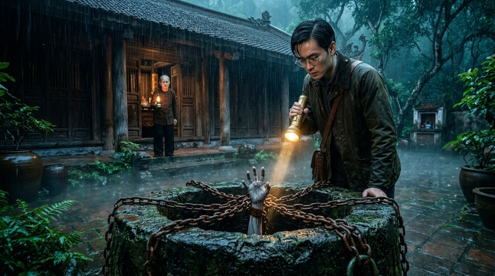

# Tiếng Gõ Đêm Ba Giờ: Lời Nguyền Giếng Đá Ong — Phim Ma Kể Chuyện Điện Ảnh (15 Cảnh × 6 Clips × 10s = 90 Clips / 15 Phút | Google Flow Omni 10s)

Dự án **Phim Ma Kể Chuyện Điện Ảnh 15 Phút** (**15 Cảnh × 6 Clips × 10 giây = 90 Clips = 900 giây / 15 phút**, tỉ lệ **16:9 Cinema 24fps**, model **`omni_flash` 10s**) đã được tối ưu hóa toàn diện theo **10 Tiêu Chuẩn Điện Ảnh Kinh Dị Dân Gian Bắc Bộ**:
- **1. Nhất Quán Giọng Người Dẫn Chuyện (`VOICE_LOCK_NARRATOR_TIENGGO` — Ưu Tiên Cao Nhất):** Duy nhất 1 giọng Nam trung niên 42–48 tuổi chuẩn miền Bắc (`~108–110 Hz` deep warm low-baritone, hơi khàn nhẹ tự nhiên, vang lồng ngực, phong cách kể chuyện ma đêm khuya, tốc độ chuẩn **`125–145 từ/phút`**), điều chỉnh cảm xúc theo mạch truyện (`CALM_MYSTERIOUS` → `RISING_DREAD` → `CONTROLLED_URGENCY`).
- **2. Tối Ưu Độ Dài Thoại & Lời Dẫn (`12–18 từ tiếng Việt / clip 10s`):** 100% trong tổng số 90 clips có độ dài câu nói từ **16–18 từ tiếng Việt** (`~7.5s–8.5s` ở tốc độ 125–145 WPM), kết thúc tự nhiên trước giây `8.8s`, không bao giờ bị cắt chữ hay đọc vội.
- **3. Cấu Trúc Prompt Chuẩn 9 Phần (`[1. FORMAT & MODEL]` → `[9. CONTINUITY & QUALITY RULES]`):** Loại bỏ hoàn toàn chỉ dẫn trùng lặp và xung đột góc máy (không trộn flycam với gimbal mặt đất), khóa chặt `media_id` nhân vật trên Google Flow Project `8a346c86-311f-47ae-8ccb-2d716a58c945` và mô tả rõ `START FRAME` / `END FRAME`.

---

## PHẦN 1: BẢNG KHÓA NHÂN VẬT & GIỌNG ĐỌC (`CHARACTER & VOICE LOCK`)

| Tag | Nhân Vật | Google Flow `media_id` | Độ Tuổi | Mã Khóa Giọng (`VOICE_LOCK`) | Hồ Sơ Giọng Chuẩn Miền Bắc |
|---|---|---|---|---|---|
| **`@Lam`** | **Hoàng Lâm / Vũ Đình Lâm** | `bf3d7dc9-c123-45eb-be8b-cd6196d35011` | 27–29 | `VOICE_LOCK_LAM_TIENGGO` | 27-year-old native Standard Northern Vietnamese young male voice (~130 Hz clear baritone-tenor), tense, breathless, urgent in horror moments (giọng nam 27 tuổi chuẩn miền Bắc, căng thẳng, gấp gáp). |
| **`@BaCam`** | **Bà Cầm** | `71231f5c-64e2-4c4c-945e-059ee37903f7` | 78 | `VOICE_LOCK_BACAM_TIENGGO` | 78-year-old native Standard Northern Vietnamese elderly female voice (~175 Hz raspy aged contralto), hushed, trembling, eerie and ominous (giọng bà lão 78 tuổi chuẩn miền Bắc, khàn đục, rờn rợn). |
| **`@CuTu`** | **Cụ Từ Hạc** | `17de0dcd-36c5-4c0c-8a9a-da1766a23268` | 80 | `VOICE_LOCK_CUTU_TIENGGO` | 80-year-old native Standard Northern Vietnamese elder male voice (~95 Hz deep gravelly bass-baritone), solemn, authoritative, resonant (giọng cụ già 80 tuổi chuẩn miền Bắc, trầm khàn, uy nghiêm). |
| **`@CoUt`** | **Oan Hồn Cô Út Nhài** | `9bdbd6ce-ef97-4c01-98e0-8b97370abd22` | 19 | `VOICE_LOCK_COUT_TIENGGO` | 19-year-old native Standard Northern Vietnamese spectral young female voice (~235 Hz ethereal soprano), sorrowful, fragile, echoing from the deep well (giọng thiếu nữ 19 tuổi chuẩn miền Bắc, thanh mảnh, ai oán). |
| **`Narrator`** | **Người Dẫn Chuyện** | *(Off-Screen VO)* | 42–48 | `VOICE_LOCK_NARRATOR_TIENGGO` | Nam 42–48 tuổi chuẩn Bắc, deep warm low-baritone (~108–110 Hz), slightly husky, 125–145 WPM. |

---

## PHẦN 2: KỊCH BẢN CHI TIẾT 15 CẢNH — 90 CLIPS × 10 GIÂY (ĐÃ TỐI ƯU 12–18 TỪ/CLIP)

### Cảnh 01 (`00:00–01:00` | 6 Clips × 10s): Cổng Nhà Cổ Trong Mưa Ngâu & Ba Lời Thề Bên Giếng Đá Ong
- **Không gian & Đạo cụ:** Mossy laterite stone archway gate, rain-swept Bát Tràng brick courtyard with the chained laterite well, and dark ironwood veranda of the 150-year-old Vũ clan ancestral house. | *Props:* Mossy stone archway gate with iron bars, laterite stone well sealed with a red-inscribed stone slab and three rusted iron chains, black oiled-paper umbrella, bronze key ring, vintage contract paper and red ink pad.

- **Clip 1 ([`canh-01/clip-1.md`](canh-01/clip-1.md) | `00:00–00:10` | `VO` | `CALM_MYSTERIOUS` | On-screen: `@Lam`):** Opening aerial shot descending through dense 7th-lunar-month evening fog toward the isolated three-bay ironwood Vũ ancestral house; @Lam stands with his camera bag before the mossy laterite archway gate.
  - *Camera Plan:* `24mm stabilized aerial drone slow descending push-in`
  - *Lời dẫn / Thoại (18 từ):* "Tháng Bảy mưa ngâu lạnh buốt… dân làng đồn nhà cổ họ Vũ mang lời nguyền chết chóc."
  - *Sound Design:* Tiếng mưa ngâu rả rích hòa tiếng gió rít lạnh lẽo qua vòm cây cổ thụ và cổng đá rêu phong.
- **Clip 2 ([`canh-01/clip-2.md`](canh-01/clip-2.md) | `00:10–00:20` | `VO` | `CALM_MYSTERIOUS` | On-screen: `@Lam`):** @Lam steps across the rain-flooded stone threshold into the dark brick courtyard, stopping before the ancient laterite well sealed with a red-inscribed stone slab and three rusted iron chains.
  - *Camera Plan:* `28mm stabilized gimbal slow tracking follow shot`
  - *Lời dẫn / Thoại (17 từ):* "Vì món thù lao lớn, Hoàng Lâm vẫn một mình đến nhận trông ngôi nhà ba đêm."
  - *Sound Design:* Tiếng giày dẫm nước mưa bì bõm trên gạch Bát Tràng và tiếng xích sắt khẽ ngân lạnh lẽo.
- **Clip 3 ([`canh-01/clip-3.md`](canh-01/clip-3.md) | `00:20–00:30` | `VO` | `RISING_DREAD` | On-screen: `@Lam, @BaCam`):** From the shadowed ironwood veranda, @BaCam emerges holding a black oiled-paper umbrella and brass oil lamp, her milky-blind left eye staring unblinkingly at @Lam as she clutches a mud-smelling bronze key ring.
  - *Camera Plan:* `35mm stabilized gimbal slow creeping push-in`
  - *Lời dẫn / Thoại (17 từ):* "Đón anh nơi hiên lạnh là bà Cầm mù một mắt, tay nắm chùm chìa khóa đồng."
  - *Sound Design:* Tiếng bước chân chậm rãi trên thềm gỗ, tiếng chùm chìa khóa đồng khua leng keng và mưa rơi trên ô giấy dầu.
- **Clip 4 ([`canh-01/clip-4.md`](canh-01/clip-4.md) | `00:30–00:40` | `LIPSYNC:@BaCam` | `RISING_DREAD` | On-screen: `@BaCam`):** @BaCam raises a bony, trembling finger to point straight out at the iron-chained laterite well in the rain, speaking in a raspy, bone-chilling Northern accent.
  - *Camera Plan:* `50mm stabilized medium close-up slow push-in`
  - *Lời dẫn / Thoại (18 từ):* "Đúng ba giờ sáng, dù dưới giếng có tiếng khóc gọi… cậu cấm được mở xích nhìn xuống!"
  - *Sound Design:* Tiếng mưa đập rào rạt ngoài sân và tiếng gió rít qua khe gỗ làm nền cho giọng khàn đục của @BaCam.
- **Clip 5 ([`canh-01/clip-5.md`](canh-01/clip-5.md) | `00:40–00:50` | `VO` | `RISING_DREAD` | On-screen: `@Lam, @BaCam`):** @BaCam leads @Lam inside the gloomy ironwood worship hall, pointing toward a tall bronze mirror draped in black silk and a narrow side corridor with only three wooden bedroom doors.
  - *Camera Plan:* `35mm stabilized gimbal slow panning track`
  - *Lời dẫn / Thoại (18 từ):* "Bà dặn cấm soi gương đồng phủ lụa đen… nếu hiện cửa thứ tư, phải bước lùi ngay."
  - *Sound Design:* Tiếng sàn gỗ lim cọt kẹt dưới chân và tiếng gió đêm lùa qua khe cửa lạnh buốt.
- **Clip 6 ([`canh-01/clip-6.md`](canh-01/clip-6.md) | `00:50–01:00` | `VO` | `RISING_DREAD` | On-screen: `@Lam, @BaCam`):** @Lam presses his red-inked thumbprint onto the old contract paper on the wooden table; when he looks up, @BaCam has vanished into the courtyard fog and the outer iron gate slams shut by itself.
  - *Camera Plan:* `35mm stabilized dolly slow pull-back`
  - *Lời dẫn / Thoại (18 từ):* "Lâm ấn ngón tay điểm chỉ đỏ thẫm, chẳng ngờ cánh cổng khép lại đã nhốt chặt anh."
  - *Sound Design:* Tiếng ấn tay lên giấy bản, tiếp theo là tiếng cổng sắt ngoài sân đóng sầm 'UỲNH!' vang vọng.

---

### Cảnh 02 (`01:00–02:00` | 6 Clips × 10s): Đêm Đầu Tiên — Đồng Hồ Dừng Lúc 2 Giờ 59 Phút & Tiếng Gõ Dưới Đáy Giếng
- **Không gian & Đạo cụ:** Dark ironwood ancestral main hall with an antique pendulum clock frozen at 02:59, looking through the narrow wooden door slit out to the rain-swept courtyard well. | *Props:* Antique wooden pendulum clock stopped at 02:59, DSLR camera, brass storm lantern, three iron chains vibrating on the laterite well, shifted stone slab, pale mud-stained fingers gripping the well rim.

- **Clip 1 ([`canh-02/clip-1.md`](canh-02/clip-1.md) | `01:00–01:10` | `VO` | `CALM_MYSTERIOUS` | On-screen: `@Lam`):** Midnight rain pounds the yin-yang roof tiles as @Lam walks slowly through the silent ironwood hall raising his DSLR camera to photograph the dragon-carved timber pillars.
  - *Camera Plan:* `28mm stabilized gimbal slow creeping push-in`
  - *Lời dẫn / Thoại (18 từ):* "Đêm đầu tiên mưa ngâu rả rích, ngôi nhà cổ nồng nặc mùi gỗ mục và bùn lạnh."
  - *Sound Design:* Tiếng mưa đêm đập trên mái ngói âm dương và tiếng màn trập máy ảnh 'tách' khẽ vang trong phòng trống.
- **Clip 2 ([`canh-02/clip-2.md`](canh-02/clip-2.md) | `01:10–01:20` | `VO` | `RISING_DREAD` | On-screen: `@Lam`):** Close view of the antique wooden pendulum clock in the hall corner reading 02:59; the brass pendulum suddenly jerks to a dead stop and both altar candles blow out, leaving @Lam in flickering lantern light.
  - *Camera Plan:* `50mm stabilized gimbal slow push-in`
  - *Lời dẫn / Thoại (18 từ):* "Đúng hai giờ năm chín phút, đồng hồ bỗng đứng khựng… hai ngọn nến bàn thờ phụt tắt."
  - *Sound Design:* Tiếng kim đồng hồ khựng lại 'kịch' khô khốc, tiếng gió thổi phụt nến và sự im lặng rợn ngợp.
- **Clip 3 ([`canh-02/clip-3.md`](canh-02/clip-3.md) | `01:20–01:30` | `VO` | `CONTROLLED_URGENCY` | On-screen: `@Lam`):** In the dead silence, three deep hollow knocks echo up from beneath the stone-sealed well outside in the rain; @Lam flinches violently, clutching his DSLR camera against his chest.
  - *Camera Plan:* `35mm stabilized medium shot slow push-in`
  - *Lời dẫn / Thoại (18 từ):* "Từ dưới đáy giếng đá ong sâu thẳm, ba tiếng gõ trầm đục dội ngược lên nắp đá!"
  - *Sound Design:* Ba tiếng gõ 'CỘC… CỘC… CỘC…' trầm đục vang lên từ lòng đất hòa tiếng thở gấp của @Lam.
- **Clip 4 ([`canh-02/clip-4.md`](canh-02/clip-4.md) | `01:30–01:40` | `VO` | `RISING_DREAD` | On-screen: `@Lam`):** @Lam creeps to the wooden door and peers through the narrow slit into the rain-swept courtyard; under a cyan lightning flash, the three thick iron chains on the well jerk and rattle violently by themselves.
  - *Camera Plan:* `35mm stabilized over-the-shoulder push-in`
  - *Lời dẫn / Thoại (18 từ):* "Qua khe cửa hẹp, Lâm chết lặng thấy ba vòng xích sắt trên miệng giếng tự giật căng."
  - *Sound Design:* Tiếng xích sắt rỉ sét va đập 'xoảng… xoảng' dữ dội trên đá ong dưới tiếng sấm rền.
- **Clip 5 ([`canh-02/clip-5.md`](canh-02/clip-5.md) | `01:40–01:50` | `VO` | `CONTROLLED_URGENCY` | On-screen: `@Lam`):** Close view on the rain-lashed laterite well: the heavy stone seal grinds sideways a hand's width, and five pale, mud-soaked, nail-torn fingers slowly thrust out of the black gap to claw the mossy rim.
  - *Camera Plan:* `50mm stabilized telephoto close-up slow push-in`
  - *Lời dẫn / Thoại (18 từ):* "Tấm bia đá nặng nhích dần… năm ngón tay trắng bệch rớm máu thò lên bấu thành giếng!"
  - *Sound Design:* Tiếng đá cọ xát nặng nề trên thành giếng và tiếng móng tay cào đá ong sột soạt lạnh gáy.
- **Clip 6 ([`canh-02/clip-6.md`](canh-02/clip-6.md) | `01:50–02:00` | `LIPSYNC:@CoUt` | `CONTROLLED_URGENCY` | On-screen: `@Lam, @CoUt`):** Just outside the wooden door slit where @Lam is peering, the wet ghostly silhouette of @CoUt whispers his name in a freezing sorrowful voice; @Lam clamps a hand over his mouth and stumbles backward.
  - *Camera Plan:* `35mm stabilized slow dolly pull-back`
  - *Lời dẫn / Thoại (17 từ):* "Lâm ơi… cứu em ra khỏi đáy giếng với… dưới này tối và lạnh lắm Lâm ơi!"
  - *Sound Design:* Giọng nữ trẻ vọng âm ướt lạnh sát vách gỗ hòa tiếng mưa đêm và tiếng chân @Lam lùi gấp.

---

### Cảnh 03 (`02:00–03:00` | 6 Clips × 10s): Tấm Khăn Lụa Đen Rơi Xuống & Bóng Người Trong Gương Đồng
- **Không gian & Đạo cụ:** Ancestral worship hall interior dominated by an ancient tarnished bronze mirror on a carved wooden stand beside dark ironwood pillars. | *Props:* Tall antique tarnished bronze mirror, black silk veil cloth on the wooden floorboards, brass storm lantern, two wet muddy barefoot prints and wet black hair strands on the dry wood floor.

- **Clip 1 ([`canh-03/clip-1.md`](canh-03/clip-1.md) | `02:00–02:10` | `VO` | `RISING_DREAD` | On-screen: `@Lam`):** @Lam backs away from the front door into the center of the worship hall; an icy gust blows through the door gap and slips the black silk veil off the tall antique bronze mirror onto the floor.
  - *Camera Plan:* `35mm stabilized gimbal tracking backward shot`
  - *Lời dẫn / Thoại (18 từ):* "Hoảng loạn lùi vào gian thờ, luồng gió âm hàn bỗng thổi tuột khăn đen trên gương đồng."
  - *Sound Design:* Tiếng gió rít lạnh buốt lùa qua khe cửa và tiếng lụa đen trượt sột soạt xuống sàn gỗ.
- **Clip 2 ([`canh-03/clip-2.md`](canh-03/clip-2.md) | `02:10–02:20` | `VO` | `RISING_DREAD` | On-screen: `@Lam`):** @Lam crouches to pick up the fallen black silk cloth, then freezes as his eyes involuntarily lift straight into the cloudy reflective surface of the ancient bronze mirror.
  - *Camera Plan:* `35mm stabilized gimbal slow tilt-up push-in`
  - *Lời dẫn / Thoại (18 từ):* "Theo phản xạ, Lâm cúi nhặt tấm khăn… rồi vô tình ngước nhìn thẳng vào mặt gương mờ."
  - *Sound Design:* Tiếng nhịp tim đập thình thịch trong không gian tĩnh mịch và tiếng hơi thở run rẩy của @Lam.
- **Clip 3 ([`canh-03/clip-3.md`](canh-03/clip-3.md) | `02:20–02:30` | `VO` | `CONTROLLED_URGENCY` | On-screen: `@Lam, @CoUt`):** Close view of the tarnished bronze mirror reflection: @Lam stands holding his brass lantern, and right behind his shoulder inside the mirror stands @CoUt in a soaked white áo dài staring down at his neck.
  - *Camera Plan:* `50mm stabilized close-up slow push-in on mirror`
  - *Lời dẫn / Thoại (18 từ):* "Trong mặt gương ố mờ, ngay sát gáy anh là bóng cô gái áo trắng đẫm bùn đen!"
  - *Sound Design:* Tiếng nước nhỏ giọt 'tách… tách' và tiếng hơi thở lạnh buốt phả sát gáy trong đêm vắng.
- **Clip 4 ([`canh-03/clip-4.md`](canh-03/clip-4.md) | `02:30–02:40` | `LIPSYNC:@Lam` | `CONTROLLED_URGENCY` | On-screen: `@Lam`):** @Lam gasps and spins around 180 degrees holding his brass storm lantern high to illuminate the hall behind him, shouting in panic, yet the space between the ironwood pillars is completely empty.
  - *Camera Plan:* `35mm stabilized whip-arc tracking shot`
  - *Lời dẫn / Thoại (17 từ):* "Ai đó?! Kẻ nào vừa đứng ngay sau lưng tôi ở trong gian nhà này thế hả?!"
  - *Sound Design:* Tiếng bước chân xoay gấp trên sàn gỗ và giọng hét thất thanh của @Lam vang dội gian nhà trống.
- **Clip 5 ([`canh-03/clip-5.md`](canh-03/clip-5.md) | `02:40–02:50` | `VO` | `RISING_DREAD` | On-screen: `@Lam`):** @Lam lowers his lantern beam to the dry wooden floorboards right where he stood: two distinct wet, black-mud barefoot prints and long strands of wet black hair glisten in the amber light.
  - *Camera Plan:* `50mm stabilized high-angle tilt-down push-in`
  - *Lời dẫn / Thoại (18 từ):* "Khoảng không sau lưng trống rỗng… nhưng sàn gỗ khô lại in rõ hai dấu chân bùn lạnh."
  - *Sound Design:* Tiếng bùn nước rỉ tý tách trên gỗ lim và tiếng đèn bão chập chờn lách tách.
- **Clip 6 ([`canh-03/clip-6.md`](canh-03/clip-6.md) | `02:50–03:00` | `VO` | `CONTROLLED_URGENCY` | On-screen: `@Lam, @CoUt`):** As @Lam turns back to throw the black cloth over the mirror, @CoUt inside the bronze reflection smiles eerily and presses her bleeding, mud-stained hand outward against the metal surface, making black water ooze out.
  - *Camera Plan:* `50mm stabilized close-up slow push-in`
  - *Lời dẫn / Thoại (18 từ):* "Khi anh định trùm khăn, bóng ma trong gương bỗng mỉm cười, vươn bàn tay rớm máu ra!"
  - *Sound Design:* Tiếng đồng ngân lạnh buốt và tiếng nước đen rỉ ra từ mặt gương chảy xuống khung gỗ.

---

### Cảnh 04 (`03:00–04:00` | 6 Clips × 10s): Bóng Ma Tiến Gần Trong Từng Tấm Ảnh Chụp Đèn Flash
- **Không gian & Đạo cụ:** Dimly lit wooden table inside the ancestral main hall surrounded by carved ironwood pillars and deep midnight shadows. | *Props:* DSLR camera with glowing LCD display and pop-up flash, draped bronze mirror in background, carved wooden table, brass storm lantern.

- **Clip 1 ([`canh-04/clip-1.md`](canh-04/clip-1.md) | `03:00–03:10` | `VO` | `RISING_DREAD` | On-screen: `@Lam`):** With shaking hands, @Lam throws the black silk veil over the bronze mirror, retreats to the wooden table, and switches on his DSLR camera screen to review the photos he took earlier.
  - *Camera Plan:* `35mm stabilized medium tracking shot`
  - *Lời dẫn / Thoại (18 từ):* "Tay run cầm cập, Lâm trùm kín mặt gương rồi bật máy ảnh xem lại những tấm hình."
  - *Sound Design:* Tiếng vải lụa phủ gấp lên gương, tiếng bước chân lùi vội và tiếng nút bấm máy ảnh lách cách.
- **Clip 2 ([`canh-04/clip-2.md`](canh-04/clip-2.md) | `03:10–03:20` | `VO` | `RISING_DREAD` | On-screen: `@CoUt`):** Close view of the camera's visual display (pure image without text): in the first wide photo of the empty hall, the pale white silhouette of @CoUt stands tilting her head beside a far dark ironwood pillar.
  - *Camera Plan:* `50mm stabilized macro close-up slow push-in`
  - *Lời dẫn / Thoại (18 từ):* "Ở bức ảnh đầu tiên chụp gian nhà trống, góc cột gỗ xa đã thoáng bóng áo trắng."
  - *Sound Design:* Tiếng nút bấm chuyển ảnh 'tách' khô khốc giữa tiếng mưa đêm rả rích ngoài hiên.
- **Clip 3 ([`canh-04/clip-3.md`](canh-04/clip-3.md) | `03:20–03:30` | `VO` | `RISING_DREAD` | On-screen: `@Lam, @CoUt`):** @Lam clicks through the second and third photographs with a trembling thumb; in each successive frame, @CoUt's soaking-wet white figure steps several paces closer toward the camera lens.
  - *Camera Plan:* `35mm stabilized over-the-shoulder push-in`
  - *Lời dẫn / Thoại (18 từ):* "Sang tấm thứ hai rồi thứ ba… sau mỗi bức hình, cái bóng lại bước gần thêm nữa."
  - *Sound Design:* Tiếng bấm nút máy ảnh dồn dập hòa tiếng nhịp thở đứt quãng đầy kinh hãi của @Lam.
- **Clip 4 ([`canh-04/clip-4.md`](canh-04/clip-4.md) | `03:30–03:40` | `VO` | `CONTROLLED_URGENCY` | On-screen: `@Lam, @CoUt`):** @Lam clicks to the final photograph: the entire frame is filled by @CoUt's corpse-pale face and hollow, dark-teared eyes pressed right against the camera lens.
  - *Camera Plan:* `50mm stabilized tight close-up push-in`
  - *Lời dẫn / Thoại (18 từ):* "Đến tấm ảnh cuối cùng, khuôn mặt trắng bệch đẫm máu lệ của cô gái áp sát kính!"
  - *Sound Design:* Tiếng thở hắt nghẹn lại nơi cổ họng @Lam và tiếng gió lạnh rít qua khe cửa sổ.
- **Clip 5 ([`canh-04/clip-5.md`](canh-04/clip-5.md) | `03:40–03:50` | `VO` | `CONTROLLED_URGENCY` | On-screen: `@Lam, @CoUt`):** The pop-up flash on @Lam's DSLR camera suddenly fires by itself with a blinding white burst; for one split-second flash, @CoUt stands in the flesh right across the wooden table before darkness swallows her.
  - *Camera Plan:* `35mm stabilized medium wide shot slow dolly-out`
  - *Lời dẫn / Thoại (18 từ):* "Đột nhiên đèn flash tự chớp sáng trắng xóa… cô gái ấy đang đứng ngay bên kia bàn!"
  - *Sound Design:* Tiếng tụ điện đèn flash rít khẽ rồi nổ 'XOẸT!' chói tai giữa căn phòng tối.
- **Clip 6 ([`canh-04/clip-6.md`](canh-04/clip-6.md) | `03:50–04:00` | `VO` | `CALM_MYSTERIOUS` | On-screen: `@Lam`):** @Lam drops the camera onto the wooden table and retreats into the corner clutching his head, shivering until the first faint rooster crow echoes from the misty hillside at dawn.
  - *Camera Plan:* `35mm stabilized slow crane-down push-in`
  - *Lời dẫn / Thoại (18 từ):* "Lâm đánh rơi máy ảnh, co ro góc tường chờ đến khi tiếng gà canh năm vang lên."
  - *Sound Design:* Tiếng máy ảnh rơi bộp lên mặt bàn gỗ, tiếng thở dốc và tiếng gà gáy xa xăm lúc rạng sáng.

---

### Cảnh 05 (`04:00–05:00` | 6 Clips × 10s): Buổi Sáng Kỳ Lạ & Cánh Cổng Bị Khóa Trái Bằng Xích Đồng
- **Không gian & Đạo cụ:** Dense morning fog over the Bát Tràng brick courtyard, the laterite well, and the padlocked outer iron gate bordering the forested hill. | *Props:* Sealed laterite well with a puddle of black water, white jade hairpin (trâm ngọc bội trắng) on the stone slab, green-rusted antique bronze padlock and chain on the iron gate, smartphone with no signal.

- **Clip 1 ([`canh-05/clip-1.md`](canh-05/clip-1.md) | `04:00–04:10` | `VO` | `CALM_MYSTERIOUS` | On-screen: `@Lam`):** Thick morning fog blankets the courtyard like incense smoke; exhausted and pale, @Lam straps on his leather camera bag and steps off the porch determined to abandon the job immediately.
  - *Camera Plan:* `28mm stabilized gimbal tracking shot`
  - *Lời dẫn / Thoại (18 từ):* "Sáng hôm sau sương mù đặc quánh, Lâm vội dọn hành lý định bỏ tiền cọc rời đi."
  - *Sound Design:* Tiếng bước chân vội vã trên thềm gạch ướt sương và tiếng quạ kêu khàn đục trên vòm cây.
- **Clip 2 ([`canh-05/clip-2.md`](canh-05/clip-2.md) | `04:10–04:20` | `VO` | `CALM_MYSTERIOUS` | On-screen: `@Lam`):** Passing the laterite well in the foggy courtyard, @Lam stops: the heavy stone slab sits neatly in place as if never moved, but a puddle of black water and a white jade hairpin rest on top.
  - *Camera Plan:* `50mm stabilized gimbal tilt-down close-up`
  - *Lời dẫn / Thoại (18 từ):* "Nắp giếng đá ong lại nằm im như cũ, nhưng trên mặt đá có chiếc trâm ngọc trắng."
  - *Sound Design:* Tiếng giọt sương rơi xuống vũng nước đen trên mặt đá và tiếng gió sớm xào xạc.
- **Clip 3 ([`canh-05/clip-3.md`](canh-05/clip-3.md) | `04:20–04:30` | `VO` | `RISING_DREAD` | On-screen: `@Lam`):** @Lam hurries to the stone archway gate and grabs the iron bars: the gate is padlocked from the outside with a green-rusted bronze lock identical to @BaCam's keys, and his phone has zero signal.
  - *Camera Plan:* `35mm stabilized gimbal push-in`
  - *Lời dẫn / Thoại (18 từ):* "Chạy ra tới cổng, Lâm bàng hoàng thấy cổng sắt đã bị khóa trái bằng ổ khóa đồng."
  - *Sound Design:* Tiếng ổ khóa đồng rỉ xanh va vào chấn song sắt 'cạch' nặng nề giữa rừng đồi tĩnh mịch.
- **Clip 4 ([`canh-05/clip-4.md`](canh-05/clip-4.md) | `04:30–04:40` | `LIPSYNC:@Lam` | `CONTROLLED_URGENCY` | On-screen: `@Lam`):** @Lam rattles the padlocked iron gate bars with both hands, shouting desperately out into the dense white hillside fog, but only his own hollow echo answers back.
  - *Camera Plan:* `35mm stabilized medium close-up shot`
  - *Lời dẫn / Thoại (17 từ):* "Bà Cầm ơi! Có ai ngoài đó không?! Mau mở cổng cho tôi ra khỏi đây với!"
  - *Sound Design:* Tiếng chấn song sắt rung 'keng… keng' dữ dội và tiếng gọi của @Lam vọng vào vách núi sương mù.
- **Clip 5 ([`canh-05/clip-5.md`](canh-05/clip-5.md) | `04:40–04:50` | `VO` | `RISING_DREAD` | On-screen: `@CuTu`):** Across the mossy stone fence in the swirling hillside mist stands @CuTu in his traditional dark robe holding a bamboo staff, staring toward the cursed ancestral house with grave dread.
  - *Camera Plan:* `50mm stabilized telephoto slow push-in`
  - *Lời dẫn / Thoại (18 từ):* "Giữa màn sương đồi đối diện, cụ Từ giữ đền làng đứng lặng nhìn sang đầy kinh hãi."
  - *Sound Design:* Tiếng gió núi thổi phần phật qua tà áo chàm và tiếng chuông đồng bên hông cụ ngân khẽ.
- **Clip 6 ([`canh-05/clip-6.md`](canh-05/clip-6.md) | `04:50–05:00` | `VO` | `RISING_DREAD` | On-screen: `@Lam`):** Before @Lam can call out again, a sudden dark afternoon storm cloud bursts into torrential rain, forcing @Lam to retreat backward across the courtyard into the wooden house as Night Two falls.
  - *Camera Plan:* `28mm stabilized gimbal slow pull-back`
  - *Lời dẫn / Thoại (18 từ):* "Cơn mưa giông chiều bất ngờ ập xuống tối sầm, đẩy Lâm quay lại nhà đêm thứ hai."
  - *Sound Design:* Tiếng sấm rền vang và tiếng mưa rào ập xuống mái ngói cổ dồn dập.

---

### Cảnh 06 (`05:00–06:00` | 6 Clips × 10s): Đêm Thứ Hai — Xuất Hiện Cánh Cửa Gỗ Thứ Tư Cuối Hành Lang
- **Không gian & Đạo cụ:** Narrow, suffocatingly dark ironwood side corridor with three locked wooden bedroom doors leading to a dead-end wooden wall. | *Props:* Brass storm lantern, three locked dark wooden doors, the newly manifested faded blood-red fourth wooden door at the corridor end, torn yellow talisman paper on the door seam, iron latch.

- **Clip 1 ([`canh-06/clip-1.md`](canh-06/clip-1.md) | `05:00–05:10` | `VO` | `RISING_DREAD` | On-screen: `@Lam`):** On the second night, @Lam walks cautiously down the narrow, suffocatingly dark ironwood corridor holding his brass storm lantern up to check the door latches as floorboards creak underfoot.
  - *Camera Plan:* `28mm stabilized gimbal slow tracking follow shot`
  - *Lời dẫn / Thoại (18 từ):* "Đêm thứ hai không dám ngủ, Lâm cầm đèn bão đi dọc hành lang kiểm tra chốt cửa."
  - *Sound Design:* Tiếng ván sàn gỗ lim kêu 'cọt… kẹt' chậm rãi dưới từng bước chân trong hành lang hẹp.
- **Clip 2 ([`canh-06/clip-2.md`](canh-06/clip-2.md) | `05:10–05:20` | `VO` | `CALM_MYSTERIOUS` | On-screen: `@Lam`):** @Lam swings his amber lantern beam across the corridor wall, counting each dark wooden bedroom door in sequence: the first door, the second door, and the third door are all bolted shut.
  - *Camera Plan:* `35mm stabilized gimbal panning track`
  - *Lời dẫn / Thoại (18 từ):* "Một cánh cửa… hai cánh cửa… ba cánh cửa gỗ đều cài then kín như lời bà dặn."
  - *Sound Design:* Tiếng tay @Lam chạm nhẹ kiểm tra từng chốt gỗ chắc chắn và tiếng mưa đêm ngoài mái hiên.
- **Clip 3 ([`canh-06/clip-3.md`](canh-06/clip-3.md) | `05:20–05:30` | `VO` | `CONTROLLED_URGENCY` | On-screen: `@Lam`):** As @Lam's lantern light reaches the dead-end wall — which was blank timber by day — a faded blood-red fourth wooden door now looms before him, sealed with a yellow talisman torn in half.
  - *Camera Plan:* `35mm stabilized slow creeping push-in`
  - *Lời dẫn / Thoại (18 từ):* "Nhưng nơi vách gỗ trống ban ngày… nay lù lù hiện ra cánh cửa thứ tư đỏ máu!"
  - *Sound Design:* Tiếng hơi thở @Lam nghẹn đặc và tiếng giấy bùa vàng rách khẽ rung phần phật trong gió lạnh.
- **Clip 4 ([`canh-06/clip-4.md`](canh-06/clip-4.md) | `05:30–05:40` | `VO` | `RISING_DREAD` | On-screen: `@Lam`):** @Lam freezes before the blood-red fourth door as the rhythmic clatter of an ancient wooden weaving loom and the muffled, heartbroken weeping of a young woman echo from behind the wood.
  - *Camera Plan:* `50mm stabilized close-up slow push-in`
  - *Lời dẫn / Thoại (18 từ):* "Sau cánh cửa cấm kỵ ấy, tiếng khung cửi dệt vải lách cách vang lên hòa tiếng khóc."
  - *Sound Design:* Tiếng thoi đưa khung cửi 'lách cách… lách cách' đều đặn và tiếng khóc tỉ tê ai oán từ trong buồng.
- **Clip 5 ([`canh-06/clip-5.md`](canh-06/clip-5.md) | `05:40–05:50` | `VO` | `CONTROLLED_URGENCY` | On-screen: `@Lam`):** Remembering the third taboo, @Lam squeezes his eyes shut and takes three slow steps backward, but the iron latch on the fourth door suddenly snaps open and both red wooden panels creak wide.
  - *Camera Plan:* `35mm stabilized dolly tracking shot`
  - *Lời dẫn / Thoại (18 từ):* "Lâm nhắm mắt bước lùi… nhưng mới ba bước, cánh cửa thứ tư bỗng tự bật mở toang!"
  - *Sound Design:* Tiếng chốt sắt bật 'CẠCH!' chát chúa và tiếng bản lề gỗ mục rên 'KẸT… ẸT' kéo dài.
- **Clip 6 ([`canh-06/clip-6.md`](canh-06/clip-6.md) | `05:50–06:00` | `VO` | `CONTROLLED_URGENCY` | On-screen: `@Lam`):** An unseen icy draft tugs the camera strap across @Lam's chest forward, drawing him step by step across the threshold of the fourth door into the pitch-black sealed room.
  - *Camera Plan:* `28mm stabilized gimbal slow push-in`
  - *Lời dẫn / Thoại (18 từ):* "Một luồng lực lạnh buốt vô hình níu dây máy ảnh, kéo anh bước vào buồng niêm phong."
  - *Sound Design:* Tiếng gió hút âm u từ trong buồng tối và tiếng bước chân @Lam bị kéo trượt qua ngưỡng cửa.

---

### Cảnh 07 (`06:00–07:00` | 6 Clips × 10s): Căn Buồng Bị Niêm Phong 50 Năm & Đường Hầm Thông Xuống Đáy Giếng
- **Không gian & Đạo cụ:** Dusty cobweb-draped maiden bedroom sealed for 50 years behind the fourth door, containing a rotting wooden loom, vanity table, and hidden stone trapdoor. | *Props:* Cobwebbed wooden loom, dusty vanity with a scratched-out ancestral portrait of @CoUt, torn straw mat, laterite stone trapdoor scarred with claw marks, flooded subterranean shaft, family portrait on wall, bronze exorcism bell.

- **Clip 1 ([`canh-07/clip-1.md`](canh-07/clip-1.md) | `06:00–06:10` | `VO` | `CALM_MYSTERIOUS` | On-screen: `@Lam`):** @Lam raises his brass lantern inside the fourth room, revealing a 50-year-old maiden's chamber draped in white cobwebs like funeral shrouds, with a rotting wooden loom now completely still.
  - *Camera Plan:* `28mm stabilized gimbal slow panning push-in`
  - *Lời dẫn / Thoại (18 từ):* "Bên trong là khuê phòng cổ phủ mạng nhện trắng xóa, chiếc khung cửi mục nằm im lìm."
  - *Sound Design:* Tiếng bước chân dẫm lên lớp bụi dày và tiếng tơ nhện đứt khẽ trong không gian ngột ngạt.
- **Clip 2 ([`canh-07/clip-2.md`](canh-07/clip-2.md) | `06:10–06:20` | `VO` | `RISING_DREAD` | On-screen: `@CoUt`):** On the rotting vanity table sits a carved wooden memorial frame holding a sepia portrait of @CoUt in a white áo dài, but both eyes on the photograph have been viciously gouged out with a blade.
  - *Camera Plan:* `50mm stabilized macro close-up push-in`
  - *Lời dẫn / Thoại (18 từ):* "Trên bàn trang điểm là di ảnh cô gái áo trắng, nhưng đôi mắt bị dao cạo nát."
  - *Sound Design:* Tiếng gió rít qua khe vách mục và âm thanh trầm đục đầy oán khí quanh bức di ảnh.
- **Clip 3 ([`canh-07/clip-3.md`](canh-07/clip-3.md) | `06:20–06:30` | `VO` | `RISING_DREAD` | On-screen: `@Lam`):** @Lam shines his lantern down beneath the vanity table where a rotted straw mat is peeled back, exposing a laterite stone floor trapdoor scarred underneath with hundreds of dried bloody fingernail grooves.
  - *Camera Plan:* `35mm stabilized high-angle tilt-down push-in`
  - *Lời dẫn / Thoại (18 từ):* "Dưới lớp chiếu cói mục lộ ra nắp hầm đá ong chi chít vết móng tay đẫm máu."
  - *Sound Design:* Tiếng chiếu cói mục sột soạt và tiếng hơi thở kinh hoàng của @Lam khi thấy vết móng tay.
- **Clip 4 ([`canh-07/clip-4.md`](canh-07/clip-4.md) | `06:30–06:40` | `VO` | `CONTROLLED_URGENCY` | On-screen: `@Lam`):** @Lam pries open the heavy laterite trapdoor a few inches: beneath lies a vertical flooded stone shaft connecting straight to the courtyard well, exhaling freezing mist and a stench of stagnant mud.
  - *Camera Plan:* `35mm stabilized over-the-shoulder tilt-down shot`
  - *Lời dẫn / Thoại (18 từ):* "Nắp hầm thông thẳng xuống đáy giếng ngoài sân… đây thực chất là ngục ngầm chôn sống người!"
  - *Sound Design:* Tiếng đá ong dịch chuyển nặng nề và tiếng nước ngầm vỗ bì bõm vọng lên từ hố sâu.
- **Clip 5 ([`canh-07/clip-5.md`](canh-07/clip-5.md) | `06:40–06:50` | `VO` | `CONTROLLED_URGENCY` | On-screen: `@Lam, @CoUt`):** Suddenly from the black water of the open shaft, @CoUt rises to the rim with blood-teared eyes; instead of attacking @Lam, she raises a pale wet hand and points at the clan portrait on the wall.
  - *Camera Plan:* `35mm stabilized low-angle push-in`
  - *Lời dẫn / Thoại (18 từ):* "Từ hầm nước đen, bóng cô gái trồi lên… chỉ thẳng vào bức ảnh gia tộc trên vách!"
  - *Sound Design:* Tiếng nước rẽ 'ào' lạnh buốt từ miệng hầm và tiếng gió âm vọng lên ai oán.
- **Clip 6 ([`canh-07/clip-6.md`](canh-07/clip-6.md) | `06:50–07:00` | `LIPSYNC:@CuTu` | `CONTROLLED_URGENCY` | On-screen: `@Lam, @CuTu`):** As @Lam falls backward onto the floor, @CuTu bursts through the room door holding his bamboo staff and rings his bronze exorcism bell sharply, speaking in a solemn, commanding Northern voice.
  - *Camera Plan:* `35mm stabilized medium tracking shot`
  - *Lời dẫn / Thoại (18 từ):* "Đừng sợ! Oán hồn cô ấy đang chỉ mặt kẻ thủ ác chôn sống mình năm xưa đấy!"
  - *Sound Design:* Tiếng chuông đồng trấn hồn ngân 'KENG!' thanh mảnh phá tan luồng khí lạnh trong căn buồng.

---

### Cảnh 08 (`07:00–08:00` | 6 Clips × 10s): Cụ Từ Tiết Lộ Thảm Án 50 Năm Trước & Sự Thật Về Bà Cầm
- **Không gian & Đạo cụ:** Main ancestral ironwood hall lit by a flickering oil lamp and external lightning flashes, with the old Vũ clan family portrait hanging on the timber wall. | *Props:* Bronze exorcism bell and bamboo staff on the wooden table, faded Vũ clan portrait on the wall, brass storm lantern, rain-lashed window shutters illuminated by lightning.

- **Clip 1 ([`canh-08/clip-1.md`](canh-08/clip-1.md) | `07:00–07:10` | `VO` | `CALM_MYSTERIOUS` | On-screen: `@Lam, @CuTu`):** @CuTu helps @Lam to his feet, leads him back out into the main ancestral hall, and sets the bronze exorcism bell on the wooden table as the apparition in the fourth room recedes into darkness.
  - *Camera Plan:* `35mm stabilized gimbal tracking shot`
  - *Lời dẫn / Thoại (18 từ):* "Tiếng chuông đồng của cụ Từ Hạc giúp Lâm trấn tĩnh, rồi cụ thở dài kể chuyện xưa."
  - *Sound Design:* Tiếng chuông đồng ngân dư âm trầm ấm trên mặt bàn gỗ và tiếng mưa ngoài hiên dịu xuống.
- **Clip 2 ([`canh-08/clip-2.md`](canh-08/clip-2.md) | `07:10–07:20` | `VO` | `CALM_MYSTERIOUS` | On-screen: `@CuTu, @CoUt`):** @CuTu raises the brass oil lamp toward the old family portrait on the timber wall, illuminating young @CoUt standing beside the scheming caretaker @BaCam fifty years ago.
  - *Camera Plan:* `35mm stabilized slow push-in on wall portrait`
  - *Lời dẫn / Thoại (18 từ):* "Năm mươi năm trước, vì tham gia sản, mụ quản gia tên Cầm đã vu oan cô Út."
  - *Sound Design:* Tiếng đèn dầu cháy lách tách và tiếng thở dài nặng trĩu của cụ già giữ đền.
- **Clip 3 ([`canh-08/clip-3.md`](canh-08/clip-3.md) | `07:20–07:30` | `VO` | `RISING_DREAD` | On-screen: `@CoUt`):** In a haunting visual memory by the rainy courtyard well, bound 19-year-old @CoUt is forced down the dark laterite shaft while the heavy red-inscribed stone slab and three iron chains seal the top.
  - *Camera Plan:* `35mm stabilized atmospheric slow push-in`
  - *Lời dẫn / Thoại (18 từ):* "Đêm mưa tháng Bảy ấy, mụ trói cô thả xuống giếng rồi dùng bia đá xích sắt khóa."
  - *Sound Design:* Tiếng xích sắt quấn chặt mặt đá và tiếng kêu cứu nghẹn tắt dưới đáy nước sâu.
- **Clip 4 ([`canh-08/clip-4.md`](canh-08/clip-4.md) | `07:30–07:40` | `LIPSYNC:@Lam` | `RISING_DREAD` | On-screen: `@Lam`):** Back in the main hall, @Lam's face drains of blood as he remembers the old woman in black who handed him the keys yesterday evening; he grips the table edge and asks @CuTu in a trembling voice.
  - *Camera Plan:* `50mm stabilized medium close-up push-in`
  - *Lời dẫn / Thoại (18 từ):* "Khoan đã cụ ơi… vậy bà lão áo đen đưa chìa khóa cho cháu hôm qua là ai?!"
  - *Sound Design:* Tiếng mưa đêm ngoài hiên và giọng hỏi run bắn vì kinh hoàng của @Lam.
- **Clip 5 ([`canh-08/clip-5.md`](canh-08/clip-5.md) | `07:40–07:50` | `LIPSYNC:@CuTu` | `CONTROLLED_URGENCY` | On-screen: `@Lam, @CuTu`):** @CuTu's weathered face turns ashen in the amber lantern glow; he seizes @Lam's wrist tightly and delivers the horrifying truth in a low, gravelly Northern voice.
  - *Camera Plan:* `50mm stabilized tight two-shot push-in`
  - *Lời dẫn / Thoại (18 từ):* "Cậu nói sao?! Bà Cầm đã ngã gãy cổ chết dưới đáy giếng từ ba năm trước rồi!"
  - *Sound Design:* Tiếng tay cụ Từ nắm chặt cổ tay @Lam và tiếng sấm rền vang vọng từ phía chân đồi.
- **Clip 6 ([`canh-08/clip-6.md`](canh-08/clip-6.md) | `07:50–08:00` | `VO` | `CONTROLLED_URGENCY` | On-screen: `@Lam`):** A blinding bolt of lightning explodes outside the wooden lattice window, illuminating @Lam's petrified, sweat-drenched face as he realizes the woman who hired him was a walking corpse.
  - *Camera Plan:* `35mm stabilized close-up push-in`
  - *Lời dẫn / Thoại (18 từ):* "Tiếng sét nổ xé màn đêm… người ký hợp đồng hôm qua chính là cái xác đội mồ!"
  - *Sound Design:* Tiếng sét nổ 'ĐOÀNG!' long trời lở đất ngay trên mái ngói cổ và tiếng gió bão gào thét.

---

### Cảnh 09 (`08:00–09:00` | 6 Clips × 10s): Tờ Hợp Đồng Hóa Vàng Mã & Khế Ước Bắt Người Thế Mạng
- **Không gian & Đạo cụ:** Wooden table in the ancestral main hall looking toward the rain-swept front veranda doors. | *Props:* Leather satchel, envelope spilling rotting yellow underworld joss paper money (tiền vàng mã âm phủ ẩm mục), ancient blood-stamped Soul-Substitution Pact (Khế Ước Thế Mạng), brass oil lamp.

- **Clip 1 ([`canh-09/clip-1.md`](canh-09/clip-1.md) | `08:00–08:10` | `VO` | `CONTROLLED_URGENCY` | On-screen: `@Lam`):** Shaking from head to toe, @Lam lunges toward his leather satchel on the wooden table and rips open the brown envelope containing the advance cash @BaCam gave him the previous evening.
  - *Camera Plan:* `35mm stabilized tracking shot`
  - *Lời dẫn / Thoại (18 từ):* "Rụng rời tay chân, Lâm lao tới mở chiếc phong bì tiền cọc bà Cầm đưa chiều qua."
  - *Sound Design:* Tiếng khóa túi da bật mở và tiếng giấy phong bì bị xé toạc gấp gáp.
- **Clip 2 ([`canh-09/clip-2.md`](canh-09/clip-2.md) | `08:10–08:20` | `VO` | `RISING_DREAD` | On-screen: `@Lam`):** Macro tabletop view: spilling out of the envelope onto the dark wood is not real currency, but a stack of rotting, mud-stained yellow underworld joss paper money oozing black well silt.
  - *Camera Plan:* `50mm stabilized macro tilt-down shot`
  - *Lời dẫn / Thoại (18 từ):* "Đổ ra mặt bàn chẳng có tiền thật… chỉ toàn tiền vàng mã âm phủ tanh mùi bùn!"
  - *Sound Design:* Tiếng giấy tiền vàng mã ẩm ướt rơi lả tả xuống mặt bàn gỗ và tiếng @Lam hít sâu kinh hãi.
- **Clip 3 ([`canh-09/clip-3.md`](canh-09/clip-3.md) | `08:20–08:30` | `VO` | `RISING_DREAD` | On-screen: `@Lam, @CuTu`):** @CuTu unfolds the coarse yellowed paper bearing @Lam's red-ink thumbprint under the brass oil lamp, revealing ancient black talismanic characters of a forbidden Soul-Substitution Pact.
  - *Camera Plan:* `35mm stabilized two-shot push-in`
  - *Lời dẫn / Thoại (18 từ):* "Cụ Từ mở tờ giấy điểm chỉ đỏ ra xem… đó là Khế Ước Thế Mạng tà thuật!"
  - *Sound Design:* Tiếng giấy bản cổ sột soạt dưới ánh đèn dầu và tiếng gió rít lạnh buốt ngoài hiên.
- **Clip 4 ([`canh-09/clip-4.md`](canh-09/clip-4.md) | `08:30–08:40` | `LIPSYNC:@CuTu` | `CONTROLLED_URGENCY` | On-screen: `@BaCam, @CuTu`):** @CuTu points a stern finger at the red thumbprint on the cursed paper, explaining @BaCam's sinister plot as her shadowy reflection flickers briefly against the rainy window lattice.
  - *Camera Plan:* `50mm stabilized medium close-up shot`
  - *Lời dẫn / Thoại (18 từ):* "Bà Cầm lừa cậu lăn tay giữ giếng ba đêm, để lấy mạng cậu thế chỗ dưới giếng!"
  - *Sound Design:* Tiếng ngón tay cụ Từ gõ mạnh lên mặt bàn gỗ hòa tiếng sấm chớp dồn dập ngoài sân.
- **Clip 5 ([`canh-09/clip-5.md`](canh-09/clip-5.md) | `08:40–08:50` | `VO` | `RISING_DREAD` | On-screen: `@Lam`):** @Lam clutches the cursed contract, finally realizing that @BaCam's three taboos were designed to stop him from discovering @CoUt's remains and breaking the well seal before 3:00 AM on Night Three.
  - *Camera Plan:* `35mm stabilized close-up slow push-in`
  - *Lời dẫn / Thoại (18 từ):* "Ba điều cấm chính là để ngăn Lâm mở giếng cứu cô Út trước giờ đòi mạng mai."
  - *Sound Design:* Tiếng giấy khế ước nhàu nát trong tay @Lam và tiếng tim đập dồn dập trong lồng ngực.
- **Clip 6 ([`canh-09/clip-6.md`](canh-09/clip-6.md) | `08:50–09:00` | `VO` | `RISING_DREAD` | On-screen: `@Lam`):** Right at that moment, from the dark rain-lashed front veranda outside the wooden lattice doors comes the slow, rhythmic clinking of @BaCam's bronze key ring approaching step by step.
  - *Camera Plan:* `35mm stabilized slow dolly push-in toward door`
  - *Lời dẫn / Thoại (18 từ):* "Đúng lúc sự thật hé lộ… ngoài hiên tối, tiếng chùm chìa khóa đồng lại khua trong mưa."
  - *Sound Design:* Tiếng chùm chìa khóa đồng khua 'leng keng… leng keng' chậm rãi hòa tiếng bước chân ướt bùn ngoài hiên.

---

### Cảnh 10 (`09:00–10:00` | 6 Clips × 10s): Ác Linh Bà Cầm Hiện Nguyên Hình Ngoài Hiên Nhà Cổ
- **Không gian & Đạo cụ:** Threshold between the ancestral main hall and the rain-drenched front veranda through wooden lattice doors. | *Props:* Wooden lattice doors, black oiled-paper umbrella dripping black mud, rusted bronze key ring scraping the wood bars, red cinnabar talisman (bùa Chu Sa) and bronze bell.

- **Clip 1 ([`canh-10/clip-1.md`](canh-10/clip-1.md) | `09:00–09:10` | `VO` | `RISING_DREAD` | On-screen: `@BaCam`):** Seen through the wooden lattice door bars out on the rain-swept veranda, @BaCam stands motionless under her torn black oiled-paper umbrella as thick black well mud drips from her tunic hem.
  - *Camera Plan:* `35mm stabilized slow push-in through lattice door`
  - *Lời dẫn / Thoại (18 từ):* "Ngoài hiên mưa gió, bóng bà Cầm đứng dưới chiếc ô rách, nước bùn đen chảy tràn thềm."
  - *Sound Design:* Tiếng bùn nước đen nhỏ giọt 'tõm… tõm' xuống thềm đá và tiếng mưa đập lên ô giấy dầu.
- **Clip 2 ([`canh-10/clip-2.md`](canh-10/clip-2.md) | `09:10–09:20` | `VO` | `CONTROLLED_URGENCY` | On-screen: `@Lam, @BaCam`):** Under a eerie green-blue lightning flash, @BaCam slowly lifts her head: her neck is snapped sideways at a grotesque 90-degree angle over her shoulder, both milky-white eyes glaring at @Lam.
  - *Camera Plan:* `50mm stabilized close-up slow push-in`
  - *Lời dẫn / Thoại (18 từ):* "Dưới ánh chớp xanh lè, bà lão ngẩng lên… cái cổ gãy vẹo sang vai, mắt trắng dã!"
  - *Sound Design:* Tiếng đốt xương cổ răng rắc khô khốc và tiếng thở khè khè như gió rít nghĩa địa.
- **Clip 3 ([`canh-10/clip-3.md`](canh-10/clip-3.md) | `09:20–09:30` | `LIPSYNC:@BaCam` | `CONTROLLED_URGENCY` | On-screen: `@BaCam`):** @BaCam rakes her desiccated hand and bronze key ring violently down the wooden lattice bars, speaking in a raspy, graveside Northern voice that echoes through the hall.
  - *Camera Plan:* `50mm stabilized tight close-up shot`
  - *Lời dẫn / Thoại (18 từ):* "Mày đã điểm chỉ máu rồi con ạ… Đêm mai ba giờ, hồn mày phải thế chỗ tao!"
  - *Sound Design:* Tiếng móng tay khô quắt và chìa khóa đồng cào 'ken két' chói tai lên chấn song gỗ lim.
- **Clip 4 ([`canh-10/clip-4.md`](canh-10/clip-4.md) | `09:30–09:40` | `VO` | `CONTROLLED_URGENCY` | On-screen: `@BaCam, @CuTu`):** @CuTu lunges forward, rings his bronze exorcism bell, and slaps a red cinnabar talisman onto the center of the ironwood door, unleashing a crimson flash that blasts @BaCam back into the courtyard rain.
  - *Camera Plan:* `35mm stabilized dynamic tracking shot`
  - *Lời dẫn / Thoại (18 từ):* "Cụ Từ Hạc lao lên dán bùa Chu Sa vào cửa, đánh bật luồng âm khí ra sân."
  - *Sound Design:* Tiếng chuông đồng ngân vang, tiếng bùa giấy nổ 'PHựT!' đỏ rực và tiếng hét khàn đặc của tà linh.
- **Clip 5 ([`canh-10/clip-5.md`](canh-10/clip-5.md) | `09:40–09:50` | `VO` | `RISING_DREAD` | On-screen: `@BaCam`):** Stooped and crooked-necked, @BaCam retreats backward into the swirling fog behind the ancient courtyard trees, leaving a raspy, echoing laugh waiting for the third and final night.
  - *Camera Plan:* `35mm stabilized slow push-in into courtyard mist`
  - *Lời dẫn / Thoại (18 từ):* "Bóng đen lưng còng lùi vào màn sương đặc quánh, để lại tiếng cười khàn hẹn đêm cuối."
  - *Sound Design:* Tiếng cười khàn đục vọng xa dần trong tiếng mưa đêm và tiếng xích sắt khẽ ngân.
- **Clip 6 ([`canh-10/clip-6.md`](canh-10/clip-6.md) | `09:50–10:00` | `VO` | `CONTROLLED_URGENCY` | On-screen: `@Lam, @CuTu`):** Inside the hall, @CuTu grips @Lam's shoulders with fierce urgency: the only way to break the Soul-Substitution Pact is to smash the three iron chains and stone seal on the well before 3:00 AM tomorrow.
  - *Camera Plan:* `35mm stabilized two-shot push-in`
  - *Lời dẫn / Thoại (18 từ):* "Cụ Từ nắm vai Lâm: muốn sống, trước ba giờ sáng phải đập bia đá cứu cô Út!"
  - *Sound Design:* Tiếng thở gấp gáp của hai người trong gian thờ và tiếng sấm đêm rền vang phía xa.

---

### Cảnh 11 (`10:00–11:00` | 6 Clips × 10s): Đêm Thứ Ba (02:45 Sáng) — Nước Giếng Đen Tràn Ngập & Bóng Ma Bước Ra Từ Gương
- **Không gian & Đạo cụ:** Ancestral main hall flooding ankle-deep with black well water around the rippling antique bronze mirror. | *Props:* Heavy iron sledgehammer, white jade hairpin, antique pendulum clock at 02:45, ankle-deep black well water seeping through floorboards, bronze mirror rippling like water.

- **Clip 1 ([`canh-11/clip-1.md`](canh-11/clip-1.md) | `10:00–10:10` | `VO` | `RISING_DREAD` | On-screen: `@Lam, @CuTu`):** Night Three at 02:45 AM: a violent storm shakes the ancestral house as @Lam grips a heavy iron sledgehammer beside @CuTu in the worship hall, both watching the antique pendulum clock.
  - *Camera Plan:* `35mm stabilized gimbal slow push-in`
  - *Lời dẫn / Thoại (18 từ):* "Đêm thứ ba lúc hai giờ bốn lăm, mưa bão gào thét làm rung chuyển ngôi nhà cổ."
  - *Sound Design:* Tiếng gió bão quật ầm ầm lên mái ngói và tiếng kim đồng hồ quả lắc tích tắc dồn dập.
- **Clip 2 ([`canh-11/clip-2.md`](canh-11/clip-2.md) | `10:10–10:20` | `VO` | `RISING_DREAD` | On-screen: `@Lam`):** Through the seams of the dark ironwood floorboards and from beneath the bronze mirror stand, freezing black well water bubbles up rapidly, flooding ankle-deep around @Lam's boots.
  - *Camera Plan:* `35mm stabilized high-angle tilt-down shot`
  - *Lời dẫn / Thoại (18 từ):* "Từ dưới khe sàn gỗ lim, nước giếng đen tanh nồng bắt đầu sủi bọt ngập mắt cá."
  - *Sound Design:* Tiếng nước đen sủi bọt 'ùng ục' từ dưới sàn gỗ và tiếng nước vỗ lạnh buốt quanh chân @Lam.
- **Clip 3 ([`canh-11/clip-3.md`](canh-11/clip-3.md) | `10:20–10:30` | `VO` | `CONTROLLED_URGENCY` | On-screen: `@CoUt`):** The black silk veil on the antique bronze mirror bursts into eerie blue-green flames and turns to ash; the bronze mirror surface ripples like deep well water as @CoUt steps straight out into the room.
  - *Camera Plan:* `35mm stabilized slow push-in on mirror`
  - *Lời dẫn / Thoại (18 từ):* "Tấm khăn đen bốc lửa xanh cháy rụi… mặt gương gợn sóng rồi cô Út bước ra ngoài!"
  - *Sound Design:* Tiếng lửa ma trơi bùng cháy 'phựt' và tiếng nước rẽ sóng khi bóng ma bước ra khỏi mặt gương.
- **Clip 4 ([`canh-11/clip-4.md`](canh-11/clip-4.md) | `10:30–10:40` | `VO` | `RISING_DREAD` | On-screen: `@Lam, @CoUt`):** @CoUt stands motionless in the ankle-deep black water with soaking hair hanging to her waist, her tear-filled dark eyes fixed on the iron sledgehammer and the white jade hairpin in @Lam's hand.
  - *Camera Plan:* `35mm stabilized medium two-shot slow push-in`
  - *Lời dẫn / Thoại (18 từ):* "Cô gái áo trắng đứng giữa sàn ngập nước, đôi mắt đẫm lệ nhìn trâm ngọc tay Lâm."
  - *Sound Design:* Tiếng nước nhỏ giọt từ tà áo dài trắng xuống sàn nước và tiếng gió lùa lạnh ngắt.
- **Clip 5 ([`canh-11/clip-5.md`](canh-11/clip-5.md) | `10:40–10:50` | `LIPSYNC:@Lam` | `CONTROLLED_URGENCY` | On-screen: `@Lam, @CoUt`):** Shivering in the freezing water, @Lam does not retreat; he steps forward through the black water, holding up the white jade hairpin and the heavy iron sledgehammer as he vows to free her.
  - *Camera Plan:* `50mm stabilized over-the-shoulder push-in`
  - *Lời dẫn / Thoại (18 từ):* "Cô Út! Tôi thấu nỗi oan của cô rồi… đêm nay tôi sẽ đập bia đá cứu cô!"
  - *Sound Design:* Tiếng chân @Lam bước dứt khoát trong nước ngập và giọng nói vang rền đầy quyết tâm.
- **Clip 6 ([`canh-11/clip-6.md`](canh-11/clip-6.md) | `10:50–11:00` | `VO` | `CALM_MYSTERIOUS` | On-screen: `@Lam, @CoUt`):** Hearing @Lam's vow, the floating black hair around @CoUt settles gently; a single clear tear rolls down her pale cheek before she raises her chained wrist to point out toward the courtyard well.
  - *Camera Plan:* `50mm stabilized close-up slow push-in`
  - *Lời dẫn / Thoại (18 từ):* "Luồng oán khí dịu xuống… cô gái rơi giọt lệ trong vắt rồi chỉ ra giếng ngoài sân."
  - *Sound Design:* Tiếng giọt nước mắt rơi xuống mặt nước lặng và tiếng cửa gỗ mở toang ra sân mưa bão.

---

### Cảnh 12 (`11:00–12:00` | 6 Clips × 10s): Cuộc Vây Hãm Của Ác Linh Bà Cầm Ngoài Sân Mưa Bão
- **Không gian & Đạo cụ:** Storm-lashed Bát Tràng brick courtyard in torrential rain between the porch steps and the chained laterite well. | *Props:* Heavy iron sledgehammer, extinguished brass storm lantern, spinning black oiled-paper umbrella, three animated rusted iron chains coiling around @Lam's ankle, peach-wood sword (kiếm gỗ đào) and ebony prayer beads.

- **Clip 1 ([`canh-12/clip-1.md`](canh-12/clip-1.md) | `11:00–11:10` | `VO` | `CONTROLLED_URGENCY` | On-screen: `@Lam, @CuTu`):** With less than ten minutes before 3:00 AM, @Lam and @CuTu burst through the wooden porch doors into the storm-flooded brick courtyard, charging toward the chained laterite well.
  - *Camera Plan:* `28mm stabilized gimbal tracking follow shot`
  - *Lời dẫn / Thoại (18 từ):* "Chỉ còn ít phút là ba giờ sáng, Lâm và cụ Từ lao ra sân hướng về giếng."
  - *Sound Design:* Tiếng cánh cửa gỗ mở tung đập vào vách và tiếng chân chạy bì bõm trên sân gạch ngập nước.
- **Clip 2 ([`canh-12/clip-2.md`](canh-12/clip-2.md) | `11:10–11:20` | `VO` | `CONTROLLED_URGENCY` | On-screen: `@Lam, @BaCam`):** Right in front of the laterite well, the crooked-necked revenant @BaCam blocks their path; she spins her black oiled-paper umbrella violently, unleashing a dark vortex that snuffs out @Lam's lantern.
  - *Camera Plan:* `35mm stabilized low-angle push-in`
  - *Lời dẫn / Thoại (18 từ):* "Nhưng ác linh bà Cầm đã chắn trước giếng, xoay chiếc ô đen thổi tắt phụt đèn bão!"
  - *Sound Design:* Tiếng ô giấy dầu xoay rít như lốc xoáy và tiếng kính đèn bão nổ 'choang' tắt ngấm.
- **Clip 3 ([`canh-12/clip-3.md`](canh-12/clip-3.md) | `11:20–11:30` | `VO` | `CONTROLLED_URGENCY` | On-screen: `@Lam`):** The three rusted iron chains on the well mouth suddenly lash out like iron serpents across the wet bricks, coiling tightly around @Lam's ankle and dragging him down into the mud puddle.
  - *Camera Plan:* `35mm stabilized low tracking shot`
  - *Lời dẫn / Thoại (18 từ):* "Ba sợi xích sắt trên giếng bỗng phóng ra như rắn độc, quấn cổ chân kéo ngã Lâm!"
  - *Sound Design:* Tiếng xích sắt quất 'XOẢNG!' trên nền gạch ướt và tiếng @Lam ngã trượt dài trong nước mưa.
- **Clip 4 ([`canh-12/clip-4.md`](canh-12/clip-4.md) | `11:30–11:40` | `LIPSYNC:@CuTu` | `CONTROLLED_URGENCY` | On-screen: `@Lam, @BaCam, @CuTu`):** @CuTu draws his peach-wood exorcism sword and ebony prayer beads, charging forward to intercept @BaCam's dark form while shouting back to @Lam over the roaring thunderstorm.
  - *Camera Plan:* `35mm stabilized handheld-style gimbal action shot`
  - *Lời dẫn / Thoại (18 từ):* "Lâm! Mau dùng búa đập đứt khóa xích trên bia đá đi! Để lão cầm chân mụ ta!"
  - *Sound Design:* Tiếng chuông đồng và tiếng gầm đanh thép của @CuTu át cả tiếng sấm sét mưa rào.
- **Clip 5 ([`canh-12/clip-5.md`](canh-12/clip-5.md) | `11:40–11:50` | `VO` | `CONTROLLED_URGENCY` | On-screen: `@BaCam, @CuTu`):** @BaCam lets out a guttural shriek as @CuTu presses his glowing peach-wood sword and prayer beads against her, locking the two in a fierce spiritual struggle beneath relentless lightning flashes.
  - *Camera Plan:* `35mm stabilized medium tracking shot`
  - *Lời dẫn / Thoại (18 từ):* "Dưới màn mưa trắng xóa, cụ Từ dồn hết sức ghì chặt tà linh mụ Cầm gào thét."
  - *Sound Design:* Tiếng gào khàn đục của tà linh va chạm với tiếng chú trấn tà và sấm sét nổ liên hồi.
- **Clip 6 ([`canh-12/clip-6.md`](canh-12/clip-6.md) | `11:50–12:00` | `VO` | `CONTROLLED_URGENCY` | On-screen: `@Lam`):** Clenching his teeth, @Lam drags the heavy iron chain bound to his ankle and crawls inch by inch through the flooded courtyard mud until his free hand grips the mossy laterite well rim.
  - *Camera Plan:* `28mm stabilized ground-level tracking shot`
  - *Lời dẫn / Thoại (18 từ):* "Lâm nghiến răng kéo lê xích sắt nơi cổ chân, bò trườn qua màn mưa tới thành giếng."
  - *Sound Design:* Tiếng xích sắt kéo lê nặng nề trên gạch đá và tiếng thở dốc nghẹn máu của @Lam.

---

### Cảnh 13 (`12:00–13:00` | 6 Clips × 10s): Nhát Búa Lúc 2 Giờ 59 Phút — Đập Vỡ Bia Trấn Yểm Đáy Giếng
- **Không gian & Đạo cụ:** Immediate rim of the mossy laterite stone well in the center of the storm-drenched courtyard. | *Props:* Heavy iron sledgehammer striking sparks off rusted iron chains, cracked stone seal slab, burning Soul-Substitution Pact turning to mud-ash, rising white pomelo-blossom mist from the open well.

- **Clip 1 ([`canh-13/clip-1.md`](canh-13/clip-1.md) | `12:00–12:10` | `VO` | `CONTROLLED_URGENCY` | On-screen: `@Lam`):** Bracing himself against the slippery laterite well rim, @Lam swings the heavy iron sledgehammer down with all his might onto the bronze padlock and first iron chain, shattering the links in a shower of sparks.
  - *Camera Plan:* `35mm stabilized low-angle dynamic push-in`
  - *Lời dẫn / Thoại (18 từ):* "Bám chặt thành giếng trơn, Lâm vung búa sắt giáng mạnh… chặt đứt tung vòng xích thứ nhất!"
  - *Sound Design:* Tiếng búa sắt nện kim loại 'CHOANG!' chát chúa tóe lửa đỏ rực giữa màn mưa đêm.
- **Clip 2 ([`canh-13/clip-2.md`](canh-13/clip-2.md) | `12:10–12:20` | `VO` | `CONTROLLED_URGENCY` | On-screen: `@Lam, @BaCam, @CoUt`):** @BaCam shrieks in agony and lunges with elongated claws to strangle @Lam, but the white spectral figure of @CoUt bursts from the rain mist right in front of @Lam, blasting @BaCam backward.
  - *Camera Plan:* `35mm stabilized medium wide tracking shot`
  - *Lời dẫn / Thoại (18 từ):* "Ác linh bà Cầm lao tới định bóp cổ… nhưng bóng trắng cô Út đã chắn trước mặt!"
  - *Sound Design:* Tiếng rít điên dại của @BaCam bị chặn đứng bởi luồng âm phong thanh khiết từ @CoUt.
- **Clip 3 ([`canh-13/clip-3.md`](canh-13/clip-3.md) | `12:20–12:30` | `VO` | `CONTROLLED_URGENCY` | On-screen: `@Lam`):** Without losing a second, @Lam swings his iron sledgehammer twice more to sever the remaining two iron chains, then raises the hammer overhead aimed straight at the center of the red-inscribed stone seal.
  - *Camera Plan:* `35mm stabilized tight action push-in`
  - *Lời dẫn / Thoại (18 từ):* "Không chậm một giây, Lâm chặt đứt hai vòng xích còn lại rồi giáng búa vào bia đá!"
  - *Sound Design:* Hai tiếng 'CHOANG! CHOANG!' liên tiếp chặt đứt xích sắt hòa tiếng gầm dồn lực của @Lam.
- **Clip 4 ([`canh-13/clip-4.md`](canh-13/clip-4.md) | `12:30–12:40` | `LIPSYNC:@Lam` | `CONTROLLED_URGENCY` | On-screen: `@Lam`):** @Lam slams the iron sledgehammer down into the center of the cursed stone slab with a roaring cry; the heavy stone cracks in half with a thunderous boom and collapses off the well mouth at 02:59:59.
  - *Camera Plan:* `50mm stabilized low-angle close-up shot`
  - *Lời dẫn / Thoại (17 từ):* "Vỡ toạc ra đi!! Trả lại ánh sáng cho người bị chôn vùi dưới đáy giếng sâu!!"
  - *Sound Design:* Tiếng đá ong nổ vỡ 'ẦM!' vang dội cả ngọn đồi hòa cùng tiếng thét dứt khoát của @Lam.
- **Clip 5 ([`canh-13/clip-5.md`](canh-13/clip-5.md) | `12:40–12:50` | `VO` | `CONTROLLED_URGENCY` | On-screen: `@BaCam`):** The instant the stone seal shatters, the Soul-Substitution Pact inside @BaCam's tunic erupts in cold blue fire; @BaCam convulses violently and dissolves into a puddle of black mud under the rain.
  - *Camera Plan:* `35mm stabilized medium close-up push-in`
  - *Lời dẫn / Thoại (18 từ):* "Bia đá vừa vỡ toác, khế ước bốc lửa xanh… tà linh bà Cầm tan thành bùn đen!"
  - *Sound Design:* Tiếng lửa xanh cháy xèo xèo trong mưa và tiếng rú tuyệt vọng tắt lịm thành tiếng bùn sụp.
- **Clip 6 ([`canh-13/clip-6.md`](canh-13/clip-6.md) | `12:50–13:00` | `VO` | `CALM_MYSTERIOUS` | On-screen: `@Lam`):** The violent thunderstorm stops instantly; from the newly unsealed mouth of the laterite stone well, a gentle column of pure white mist carrying the scent of ancient pomelo blossoms rises into the night air.
  - *Camera Plan:* `35mm stabilized slow crane-up pull-back`
  - *Lời dẫn / Thoại (18 từ):* "Cơn cuồng phong lập tức lặng tờ… từ lòng giếng mở toang, làn sương trắng chậm bay lên."
  - *Sound Design:* Tiếng mưa bão tắt hẳn, nhường chỗ cho sự tĩnh lặng thanh sạch và tiếng nước giếng ngân trong trẻo.

---

### Cảnh 14 (`13:00–14:00` | 6 Clips × 10s): Giọt Nước Mắt Giải Oan & Lời Tạ Từ Bên Miệng Giếng
- **Không gian & Đạo cụ:** Moonlit Bát Tràng brick courtyard around the unsealed, crystal-clear laterite stone well under a clearing 7th-month full moon. | *Props:* Open laterite stone well filled with crystal-clear water reflecting the full moon, white jade hairpin placed on the mossy well rim, glowing fireflies ascending into the night sky.

- **Clip 1 ([`canh-14/clip-1.md`](canh-14/clip-1.md) | `13:00–13:10` | `VO` | `CALM_MYSTERIOUS` | On-screen: `@Lam`):** Dark storm clouds part overhead to reveal the clear 7th-month full moon, casting silvery-white moonlight down across the wet Bát Tràng brick courtyard and the open laterite well where @Lam stands.
  - *Camera Plan:* `28mm stabilized gimbal slow tilt-down push-in`
  - *Lời dẫn / Thoại (18 từ):* "Mây đen trên đồi dần tan, trả lại ánh trăng rằm tháng Bảy chiếu sáng sân gạch cổ."
  - *Sound Design:* Tiếng gió đêm dịu nhẹ thổi qua vòm cây và tiếng giọt nước mưa cuối cùng rơi thanh thản.
- **Clip 2 ([`canh-14/clip-2.md`](canh-14/clip-2.md) | `13:10–13:20` | `VO` | `CALM_MYSTERIOUS` | On-screen: `@Lam, @CuTu`):** @Lam and @CuTu lean over the mossy laterite well rim looking down: the foul black mud water has vanished completely, replaced by crystal-clear spring water reflecting the full moon.
  - *Camera Plan:* `35mm stabilized over-the-shoulder tilt-down shot`
  - *Lời dẫn / Thoại (18 từ):* "Nhìn xuống lòng giếng, làn nước đen đã biến mất, chỉ còn mạch nước trong vắt ánh trăng."
  - *Sound Design:* Tiếng mạch nước ngầm chảy róc rách êm dịu từ đáy giếng đá ong sâu thẳm.
- **Clip 3 ([`canh-14/clip-3.md`](canh-14/clip-3.md) | `13:20–13:30` | `VO` | `CALM_MYSTERIOUS` | On-screen: `@CoUt`):** Beside the mossy well under the silver moonlight, @CoUt appears no longer soaked in black mud or bound in chains, but as a serene 19-year-old maiden in a pure, clean white silk áo dài.
  - *Camera Plan:* `50mm stabilized slow push-in`
  - *Lời dẫn / Thoại (17 từ):* "Bên thành giếng dưới trăng bạc, cô Út hiện lên trong tà áo dài trắng tinh khôi."
  - *Sound Design:* Tiếng chuông gió ngân khẽ như hơi thở nhẹ nhàng giữa đêm trăng rằm thanh tịnh.
- **Clip 4 ([`canh-14/clip-4.md`](canh-14/clip-4.md) | `13:30–13:40` | `VO` | `CALM_MYSTERIOUS` | On-screen: `@Lam`):** With deep reverence, @Lam uses both hands to place the white jade hairpin gently onto the mossy laterite well rim right in front of @CoUt.
  - *Camera Plan:* `50mm stabilized close-up push-in`
  - *Lời dẫn / Thoại (18 từ):* "Lâm thành kính đặt chiếc trâm ngọc trắng lên thành giếng, trả kỷ vật cho người thiếu nữ."
  - *Sound Design:* Tiếng ngọc bội chạm nhẹ 'cạch' rất khẽ lên mặt đá ong rêu phong trong đêm yên ả.
- **Clip 5 ([`canh-14/clip-5.md`](canh-14/clip-5.md) | `13:40–13:50` | `LIPSYNC:@CoUt` | `CALM_MYSTERIOUS` | On-screen: `@Lam, @CuTu, @CoUt`):** @CoUt bows her head gracefully toward @Lam and @CuTu with a peaceful smile, her pure Northern voice echoing softly like a night breeze across the courtyard.
  - *Camera Plan:* `35mm stabilized medium shot slow push-in`
  - *Lời dẫn / Thoại (18 từ):* "Đa tạ người đã mở giếng giải oan… Từ nay ngôi nhà không còn tiếng khóc đêm nữa."
  - *Sound Design:* Giọng nữ trong trẻo nhẹ như gió thoảng hòa cùng tiếng lá cây xào xạc êm đềm.
- **Clip 6 ([`canh-14/clip-6.md`](canh-14/clip-6.md) | `13:50–14:00` | `VO` | `CALM_MYSTERIOUS` | On-screen: `@CoUt`):** @CoUt's luminous white form dissolves into thousands of soft golden fireflies that swirl upward past the yin-yang tiled roof and vanish into the tranquil moonlit sky.
  - *Camera Plan:* `28mm stabilized crane-up tilt-up shot`
  - *Lời dẫn / Thoại (18 từ):* "Bóng người thiếu nữ hóa thành muôn vàn đom đóm sáng, bay qua mái ngói tan vào trăng."
  - *Sound Design:* Tiếng ngân thanh thoát nhẹ bẫng lan tỏa khắp không gian khi đàn đom đóm bay lên trời đêm.

---

### Cảnh 15 (`14:00–15:00` | 6 Clips × 10s): Bình Minh Trên Nhà Cổ & Dấu Tay Hơi Nước Trên Gương Đồng
- **Không gian & Đạo cụ:** Sunlit three-bay ironwood ancestral house, green hillside gravesite, bright worship hall with the uncovered bronze mirror, and open courtyard gate. | *Props:* Warm morning sunlight beams, newly tended hillside grave with incense smoke, uncovered polished antique bronze mirror with a fading condensation handprint, leather camera satchel.

- **Clip 1 ([`canh-15/clip-1.md`](canh-15/clip-1.md) | `14:00–14:10` | `VO` | `CALM_MYSTERIOUS` | On-screen: `@Lam`):** Warm golden dawn sunlight streams through the ancient tree canopy onto the three-bay ironwood ancestral house as @Lam steps out onto the dry veranda, the heavy curse completely lifted.
  - *Camera Plan:* `28mm stabilized gimbal slow panning shot`
  - *Lời dẫn / Thoại (18 từ):* "Sáng ngày thứ tư, nắng bình minh ấm áp xuyên vòm cây, sưởi ấm ngôi nhà gỗ cổ."
  - *Sound Design:* Tiếng chim sớm hót líu lo trên cành cây cổ thụ và tiếng gió ban mai trong lành.
- **Clip 2 ([`canh-15/clip-2.md`](canh-15/clip-2.md) | `14:10–14:20` | `VO` | `CALM_MYSTERIOUS` | On-screen: `@Lam, @CuTu`):** On a sunlit grassy hillside overlooking the valley, @Lam and @CuTu bow respectfully before a newly built, clean stone grave for @CoUt as fragrant sandalwood incense smoke curls upward.
  - *Camera Plan:* `35mm stabilized slow push-in`
  - *Lời dẫn / Thoại (18 từ):* "Lâm cùng cụ Từ đưa hài cốt cô Út lên đồi an táng, khép lại nỗi oan xưa."
  - *Sound Design:* Tiếng gió đồi thổi nhẹ qua ngọn cỏ xanh và tiếng khói hương trầm cháy êm ả.
- **Clip 3 ([`canh-15/clip-3.md`](canh-15/clip-3.md) | `14:20–14:30` | `VO` | `CALM_MYSTERIOUS` | On-screen: `@Lam`):** Returning to the bright ancestral main hall to pack his leather camera bag before heading back to the city, @Lam pauses before the antique bronze mirror, now uncovered and gleaming in warm sunlight.
  - *Camera Plan:* `35mm stabilized tracking shot`
  - *Lời dẫn / Thoại (18 từ):* "Trở lại gian chính thu dọn hành lý, chiếc gương đồng cổ nay sáng bóng dưới nắng mai."
  - *Sound Design:* Tiếng kéo khóa túi da máy ảnh và tiếng nắng sớm ấm áp ngập tràn gian nhà gỗ.
- **Clip 4 ([`canh-15/clip-4.md`](canh-15/clip-4.md) | `14:30–14:40` | `VO` | `CALM_MYSTERIOUS` | On-screen: `@Lam`):** Just as @Lam slings his camera bag over his shoulder and turns toward the front door, a soft mist of condensation blooms on the bronze mirror behind him, forming a small, gentle handprint waving farewell.
  - *Camera Plan:* `50mm stabilized close-up push-in on mirror`
  - *Lời dẫn / Thoại (18 từ):* "Khi Lâm vừa quay lưng bước đi, mặt gương đồng sau lưng bỗng hiện dấu tay vẫy chào."
  - *Sound Design:* Tiếng hơi sương tụ nhẹ trên mặt đồng cổ và một âm ngân ấm áp thoáng qua.
- **Clip 5 ([`canh-15/clip-5.md`](canh-15/clip-5.md) | `14:40–14:50` | `LIPSYNC:@Lam` | `CALM_MYSTERIOUS` | On-screen: `@Lam`):** @Lam pauses at the sunlit wooden threshold, looks back over his shoulder at the gleaming bronze mirror with a gentle, respectful smile, and speaks softly before stepping outside.
  - *Camera Plan:* `50mm stabilized medium close-up shot`
  - *Lời dẫn / Thoại (18 từ):* "Yên nghỉ thanh thản nơi chín suối nhé… Cô Út. Tạm biệt cô, tôi về thành phố đây."
  - *Sound Design:* Giọng nam trầm ấm nhẹ nhàng của @Lam hòa cùng tiếng chim hót ngoài sân nắng.
- **Clip 6 ([`canh-15/clip-6.md`](canh-15/clip-6.md) | `14:50–15:00` | `VO` | `CALM_MYSTERIOUS` | On-screen: `@Lam`):** The camera pulls back slowly across the sunlit courtyard past the open, clear-water laterite well and through the mossy stone archway gate as @Lam walks away down the peaceful hillside path.
  - *Camera Plan:* `24mm stabilized dolly slow pull-back`
  - *Lời dẫn / Thoại (18 từ):* "Tiếng gõ lúc ba giờ sáng khép lại… để lại bài học nhân quả nơi cõi nhân gian."
  - *Sound Design:* Tiếng bước chân @Lam xa dần trên đường đồi đầy nắng và tiếng chuông đền làng ngân vang thanh tịnh.

---
