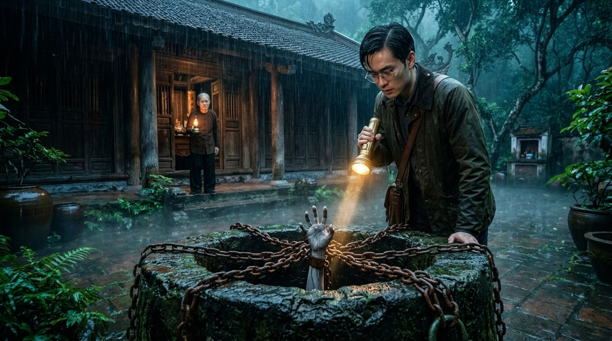
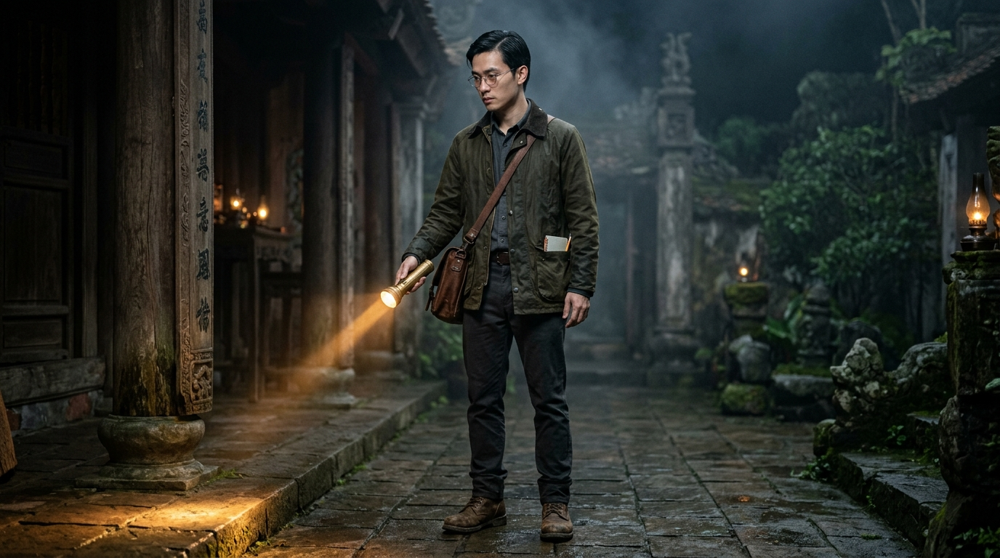
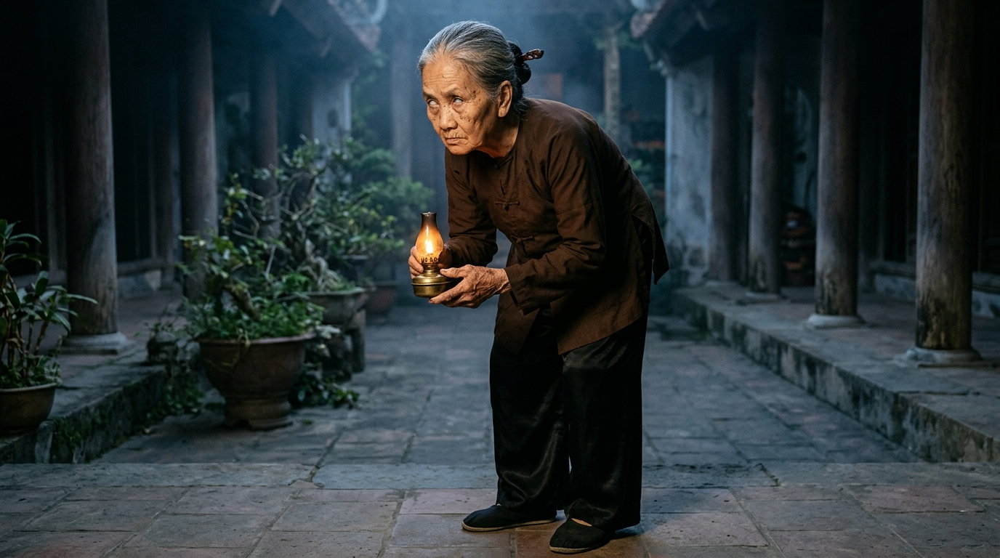
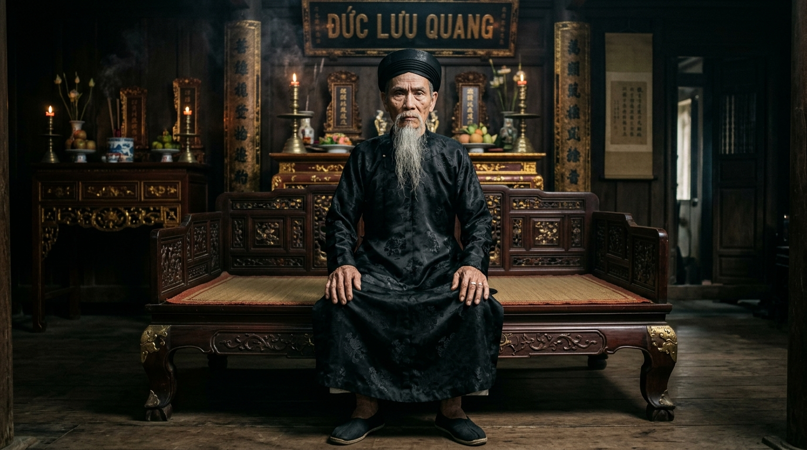
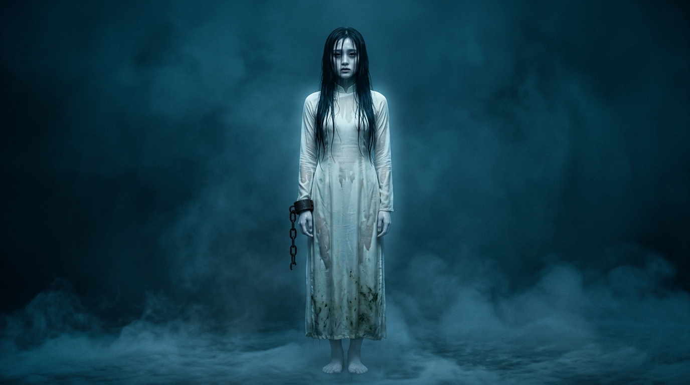
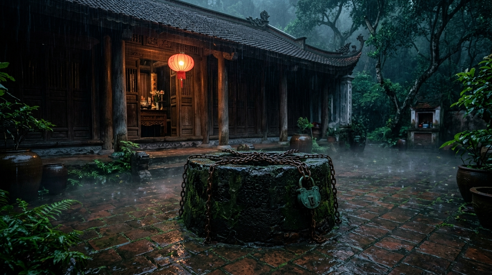
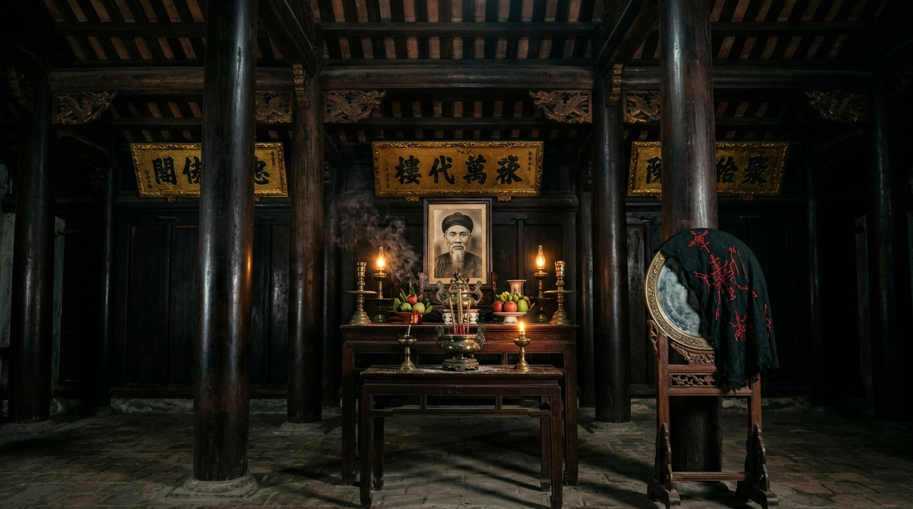
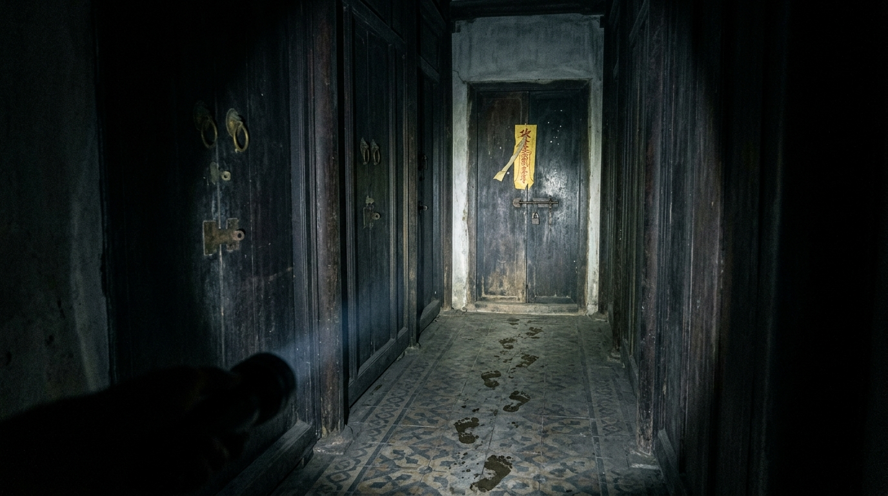

# Tiếng Gõ Đêm Ba Giờ: Lời Nguyền Giếng Đá Ong — Phim Ma Kể Chuyện Điện Ảnh (15 Cảnh × 6 Clips × 10s = 90 Clips / 15 Phút | Google Flow Omni 10s)



Dự án **Phim Ma Kể Chuyện Điện Ảnh 15 Phút** (**15 Cảnh × 6 Clips × 10 giây = 90 Clips = 900 giây / 15 phút**, tỉ lệ **16:9 Cinema 24fps**, model **`omni_flash` 10s**) được thiết kế chuyên biệt theo cấu trúc **Truyện Ma Đêm Khuya Dẫn Chuyện + Dựng Cảnh Điện Ảnh Kinh Dị Dân Gian Việt Nam**:
- **Lớp Dẫn Chuyện (`VOICE_LOCK_NARRATOR` — 80% thời lượng):** Giọng nam trung niên chuẩn miền Bắc trầm khàn, lạnh gáy, nhịp kể chuyện ma đêm khuya (`0.90x–0.95x`), dẫn dắt tâm lý và giải thích từng điều cấm kỵ tâm linh.
- **Lớp Hiện Trường & Điểm Nhấn Thoại (`Foley + 20% On-screen Lip-Sync`):** Tiếng mưa ngâu rả rích trên mái ngói âm dương, tiếng xích sắt rỉ cọ vào thành giếng đá ong kêu *'keng… kẹt'*, tiếng móng tay cào sau cánh cửa gỗ lim lúc 3 giờ sáng, kết hợp đúng những câu thoại ngắn đắt giá nhất ở cao trào.
- **Danh mục 90 files kịch bản chi tiết:** [`canh-01/clip-1.md`](canh-01/clip-1.md) → [`canh-15/clip-6.md`](canh-15/clip-6.md) và tổng hợp tại [`FLOW_PROMPTS.md`](FLOW_PROMPTS.md).

---

## PHẦN 1: Ý TƯỞNG TRUNG TÂM & 3 ĐIỀU CẤM KỴ SỐNG CÒN (HIGH-CONCEPT HOOK)

### 1. Tóm tắt cốt truyện (Logline)
**Hoàng Lâm** (29 tuổi, nhiếp ảnh gia tư liệu kiến trúc cổ) nhận lời thuê trông coi và chụp ảnh kiểm kê **Ngôi nhà gỗ lim ba gian năm chái cổ** nằm biệt lập trên đồi sương mù trong **3 đêm mưa ngâu tháng Bảy âm lịch**. Người giao chìa khóa cho anh là **Bà Cầm** (68 tuổi, bà quản gia già có đôi mắt đục mờ và giọng nói khàn lạnh như gió lùa qua khe mộ). Trước khi biến mất vào màn sương chiều, bà Cầm dặn Lâm **3 điều cấm kỵ tuyệt đối sau 12 giờ đêm**:
1. **Cấm kỵ thứ nhất — Tiếng gõ dưới giếng đá ong lúc 3 giờ sáng:** Trước sân nhà có một chiếc giếng đá ong cổ bị đậy kín bằng tấm bia đá khắc chữ Chu Sa và khóa chặt bởi ba vòng xích sắt rỉ. Đúng 3 giờ sáng, dù nghe tiếng gõ *'cộc… cộc… cộc'* từ dưới nắp giếng hay tiếng phụ nữ khóc gọi tên mình, **tuyệt đối không được mở xích nhìn xuống giếng**.
2. **Cấm kỵ thứ hai — Chiếc gương đồng phủ lụa đen gian giữa:** Chiếc gương đồng cổ đặt đối diện bàn thờ tổ luôn phải phủ kín bằng tấm khăn lụa đen. Nếu gió thổi rơi khăn sau nửa đêm, phải nhắm chặt mắt mà phủ lại, **tuyệt đối không được nhìn vào bóng phản chiếu trong gương**.
3. **Cấm kỵ thứ ba — Cánh cửa gỗ thứ tư trên hành lang:** Ngôi nhà cổ chỉ có đúng **3 buồng ngủ**. Nếu đi tuần lúc nửa đêm mà đếm thấy xuất hiện **cánh cửa gỗ thứ 4** ở cuối hành lang, phải lập tức bước lùi 7 bước, **tuyệt đối không được đẩy cửa bước vào**.

Nhưng ngay từ đêm đầu tiên, chiếc đèn flash máy ảnh của Lâm đã vô tình đánh thức thứ bị giam cầm dưới đáy giếng đá ong suốt 50 năm qua...

---

## PHẦN 2: HỆ THỐNG KHÓA NHÂN VẬT, GIỌNG ĐỌC & BỐI CẢNH (`CHARACTER_LOCK` & `VOICE_LOCK`)

### 1. `VOICE_LOCK_NARRATOR` (Người Kể Chuyện Ma Đêm Khuya — Xuyên suốt 15 phút)
```text
[VOICE_LOCK_NARRATOR — Cố định giọng Nam Người Kể Chuyện Ma chuẩn miền Bắc]: Fixed 42-year-old native Standard Northern Vietnamese male late-night ghost storyteller voice, deep resonant chest baritone with a chilling, husky, gravelly texture, slow atmospheric pacing (0.90x), deliberate suspenseful pauses, evoking classic Vietnamese midnight ghost radio storytelling. Never sound upbeat, commercial, or robotic; never use Southern slang.
```

### 2. Bốn Nhân Vật Cốt Lõi (`CHARACTER_SPECS`)

| Tag | Tên Nhân Vật | Vai Trò & Tạo Hình Cố Định (Photorealistic 16:9) | Giọng Thoại (`VOICE_LOCK`) |
| :--- | :--- | :--- | :--- |
| **`@Lam`** | **Hoàng Lâm** (29 tuổi) | Nam nhiếp ảnh gia kiến trúc cổ, cao 1m75, dáng gầy săn chắc, gương mặt góc cạnh, mắt sâu căng thẳng, tóc đen ngắn hơi rối vì mưa ẩm; mặc áo sơ mi flannel xanh rêu sẫm bên trong áo khoác kaki nâu sẫm, đeo máy ảnh cơ DSLR đen trước ngực, tay cầm đèn bão dầu hỏa ánh vàng cam. | Nam chuẩn miền Bắc (29 tuổi, trầm, hơi thở gấp gáp, run rẩy khi đối diện hiện tượng tâm linh). |
| **`@BaCam`** | **Bà Cầm** (68 tuổi) | Bà quản gia già bí ẩn của nhà cổ; dáng lưng còng nhẹ, làn da nhăn nheo tái xám như sáp nến, đôi mắt đục mờ vô hồn không chớp, tóc bạc búi chặt bằng trâm xương trắng; mặc áo bà ba lụa đen cổ cao cài cúc tàu, tay cầm chiếc ô giấy dầu đen và chùm chìa khóa đồng cổ rỉ xanh. | Nữ già chuẩn miền Bắc (68 tuổi, giọng khàn đặc, đều đều, lạnh lẽo như vọng ra từ đáy giếng). |
| **`@CuTu`** | **Cụ Từ Hạc** (72 tuổi) | Cụ ông giữ đền cổ đầu làng; râu tóc bạc trắng, gương mặt nghiêm nghị hằn sâu nếp nhăn từng trải, ánh mắt sáng quắc; mặc áo chàm nâu sẫm truyền thống, khoác áo tơi lá cọ đi mưa, tay cầm gậy trúc và chiếc chuông đồng nhỏ trấn hồn. | Nam cao niên chuẩn miền Bắc (72 tuổi, giọng trầm vang, uy nghiêm, đanh thép). |
| **`@CoUt`** | **Vong Nữ Giếng Cổ — Cô Út** (22 tuổi) | Oán linh cô gái trẻ bị trấn yểm dưới giếng đá ong 50 năm trước; làn da trắng bệch ướt sũng nước mưa, mái tóc đen dài ướt đẫm che khuất nửa gương mặt buồn thảm lạnh lẽo, mặc áo dài cổ truyền trắng ngà loang vết bùn đen dưới gấu áo, đôi bàn chân trần rớm nước đen đứng bất động trong bóng tối. | Nữ trẻ chuẩn miền Bắc (22 tuổi, chỉ cất tiếng hát ru hoặc gọi tên thì thầm ngân dài lạnh sống lưng `0.85x`). |

#### Hình Ảnh Thiết Kế & Khóa Nhân Vật (`character_refs/`)

##### 1. `@Lam` — Hoàng Lâm (Kỹ sư / Nhiếp ảnh gia khảo cổ, 27–29 tuổi)


##### 2. `@BaCam` — Bà Cầm (Bà quản gia mù một mắt canh nhà từ đường)


##### 3. `@CuTu` — Cụ Tổ / Cụ Từ Hạc (Bậc cao niên giữ bí mật dòng tộc)


##### 4. `@CoUt` — Oan Hồn Cô Út Dưới Đáy Giếng Đá Ong


### 3. Ba Bối Cảnh Kinh Dị Cố Định (`LOCATIONS` & `scene_refs/`)
1. **`ANCIENT_COURTYARD_WELL` (Sân Gạch Bát Tràng & Giếng Đá Ong Trấn Yểm):**
   - Khoảng sân gạch cổ rêu phong ngập nước mưa đêm trước ngôi nhà gỗ lim ba gian mái ngói âm dương. Chính giữa sân là chiếc giếng đá ong cổ rêu đen, miệng giếng bị đậy kín và khóa chặt bởi bảy sợi xích sắt to bản rỉ sét cùng ổ khóa đồng xanh; sương mù trắng đục là là mặt đất dưới ánh đèn lồng đỏ và đèn bão vàng yếu ớt.
   

2. **`IRONWOOD_ANCESTRAL_HALL` (Gian Thờ Chính & Chiếc Gương Đồng Phủ Lụa Đen):**
   - Gian giữa nhà cổ bằng gỗ lim đen bóng nặng nề mùi trầm hương ẩm mốc; hoành phi câu đối sơn son thếp vàng đã bong tróc, đồng hồ quả lắc cổ đứng im ở góc tường; đối diện án thờ là chiếc gương đồng tròn lớn đặt trên giá gỗ chạm rồng, phủ tấm khăn lụa đen thêu bùa chỉ đỏ; ánh nến leo lét hắt bóng dài kỳ dị lên vách gỗ.
   

3. **`FORBIDDEN_FOURTH_CHAMBER` (Hành Lang Gỗ Đêm Khuya & Cánh Cửa Thứ Tư Bị Niêm Phong):**
   - Hành lang gỗ lim hẹp hun hút chìm trong bóng tối xanh lạnh; ở cuối vách gỗ xuất hiện cánh cửa bức bàn thứ tư dán lá bùa vàng đã rách đôi cùng dấu chân bùn nước ướt sũng dẫn thẳng tới ngưỡng cửa; bên trong là căn buồng cổ hoang phế với nắp hầm đá dẫn thẳng xuống lòng giếng sâu.
   

---

## PHẦN 3: KỊCH BẢN CHI TIẾT 15 CẢNH — 15 PHÚT (90 CLIPS × 10 GIÂY)

### 🕯️ HỒI I: BA ĐIỀU CẤM KỴ & TIẾNG GÕ LÚC BA GIỜ SÁNG (Phút 01 – Phút 05)

#### **Cảnh 01 (`00:00–01:00` | 6 Clips × 10s): Cổng Nhà Cổ Trong Mưa Ngâu & Ba Lời Thề Bên Giếng Đá Ong**
- **Clip 1 (`00:00–00:10` — VO):** Toàn cảnh flycam chậm xuyên qua màn sương mù dày đặc lúc chập tối tháng Bảy âm lịch, lộ ra ngôi nhà cổ gỗ lim ba gian mái ngói âm dương nằm cô độc giữa rừng cây cổ thụ. `@Lam` khoác túi máy ảnh đứng trước cổng vòm đá rêu phong.
  - *Lời dẫn (Narrator):* "Người dân vùng đồi đá ong này vẫn rỉ tai nhau một lời nguyền rợn tóc gáy… Rằng cứ vào tháng Bảy mưa ngâu âm khí nặng nề, có cho vàng cũng đừng kẻ nào dại dột bước qua cổng nhà cổ họ Vũ sau giờ lên đèn."
- **Clip 2 (`00:10–00:20` — VO):** `@Lam` bước qua bậc thềm đá ngập nước mưa. Giữa sân gạch tối sẫm là chiếc giếng đá ong cổ bị đậy kín bằng tấm bia đá khắc chữ đỏ và quấn ba vòng xích sắt rỉ.
  - *Lời dẫn (Narrator):* "Ấy thế mà vì món tiền thù lao hậu hĩnh, Hoàng Lâm — một thợ chụp ảnh kiến trúc cổ — lại một mình tìm đến, nhận lời trông coi ngôi nhà hoang này trong đúng ba đêm."
- **Clip 3 (`00:20–00:30` — VO):** Từ dưới hiên nhà tối om, `@BaCam` cầm ô giấy dầu đen và đèn bão bước ra, gương mặt tái xám không một nụ cười, đôi mắt đục mờ nhìn chằm chằm vào Lâm.
  - *Lời dẫn (Narrator):* "Đón bước chân anh nơi hiên nhà lạnh toát chỉ có bà Cầm… bà quản gia già với đôi mắt đục lờ như mắt cá chết, bàn tay gầy guộc khô đét nắm chặt chùm chìa khóa đồng nồng nặc mùi bùn tanh."
- **Clip 4 (`00:30–00:40` — Lip-Sync `@BaCam`):** Bà Cầm chỉ ngón tay gầy guộc vào chiếc giếng đá ong quấn xích sắt ngoài sân mưa, giọng khàn đặc lạnh gáy.
  - *Thoại (`@BaCam`):* "Cậu nhớ kỹ lời bà… Đúng ba giờ sáng, dù dưới đáy giếng có tiếng người cào đá hay tiếng con gái khóc gọi tên cậu… có chết cũng không được tháo xích nhìn xuống!"
- **Clip 5 (`00:40–00:50` — VO):** Bà Cầm dẫn Lâm vào gian thờ gỗ lim âm u, chỉ tay vào chiếc gương đồng lớn đang phủ kín tấm khăn lụa đen và dãy hành lang chỉ có 3 cánh cửa gỗ.
  - *Lời dẫn (Narrator):* "Điều cấm thứ hai: không được soi chiếc gương đồng phủ lụa đen sau nửa đêm. Và điều cấm thứ ba: hành lang này chỉ có ba buồng… nếu đếm thấy cánh cửa thứ tư, phải nhắm mắt bước lùi bảy bước."
- **Clip 6 (`00:50–01:00` — VO):** Lâm đặt bút ký và lăn tay mực đỏ vào tờ giấy bản cũ kỹ trên bàn. Khi Lâm ngẩng đầu lên, bà Cầm đã biến mất ngoài cổng sương mù tự lúc nào, chỉ còn cánh cổng sắt tự đóng sầm lại kêu *'UỲNH!'*.
  - *Lời dẫn (Narrator):* "Lâm ấn ngón tay điểm chỉ đỏ thẫm lên tờ giấy cũ… mà chẳng hề hay biết, khi cánh cổng sắt sau lưng khép lại, anh đã tự nhốt mình vào một cái bẫy không lối thoát."

---

#### **Cảnh 02 (`01:00–02:00` | 6 Clips × 10s): Đêm Đầu Tiên — Đồng Hồ Dừng Lúc 2 Giờ 59 Phút & Tiếng Gõ Dưới Đáy Giếng**
- **Clip 1 (`01:00–01:10` — VO):** Đêm khuya mưa tầm tã đập lên mái ngói. Lâm cầm máy ảnh DSLR đi chụp tư liệu các cột gỗ lim chạm khắc rồng phượng trong gian nhà vắng lặng.
  - *Lời dẫn (Narrator):* "Đêm đầu tiên trôi qua trong tiếng mưa ngâu rả rích. Cả ngôi nhà rộng lớn nồng nặc mùi gỗ mục và mùi bùn lạnh bốc lên từ dưới nền gạch."
- **Clip 2 (`01:10–01:20` — VO):** Cận cảnh chiếc đồng hồ quả lắc gỗ cổ trong góc phòng chỉ `02:59`. Con lắc bằng đồng bỗng khựng lại cái *'kịch'*, hai ngọn nến trên bàn thờ phụt tắt, chỉ còn ngọn đèn bão chập chờn.
  - *Lời dẫn (Narrator):* "Đúng hai giờ năm mươi chín phút đêm… kim đồng hồ quả lắc bỗng đứng khựng lại. Cả không gian chết lặng như tờ, từng cơn gió khuya rít qua khe cửa lạnh buốt sống lưng."
- **Clip 3 (`01:20–01:30` — VO):** Giữa sự tĩnh lặng chết chóc, từ ngoài sân mưa vang lên 3 tiếng gõ khô khốc dội từ dưới lòng đất lên tấm bia đá đậy giếng: *'CỘC… CỘC… CỘC…'*. Lâm giật bắn mình, cứng người giữ chặt máy ảnh.
  - *Lời dẫn (Narrator):* "Và rồi… từ dưới đáy giếng đá ong sâu thẳm ngoài sân mưa, ba tiếng gõ trầm đục vang lên từng hồi… Cộc… cộc… cộc… như có kẻ đang dùng khớp xương ngón tay đẫm máu gõ ngược lên nắp đá trấn yểm!"
- **Clip 4 (`01:30–01:40` — VO):** Lâm rón rén bước tới áp mắt nhìn qua khe cửa gỗ bức bàn ra sân. Dưới ánh chớp xanh lè, ba vòng xích sắt quấn quanh miệng giếng đang tự rung lên *'xoảng… xoảng'* dù không có một bóng người.
  - *Lời dẫn (Narrator):* "Qua khe cửa gỗ hẹp, Lâm chết lặng khi thấy ba sợi xích sắt to bằng cổ tay đang tự giật căng lên từng hồi… phát ra tiếng leng keng lạnh buốt giữa màn mưa."
- **Clip 5 (`01:40–01:50` — VO):** Đặc tả miệng giếng đá ong: tấm bia đá nặng hàng tạ bị đẩy nhích sang một bên khoảng một gang tay. Từ khe tối đen của miệng giếng, năm ngón tay trắng bệch ướt sũng bùn đen từ từ thò lên bấu chặt vào thành đá ong!
  - *Lời dẫn (Narrator):* "Tấm bia đá nặng hàng tạ bỗng rùng mình xê dịch… Từ khe tối đen ngòm bốc mùi bùn xác chết, năm ngón tay trắng bệch, tróc hết móng vì cào đá, chậm rãi thò lên bấu chặt vào thành giếng!"
- **Clip 6 (`01:50–02:00` — Lip-Sync `@CoUt` off-screen / `@Lam`):** Một giọng nữ trẻ lạnh buốt vang lên ngay sát bên ngoài tấm cửa gỗ nơi Lâm đang đứng, gọi đúng tên anh. Lâm bịt chặt miệng, lùi lại trong hoảng loạn.
  - *Thoại (Tiếng vọng ngoài cửa / `@Lam` thì thầm):* "Lâm ơi… cứu em ra khỏi đáy giếng với… Dưới này tối và lạnh lắm Lâm ơi…"

---

#### **Cảnh 03 (`02:00–03:00` | 6 Clips × 10s): Tấm Khăn Lụa Đen Rơi Xuống & Bóng Người Trong Gương Đồng**
- **Clip 1 (`02:00–02:10` — VO):** Lâm hoảng sợ lùi từ cửa chính vào gian thờ giữa nhà. Một luồng gió lạnh buốt thổi thông thốc qua khe cửa làm tấm khăn lụa đen phủ trên chiếc gương đồng cổ từ từ tuột xuống sàn gỗ.
  - *Lời dẫn (Narrator):* "Hoảng hồn lùi lại phía sau, Lâm quên mất lời dặn thứ hai của bà quản gia… Một cơn gió âm hàn thổi lùa qua khe cửa, cuốn phăng tấm khăn lụa đen trên mặt chiếc gương đồng cổ."
- **Clip 2 (`02:10–02:20` — VO):** Lâm cúi xuống nhặt tấm khăn lụa đen, nhưng theo phản xạ anh vô tình ngước mắt nhìn thẳng vào mặt chiếc gương đồng xỉn màu trước mặt.
  - *Lời dẫn (Narrator):* "Theo bản năng, anh cúi xuống nhặt tấm khăn… rồi vô tình ngước mắt nhìn thẳng vào mặt gương đồng mờ đục."
- **Clip 3 (`02:20–02:30` — VO):** Cận cảnh mặt gương đồng: trong gương hiện rõ hình ảnh của Lâm đang cầm đèn bão, nhưng **ngay sát sau lưng anh trong gương** là bóng `@CoUt` mặc áo dài trắng ướt sũng, mái tóc đen dài rũ rượi đang cúi đầu nhìn chằm chằm vào gáy anh!
  - *Lời dẫn (Narrator):* "Máu trong người Lâm như đông cứng lại… Trong mặt gương đồng ố mờ, anh không hề đứng một mình. Ngay sát sau gáy anh là cái bóng trắng bệch của một người con gái ướt sũng bùn đen, hơi thở lạnh như băng đang phả thẳng vào cổ anh!"
- **Clip 4 (`02:30–02:40` — Lip-Sync `@Lam`):** Lâm hét lên kinh hãi, xoay phắt người lại giơ cao đèn bão chiếu ra sau lưng. Nhưng khoảng không gian sau lưng anh hoàn toàn trống rỗng!
  - *Thoại (`@Lam`):* "Ai?! Kẻ nào đang đứng sau lưng tôi đó?!"
- **Clip 5 (`02:40–02:50` — VO):** Lâm chiếu đèn bão xuống sàn gỗ ngay chỗ mình vừa đứng: trên mặt sàn gỗ khô ráo in rõ **hai dấu bàn chân trần ướt sũng nước bùn đen** cùng những sợi tóc dài dính bết trên ván gỗ.
  - *Lời dẫn (Narrator):* "Sau lưng anh hoàn toàn trống không… Nhưng dưới ánh đèn dầu run rẩy, ngay trên sàn gỗ khô ráo lại in rõ hai dấu chân trần ướt sũng bùn đen, còn vương những sợi tóc dài lạnh ngắt."
- **Clip 6 (`02:50–03:00` — VO):** Khi Lâm quay lại định trùm khăn lên gương đồng, bóng cô gái trong gương đột nhiên mỉm cười lạnh lẽo và áp cả bàn tay ướt đẫm từ mặt trong của gương đồng ra ngoài, làm mặt gương rỉ nước đen!
  - *Lời dẫn (Narrator):* "Khi anh run rẩy quay lại định phủ tấm khăn lụa đen… cái bóng trong gương bỗng nhoẻn miệng cười lạnh lẽo, bàn tay rớm máu từ bên trong mặt gương đồng vươn thẳng ra ngoài như muốn túm lấy cổ họng anh!"

---

#### **Cảnh 04 (`03:00–04:00` | 6 Clips × 10s): Bóng Ma Tiến Gần Trong Từng Tấm Ảnh Chụp Đèn Flash**
- **Clip 1 (`03:00–03:10` — VO):** Tay run cầm cập, Lâm trùm vội tấm khăn đen lên gương rồi lùi về bàn gỗ, bật màn hình chiếc máy ảnh DSLR để kiểm tra lại những bức ảnh anh vừa chụp lúc nửa đêm.
  - *Lời dẫn (Narrator):* "Tim đập thình thịch trong lồng ngực, Lâm vội vã trùm kín mặt gương rồi mở lại chiếc máy ảnh… nơi lưu giữ những bức hình anh vừa chụp cách đó ít phút."
- **Clip 2 (`03:10–03:20` — VO):** Cận cảnh màn hình máy ảnh (chỉ hiển thị hình ảnh thị giác, không chữ): ở bức ảnh đầu tiên chụp góc phòng khách trống, xa xa nơi góc cột gỗ tối om có bóng mờ trắng của `@CoUt` đang đứng nghiêng đầu.
  - *Lời dẫn (Narrator):* "Ở tấm ảnh đầu tiên chụp gian nhà trống… nơi góc cột gỗ lim tối om đã thấp thoáng bóng một người con gái áo trắng đứng nép mình từ bao giờ."
- **Clip 3 (`03:20–03:30` — VO):** Lâm bấm sang tấm ảnh thứ hai và thứ ba: sau mỗi tấm ảnh, cái bóng áo trắng của `@CoUt` lại bước gần hơn về phía ống kính máy ảnh thêm vài bước, hai tay buông thõng nhỏ nước.
  - *Lời dẫn (Narrator):* "Sang tấm ảnh thứ hai… rồi tấm thứ ba… Qua mỗi lần ánh đèn flash chớp sáng, cái bóng ấy lại lặng lẽ bước gần về phía anh thêm một đoạn."
- **Clip 4 (`03:30–03:40` — VO):** Lâm bấm tới tấm ảnh cuối cùng: toàn bộ khung hình bị choáng ngợp bởi khuôn mặt tái nhợt, đôi mắt sâu thẳm u uất của `@CoUt` đang đứng sát rạt ngay trước mũi ống kính!
  - *Lời dẫn (Narrator):* "Đến tấm hình cuối cùng… Lâm gần như ngất lịm khi thấy gương mặt trương phềnh, trắng bệch của cô gái đã áp sát rạt ngay trước ống kính… đôi mắt sâu hoắm rỉ ra hai hàng nước đen đặc nhìn xoáy vào anh!"
- **Clip 5 (`03:40–03:50` — VO):** Đèn flash trên máy ảnh của Lâm tự động chớp sáng *'XOẸT!'* giữa căn phòng tối. Trong tích tắc ánh chớp trắng lóe lên 1 giây, `@CoUt` hiện hình đứng ngay bên kia bàn gỗ rồi biến mất khi bóng tối ập lại!
  - *Lời dẫn (Narrator):* "Đột nhiên, chiếc máy ảnh trên tay anh tự chớp đèn flash trắng xóa… Trong tích tắc ánh sáng lóe lên, cô gái ấy đang đứng ngay bên kia chiếc bàn gỗ!"
- **Clip 6 (`03:50–04:00` — VO):** Lâm đánh rơi máy ảnh xuống bàn, ôm đầu lùi vào góc tường chờ đến khi tiếng gà gáy đầu tiên cất lên lúc rạng sáng.
  - *Lời dẫn (Narrator):* "Lâm chết trân nhìn vào khoảng không tối mịt… phải đến khi tiếng gà gáy canh năm cất lên từ phía chân đồi, luồng khí lạnh cắt da cắt thịt trong phòng mới dần tan biến."

---

#### **Cảnh 05 (`04:00–05:00` | 6 Clips × 10s): Buổi Sáng Kỳ Lạ & Cánh Cổng Bị Khóa Trái Bằng Xích Đồng**
- **Clip 1 (`04:00–04:10` — VO):** Sáng sớm sương mù vẫn bao phủ dày đặc quanh ngôi nhà cổ. Lâm mệt mỏi bước ra sân gạch định bỏ cuộc rời khỏi ngôi nhà ngay lập tức.
  - *Lời dẫn (Narrator):* "Sáng hôm sau, dù trời đã hửng nhưng sương mù vẫn đặc quánh như khói hương. Quá khiếp đảm sau đêm đầu tiên, Lâm thu dọn đồ đạc định bỏ tiền cọc mà rời đi ngay lập tức."
- **Clip 2 (`04:10–04:20` — VO):** Khi Lâm đi ngang qua chiếc giếng đá ong giữa sân, tấm bia đá đậy giếng vẫn nằm ngay ngắn như chưa hề xê dịch, nhưng trên mặt đá lại đọng một vũng nước đen và một chiếc trâm cài tóc bằng ngọc bội trắng.
  - *Lời dẫn (Narrator):* "Thế nhưng khi đi ngang qua chiếc giếng cổ giữa sân… tấm bia đá vẫn nằm im lìm như chưa từng dịch chuyển, chỉ có một chiếc trâm ngọc trắng muốt nằm lạnh lẽo trên mặt đá."
- **Clip 3 (`04:20–04:30` — VO):** Lâm chạy ra tới cổng vòm đá: cánh cổng sắt đã bị quấn chặt từ bên ngoài bằng một ổ khóa đồng cổ rỉ xanh — loại khóa y hệt chùm chìa khóa trên tay bà Cầm. Điện thoại trong tay anh hoàn toàn mất sóng.
  - *Lời dẫn (Narrator):* "Chạy ra tới cổng chính, Lâm bàng hoàng nhận ra cánh cổng sắt đã bị khóa trái từ bên ngoài bằng một ổ khóa đồng rỉ xanh… còn xung quanh là vách đá dựng đứng và rừng sâu mất sóng."
- **Clip 4 (`04:30–04:40` — Lip-Sync `@Lam`):** Lâm lay mạnh cánh cổng sắt khóa chặt, gọi lớn vào màn sương mù trắng xóa nhưng chỉ có tiếng vọng của chính mình dội lại.
  - *Thoại (`@Lam`):* "Bà Cầm ơi! Có ai ngoài đó không?! Mở cổng cho tôi ra!"
- **Clip 5 (`04:40–04:50` — VO):** Từ bên kia hàng rào đá trong màn sương mù, thấp thoáng bóng `@CuTu` (Cụ Từ giữ đền làng) đội nón lá, khoác áo tơi đang đứng nhìn vào ngôi nhà cổ với ánh mắt kinh hoàng.
  - *Lời dẫn (Narrator):* "Giữa màn sương trắng đục bên kia sườn đồi, thấp thoáng bóng một cụ già giữ đền trong làng đang đứng nhìn sang ngôi nhà cổ với ánh mắt kinh hãi tột cùng."
- **Clip 6 (`04:50–05:00` — VO):** Chưa kịp để Lâm gọi với sang, cơn mưa chiều tối ngày thứ hai đã ập xuống tối sầm mặt đất, buộc Lâm phải quay lại vào trong ngôi nhà gỗ khi màn đêm thứ hai bắt đầu buông xuống.
  - *Lời dẫn (Narrator):* "Cơn mưa giông chiều ngày thứ hai bất ngờ ập xuống đen kịt cả bầu trời… đẩy người thanh niên trẻ quay trở lại căn nhà gỗ lim khi đêm thứ hai kinh hoàng bắt đầu."

---

### 🕯️ HỒI II: CÁNH CỬA THỨ TƯ & SỰ THẬT RỢN NGƯỜI VỀ BÀ QUẢN GIA (Phút 06 – Phút 10)

#### **Cảnh 06 (`05:00–06:00` | 6 Clips × 10s): Đêm Thứ Hai — Xuất Hiện Cánh Cửa Gỗ Thứ Tư Cuối Hành Lang**
- **Clip 1 (`05:00–05:10` — VO):** Đêm thứ hai. Lâm cầm đèn bão đi dọc hành lang gỗ lim hẹp để kiểm tra các chốt cửa. Tiếng ván sàn gỗ kêu *'cọt kẹt'* dưới từng bước chân.
  - *Lời dẫn (Narrator):* "Đêm thứ hai, nỗi sợ hãi khiến Lâm không dám chợp mắt. Anh cầm ngọn đèn dầu đi dọc hành lang gỗ lim để kiểm tra từng cánh cửa buồng."
- **Clip 2 (`05:10–05:20` — VO):** Lâm chiếu đèn bão đếm từng cánh cửa gỗ dọc hành lang: cánh cửa thứ nhất… cánh cửa thứ hai… cánh cửa thứ ba đều khóa kín.
  - *Lời dẫn (Narrator):* "Một cánh cửa… hai cánh cửa… ba cánh cửa… Tất cả đều đóng chặt đúng như lời bà quản gia đã dặn."
- **Clip 3 (`05:20–05:30` — VO):** Nhưng khi Lâm chiếu đèn bão tới bức tường gỗ cuối hành lang — nơi ban ngày vốn chỉ là vách gỗ trống — bỗng sừng sững xuất hiện **cánh cửa gỗ thứ tư** màu đỏ máu đã phai, trên khe cửa dán một lá bùa vàng đã rách làm đôi!
  - *Lời dẫn (Narrator):* "Nhưng khi ánh đèn dầu quét tới cuối hành lang tối tăm… hơi thở Lâm nghẹn đặc nơi cổ họng. Nơi bức vách gỗ vốn trống không ban ngày, nay lù lù hiện ra cánh cửa buồng thứ tư đỏ sẫm như máu khô, dán lá bùa vàng đã rách toạc!"
- **Clip 4 (`05:30–05:40` — VO):** Từ bên trong cánh cửa thứ tư vang ra tiếng khung cửi dệt vải *'lách cách… lách cách'* đều đặn giữa đêm khuya và tiếng một người con gái khóc tỉ tê.
  - *Lời dẫn (Narrator):* "Từ sau cánh cửa cấm kỵ ấy, tiếng thoi đưa khung cửi lách cách bỗng vang lên đều đặn giữa đêm khuya… hòa lẫn tiếng khóc nức nở nghẹn ngào của một người con gái."
- **Clip 5 (`05:40–05:50` — VO):** Nhớ lời dặn thứ ba, Lâm nhắm mắt định bước lùi lại 7 bước. Nhưng vừa lùi được 3 bước, cánh cửa gỗ thứ tư phía trước tự động bật chốt mở toang kêu *'KẸT…ẸT'*!
  - *Lời dẫn (Narrator):* "Nhớ tới điều cấm thứ ba, Lâm cố nhắm chặt mắt bước lùi lại… Nhưng mới lùi được ba bước, chốt sắt của cánh cửa thứ tư bỗng tự bật tung, hai cánh cửa gỗ từ từ mở toang!"
- **Clip 6 (`05:50–06:00` — VO):** Chiếc máy ảnh đeo trước ngực Lâm bị một luồng lực vô hình kéo giật về phía trước, dẫn dụ anh bước qua ngưỡng cửa thứ tư vào căn buồng tối đen.
  - *Lời dẫn (Narrator):* "Một luồng khí lạnh như bàn tay vô hình níu lấy vạt áo anh, kéo Lâm bước qua ngưỡng cửa của căn buồng đã bị niêm phong suốt nửa thế kỷ."

---

#### **Cảnh 07 (`06:00–07:00` | 6 Clips × 10s): Căn Buồng Bị Niêm Phong 50 Năm & Đường Hầm Thông Xuống Đáy Giếng**
- **Clip 1 (`06:00–06:10` — VO):** Lâm giơ đèn bão bước vào trong cánh cửa thứ tư: đó là một khuê phòng cổ phủ đầy mạng nhện trắng xóa, có chiếc khung cửi gỗ mục và bàn trang điểm bám bụi dày.
  - *Lời dẫn (Narrator):* "Bên trong cánh cửa thứ tư là khuê phòng của một thiếu nữ xưa, phủ kín mạng nhện trắng xóa như khăn tang. Chiếc khung cửi gỗ vừa nãy còn kêu lách cách, nay lại nằm im lìm mục nát."
- **Clip 2 (`06:10–06:20` — VO):** Trên bàn trang điểm có đặt một khung ảnh thờ cổ bằng gỗ chạm: bức ảnh chụp `@CoUt` thời còn sống mặc áo dài trắng, nhưng phần đôi mắt trên tấm ảnh đã bị ai đó dùng vật nhọn cạo rách nát!
  - *Lời dẫn (Narrator):* "Trên chiếc bàn trang điểm mục nát là di ảnh thờ của cô gái áo trắng năm xưa… nhưng cả hai con mắt trên bức hình đều đã bị kẻ nào đó dùng dao nhọn đâm nát bấy, rách toạc đầy thù hận!"
- **Clip 3 (`06:20–06:30` — VO):** Lâm chiếu đèn xuống sàn gỗ dưới chân bàn trang điểm: tấm thảm cói mục bị lật tung, lộ ra một nắp hầm bằng đá ong có hàng trăm vết móng tay cào sâu rướm máu khô ở mặt dưới!
  - *Lời dẫn (Narrator):* "Rùng rợn hơn cả là dưới lớp chiếu cói ẩm mục… một nắp hầm đá ong lộ ra, mặt đá dưới chi chít hàng trăm vết móng tay cào cấu tuyệt vọng, máu thịt khô đen vẫn còn bám chặt vào từng thớ đá!"
- **Clip 4 (`06:30–06:40` — VO):** Khi Lâm nâng nhẹ nắp hầm đá lên, bên dưới là một đường ống giếng ngầm thẳng đứng dẫn thông ra chiếc giếng đá ong ngoài sân, hơi nước lạnh buốt và mùi tanh nồng bốc lên nghi ngút.
  - *Lời dẫn (Narrator):* "Đường hầm ấy thông thẳng xuống đáy chiếc giếng đá ong ngoài sân… Nơi đây không phải là giếng lấy nước, mà là một nhà ngục ngầm dùng để chôn sống người dưới đáy nước lạnh!"
- **Clip 5 (`06:40–06:50` — VO):** Đột nhiên từ dưới lòng hầm tối đen, bóng `@CoUt` trồi lên sát miệng hầm, đôi mắt đẫm lệ nhìn Lâm rồi giơ bàn tay trắng bệch chỉ thẳng về phía… bức ảnh tập thể gia tộc treo trên tường!
  - *Lời dẫn (Narrator):* "Bất ngờ từ dưới miệng hầm sâu thẳm, bóng cô gái áo trắng trồi lên sát mặt nước… Đôi mắt đẫm máu lệ của cô không hề tấn công Lâm, mà chỉ thẳng lên bức ảnh gia tộc treo trên vách gỗ!"
- **Clip 6 (`06:50–07:00` — Lip-Sync `@CuTu`):** Đúng lúc Lâm ngã ngồi ra sau, `@CuTu` (Cụ Từ giữ đền làng) cầm gậy trúc và chuông đồng phá cửa sổ bước vào, lắc mạnh tiếng chuông đồng *'KENG!'* trấn định không gian.
  - *Thoại (`@CuTu`):* "Đừng chạy! Oán hồn cô ấy không đòi mạng cậu đâu… Cô ấy đang chỉ mặt kẻ thủ ác đã chôn sống mình dưới đáy giếng năm mươi năm trước đấy!"

---

#### **Cảnh 08 (`07:00–08:00` | 6 Clips × 10s): Cụ Từ Tiết Lộ Thảm Án 50 Năm Trước & Sự Thật Về "Bà Cầm"**
- **Clip 1 (`07:00–07:10` — VO):** Cụ Từ Hạc đỡ Lâm dậy, dẫn anh ra gian chính và đặt chiếc chuông đồng trấn hồn lên bàn gỗ. Bóng cô gái trong buồng thứ tư lặng lẽ lùi vào bóng tối.
  - *Lời dẫn (Narrator):* "Tiếng chuông đồng thanh mảnh của cụ Từ Hạc — người giữ đền cổ cuối làng — đã kịp thời kéo Lâm khỏi cơn mê loạn. Cụ nhìn căn buồng tối rồi thở dài kể lại thảm án năm xưa."
- **Clip 2 (`07:10–07:20` — VO):** Cụ Từ chiếu đèn bão lên bức ảnh cũ trên tường: năm mươi năm trước, Cô Út là con gái út được thừa kế ngôi nhà cổ họ Vũ, nhưng lòng tham đã biến người thân thành ác quỷ.
  - *Lời dẫn (Narrator):* "Năm mươi năm trước, cô Út vốn là người thừa kế duy nhất của ngôi nhà cổ này. Vì tham khối gia sản, người đàn bà quản gia tên Cầm đã vu oan cho cô tội thất tiết."
- **Clip 3 (`07:20–07:30` — VO):** Cảnh tái hiện qua ánh đèn chập chờn trên mặt giếng: Cô Út bị trói chặt đẩy xuống đáy giếng đá ong thông từ căn buồng thứ tư, rồi bị đậy bia đá Chu Sa và quấn ba vòng xích sắt để linh hồn không thể siêu thoát.
  - *Lời dẫn (Narrator):* "Trong một đêm mưa ngâu tháng Bảy, họ trói cô thả xuống đường hầm thông ra giếng đá ong… rồi dùng bia đá khắc bùa Chu Sa và ba vòng xích sắt khóa chặt miệng giếng, giam cầm oán hồn cô mãi mãi dưới đáy nước."
- **Clip 4 (`07:30–07:40` — Lip-Sync `@Lam`):** Lâm bàng hoàng nhớ lại bà lão mặc áo bà ba đen đã thuê mình chiều hôm qua.
  - *Thoại (`@Lam`):* "Khoan đã cụ ơi… Nếu bà Cầm gây ra tội ác đó từ năm mươi năm trước… vậy bà lão mặc áo bà ba đen vừa trao chìa khóa và bắt cháu lăn tay chiều hôm qua… là người hay là ma?!"
- **Clip 5 (`07:40–07:50` — Lip-Sync `@CuTu`):** Gương mặt cụ Từ biến sắc dưới ánh đèn dầu, cụ nắm chặt cổ tay Lâm nói từng chữ rợn tóc gáy.
  - *Thoại (`@CuTu`):* "Cậu nói cái gì cơ?! Bà Cầm quản gia đã bị oán hồn kéo chân, ngã gãy cổ chết cứng dưới đáy cái giếng đá ong đó từ ba năm trước rồi còn đâu!"
- **Clip 6 (`07:50–08:00` — VO):** Một tiếng sét *'ĐOÀNG!'* nổ vang xé toạc bầu trời đêm ngoài sân, chiếu sáng gương mặt chết trân của Lâm khi nhận ra người ký hợp đồng với anh chiều qua không phải là người sống!
  - *Lời dẫn (Narrator):* "Một tiếng sét nổ đoàng xé toạc bầu trời đêm mưa ngâu… Lâm chết trân, toàn thân lạnh toát khi nhận ra bà lão da xám ngoét nói chuyện với mình chiều qua… chính là một cái xác chết đội mồ!"

---

#### **Cảnh 09 (`08:00–09:00` | 6 Clips × 10s): Tờ Hợp Đồng Hóa Vàng Mã & Khế Ước Bắt Người Thế Mạng**
- **Clip 1 (`08:00–08:10` — VO):** Lâm lao về phía chiếc bàn gỗ nơi anh cất phong bì tiền cọc và tờ giấy hợp đồng mà bà Cầm đưa cho lúc chiều tối hôm trước.
  - *Lời dẫn (Narrator):* "Rụng rời tay chân, Lâm lao tới chiếc túi xách trên bàn gỗ, run rẩy dốc chiếc phong bì tiền công mà bà Cầm đã trao tận tay anh chiều hôm trước."
- **Clip 2 (`08:10–08:20` — VO):** Cận cảnh trên mặt bàn gỗ: từ trong phong bì rơi ra không phải tiền thật, mà là một xấp **tiền vàng mã âm phủ đã ố vàng, ẩm mục và bốc mùi bùn đất**!
  - *Lời dẫn (Narrator):* "Từ trong phong bì rơi lả tả xuống mặt bàn… chẳng có tờ tiền thật nào cả, mà toàn là những xấp tiền vàng mã âm phủ đã ố mục, tanh nồng mùi bùn xác dưới đáy giếng sâu!"
- **Clip 3 (`08:20–08:30` — VO):** Cụ Từ mở tờ giấy bản mà Lâm đã điểm chỉ mực đỏ hôm qua ra xem dưới ánh đèn dầu: đó là tờ **Khế Ước Thế Mạng** viết trên giấy sắc bùa cổ.
  - *Lời dẫn (Narrator):* "Cụ Từ mở tờ giấy mà Lâm đã lăn tay điểm chỉ hôm qua… Đó chẳng phải hợp đồng trông nhà nào cả, mà là một tờ khế ước thế mạng của tà thuật cổ!"
- **Clip 4 (`08:30–08:40` — Lip-Sync `@CuTu`):** Cụ Từ chỉ vào vết điểm chỉ đỏ thẫm trên tờ giấy cổ, giải thích âm mưu thâm độc của ác linh Bà Cầm.
  - *Thoại (`@CuTu`):* "Bà Cầm chết dưới tay oán hồn cô Út nhưng vẫn dùng tà thuật giữ chặt nắp giếng! Bà ta lừa cậu lăn tay và bắt cậu giữ nguyên nắp giếng qua ba đêm để lấy mạng cậu thế chỗ cho bà ta!"
- **Clip 5 (`08:40–08:50` — VO):** Hóa ra 3 điều cấm kỵ mà bà Cầm dặn (không mở nắp giếng, không nhìn gương, không vào buồng thứ tư) chính là để **ngăn Lâm phát hiện ra hài cốt của Cô Út và giải phóng cho cô** trước khi khế ước thế mạng hoàn tất vào 3 giờ sáng đêm thứ ba!
  - *Lời dẫn (Narrator):* "Hóa ra ba điều cấm kỵ mà bà Cầm căn dặn không phải để bảo vệ Lâm… mà là để ngăn anh mở nắp giếng giải cứu linh hồn cô Út, chờ đúng ba giờ sáng đêm thứ ba sẽ kéo Lâm xuống đáy giếng thế mạng!"
- **Clip 6 (`08:50–09:00` — VO):** Đúng lúc đó, từ ngoài hiên nhà cổ vang lên tiếng chùm chìa khóa đồng khua *'leng keng… leng keng'* chậm rãi trong mưa đêm.
  - *Lời dẫn (Narrator):* "Và ngay khi sự thật kinh hoàng vừa hé lộ… ngoài hiên nhà tối om, tiếng chùm chìa khóa đồng quen thuộc lại bắt đầu khua leng keng trong tiếng mưa."

---

#### **Cảnh 10 (`09:00–10:00` | 6 Clips × 10s): Ác Linh Bà Cầm Hiện Nguyên Hình Ngoài Hiên Nhà Cổ**
- **Clip 1 (`09:00–09:10` — VO):** Qua khung cửa song gỗ nhìn ra hiên nhà mưa gió, bóng `@BaCam` đứng lù lù dưới chiếc ô giấy dầu đen, toàn thân ướt đẫm nước bùn đen kịt chảy thành dòng xuống bậc thềm.
  - *Lời dẫn (Narrator):* "Ngoài hiên nhà mưa tầm tã, bóng bà Cầm đứng sừng sững dưới chiếc ô giấy dầu rách nát… Nước bùn đen kịt từ gấu áo bà ta chảy tràn qua bậc cửa gỗ."
- **Clip 2 (`09:10–09:20` — VO):** Dưới ánh chớp lóe lên, bà Cầm từ từ ngẩng mặt lên: cái cổ của bà ta vẹo hẳn sang một bên một góc kỳ dị như lúc ngã gãy cổ dưới giếng, đôi mắt trắng dã nhìn xuyên qua khe cửa vào Lâm!
  - *Lời dẫn (Narrator):* "Dưới ánh chớp xanh lè như lửa ma trơi, bà lão từ từ ngẩng mặt lên… Cái cổ gãy gập vẹo hẳn xuống bả vai, đôi mắt trắng dã không tròng nhìn xoáy qua song cửa, miệng phát ra tiếng khè khè như tiếng gió rít nơi nghĩa địa!"
- **Clip 3 (`09:20–09:30` — Lip-Sync `@BaCam`):** Bà Cầm giơ bàn tay khô quắt cầm chùm chìa khóa đồng cào mạnh lên chấn song cửa gỗ kêu *'ken két'*, giọng khàn rợn người.
  - *Thoại (`@BaCam`):* "Mày đã điểm chỉ máu vào khế ước rồi con ạ… Đêm mai đúng ba giờ sáng… hồn mày phải xuống đáy giếng lạnh thế chỗ cho tao!"
- **Clip 4 (`09:30–09:40` — VO):** Cụ Từ Hạc bước lên phía trước, vung chiếc chuông đồng và dán lá bùa Chu Sa lên chính giữa cánh cửa gỗ lim, tạo thành một luồng sáng đỏ hất lùi bóng đen của bà Cầm ra ngoài sân mưa.
  - *Lời dẫn (Narrator):* "Cụ Từ Hạc lập tức lao lên, áp lá bùa Chu Sa lên cánh cửa gỗ lim, đẩy lùi luồng âm khí đen kịt của ác linh bà quản gia ra ngoài sân mưa."
- **Clip 5 (`09:40–09:50` — VO):** Bà Cầm lùi dần về phía bóng tối sau rặng cây cổ thụ, để lại tiếng cười khàn đục vọng lại và lời hẹn định mệnh vào đêm thứ ba.
  - *Lời dẫn (Narrator):* "Cái bóng đen lưng còng lùi dần vào màn sương mù đặc quánh, để lại tiếng cười khàn đục hẹn giờ đòi mạng vào đúng canh ba đêm cuối cùng."
- **Clip 6 (`09:50–10:00` — VO):** Cụ Từ quay sang nhìn Lâm vẻ mặt vô cùng nghiêm trọng: cách duy nhất để xóa bỏ khế ước thế mạng là trước 3 giờ sáng đêm thứ ba, phải đập đứt ba vòng xích sắt trên miệng giếng và tháo tấm bia trấn yểm để giải thoát cho oán hồn Cô Út!
  - *Lời dẫn (Narrator):* "Cụ Từ nắm chặt tay Lâm: chỉ còn một con đường sống duy nhất… Trước khi điểm ba giờ sáng đêm mai, phải phá bỏ ba vòng xích sắt và lật tấm bia trấn yểm trên miệng giếng để trả tự do cho linh hồn cô Út!"

---

### 🕯️ HỒI III: ĐÊM THỨ BA — PHÁ ẤN GIẾNG CỔ & HỒI KẾT RÙNG RỢN (Phút 11 – Phút 15)

#### **Cảnh 11 (`10:00–11:00` | 6 Clips × 10s): Đêm Thứ Ba (02:45 Sáng) — Nước Giếng Đen Tràn Ngập & Bóng Ma Bước Ra Từ Gương**
- **Clip 1 (`10:00–10:10` — VO):** Đêm thứ ba — `02:45` sáng. Mưa bão gào thét dữ dội nhất trong ba đêm. Lâm cầm chiếc búa sắt lớn đứng cùng Cụ Từ trong gian thờ, mắt nhìn chằm chằm vào chiếc đồng hồ quả lắc.
  - *Lời dẫn (Narrator):* "Đêm thứ ba — đêm cuối cùng của khế ước. Khi kim đồng hồ nhích dần về hai giờ bốn mươi lăm phút sáng, cả ngôi nhà cổ rung chuyển trong cơn mưa bão dữ dội chưa từng thấy."
- **Clip 2 (`10:10–10:20` — VO):** Từ dưới các khe ván sàn gỗ lim và từ chân chiếc gương đồng cổ, từng dòng nước giếng đen ngòm, lạnh buốt bắt đầu sủi bọt và tràn ngập khắp mặt sàn nhà!
  - *Lời dẫn (Narrator):* "Từ dưới các khe ván sàn gỗ lim… nước giếng đen ngòm, tanh nồng mùi bùn sâu bắt đầu sủi bọt và dâng tràn ngập mắt cá chân."
- **Clip 3 (`10:20–10:30` — VO):** Tấm khăn lụa đen trên chiếc gương đồng tự bốc cháy thành tro xám. Mặt gương đồng gợn sóng như mặt nước giếng, và từ trong gương, bàn tay trắng bệch của `@CoUt` vươn thẳng ra ngoài đời thực!
  - *Lời dẫn (Narrator):* "Tấm khăn lụa đen trên mặt gương tự bốc lửa xanh cháy rụi… Mặt gương đồng gợn sóng sùng sục như miệng giếng sâu, và từ trong bóng tối ấy, vong hồn cô Út ướt đẫm nước đen từ từ bước thẳng ra gian nhà!"
- **Clip 4 (`10:30–10:40` — VO):** `@CoUt` đứng giữa gian phòng ngập nước, mái tóc đen dài ướt đẫm xõa xuống tận sàn, đôi mắt đẫm lệ nhìn chiếc búa sắt trên tay Lâm và chiếc trâm ngọc bội anh đang giữ.
  - *Lời dẫn (Narrator):* "Cô gái áo trắng đứng lặng giữa gian phòng ngập nước lạnh… Đôi mắt u uất suốt năm mươi năm bị giam cầm nhìn chằm chằm vào chiếc trâm ngọc trên tay Lâm."
- **Clip 5 (`10:40–10:50` — Lip-Sync `@Lam`):** Dù run bắn vì lạnh, Lâm không hề bỏ chạy mà bước lên một bước, giơ chiếc trâm ngọc trắng và cây búa sắt ra trước mặt `@CoUt`.
  - *Thoại (`@Lam`):* "Cô Út! Tôi thấu nỗi oan khuất của cô rồi… Đêm nay dù có chết, tôi cũng sẽ đập nát tấm bia trấn yểm ngoài sân để giải thoát cho cô!"
- **Clip 6 (`10:50–11:00` — VO):** Nghe lời Lâm, những lọn tóc đen đang dựng đứng quanh người `@CoUt` dịu xuống; một giọt nước mắt trong vắt lăn dài trên gò má tái nhợt của cô trước khi cô chỉ tay ra phía chiếc giếng ngoài sân!
  - *Lời dẫn (Narrator):* "Nghe câu nói ấy, luồng oán khí lạnh buốt trong phòng bỗng chùng xuống… Một giọt nước mắt lăn dài trên gò má tái nhợt của người con gái khuất mặt, rồi cô giơ tay chỉ thẳng ra chiếc giếng ngoài sân."

---

#### **Cảnh 12 (`11:00–12:00` | 6 Clips × 10s): Cuộc Vây Hãm Của Ác Linh Bà Cầm Ngoài Sân Mưa Bão**
- **Clip 1 (`11:00–11:10` — VO):** Cụ Từ và Lâm mở tung cánh cửa gỗ lao ra khoảng sân gạch ngập nước mưa để tiến về phía chiếc giếng đá ong giữa sân.
  - *Lời dẫn (Narrator):* "Chỉ còn chưa đầy mười phút nữa là điểm ba giờ sáng… Lâm và cụ Từ Hạc tung cửa lao ra khoảng sân gạch ngập nước mưa để tiến tới miệng giếng đá ong."
- **Clip 2 (`11:10–11:20` — VO):** Nhưng ngay giữa sân trước miệng giếng, ác linh `@BaCam` đã đứng chắn đường từ bao giờ, chiếc ô giấy dầu đen xoay tít tạo thành một luồng gió đen thổi tắt ngọn đèn bão của Lâm!
  - *Lời dẫn (Narrator):* "Nhưng ngay trước miệng giếng cổ, ác linh bà Cầm đã đứng chắn tự bao giờ… Chiếc ô giấy dầu đen trên tay bà ta xoay tít, thổi bùng lên một cơn lốc âm hàn dập tắt ngọn đèn dầu!"
- **Clip 3 (`11:20–11:30` — VO):** Ba sợi xích sắt trên miệng giếng tự động phóng vọt ra như ba con rắn sắt rỉ, quấn chặt lấy cổ chân Lâm kéo lê anh trên nền gạch ướt!
  - *Lời dẫn (Narrator):* "Ba sợi xích sắt rỉ trên miệng giếng bỗng quẫy mạnh như những con mãng xà bằng sắt, lao tới quấn chặt lấy cổ chân Lâm, kéo anh trượt dài trên nền gạch rêu phong!"
- **Clip 4 (`11:30–11:40` — Lip-Sync `@CuTu`):** Cụ Từ Hạc rút thanh kiếm gỗ đào và chuỗi hạt gỗ mun, đọc chú trấn tà và lao lên giữ chặt bóng đen của Bà Cầm để mở đường cho Lâm.
  - *Thoại (`@CuTu`):* "Lâm! Mau dùng búa đập đứt khóa xích trên tấm bia đá đi! Để lão già này cầm chân mụ ta!"
- **Clip 5 (`11:40–11:50` — VO):** Bà Cầm gào lên một tiếng khàn đục, lao vào giằng co quyết liệt với Cụ Từ dưới làn mưa trắng xóa và ánh chớp liên hồi.
  - *Lời dẫn (Narrator):* "Dưới màn mưa tầm tã và ánh chớp xé trời, cụ Từ dùng hết sức bình sinh ghì chặt tà linh của mụ quản gia độc ác đang điên cuồng gào thét."
- **Clip 6 (`11:50–12:00` — VO):** Lâm nghiến răng kéo lê sợi xích sắt nơi cổ chân, bò trườn qua làn nước mưa ngập sân để chạm tới miệng giếng đá ong.
  - *Lời dẫn (Narrator):* "Lâm nghiến chặt răng, kéo lê sợi xích sắt lạnh buốt nơi cổ chân, từng tấc một lao tới miệng chiếc giếng đá ong khi thời khắc ba giờ sáng đã cận kề."

---

#### **Cảnh 13 (`12:00–13:00` | 6 Clips × 10s): Nhát Búa Lúc 2 Giờ 59 Phút — Đập Vỡ Bia Trấn Yểm Đáy Giếng**
- **Clip 1 (`12:00–12:10` — VO):** Lâm bám vào thành giếng đá ong, dùng hết sức vung chiếc búa sắt giáng mạnh xuống ổ khóa đồng và mắt xích sắt thứ nhất: *'CHOANG!'* — tia lửa bắn tung tóe trong đêm mưa, vòng xích thứ nhất đứt đôi!
  - *Lời dẫn (Narrator):* "Bám chặt vào thành giếng trơn trượt, Lâm vung cao chiếc búa sắt giáng xuống nhát đầu tiên… Tiếng kim loại va nhau chát chúa tóe lửa trong đêm mưa, chặt đứt vòng xích sắt thứ nhất!"
- **Clip 2 (`12:10–12:20` — VO):** Ác linh Bà Cầm rú lên đau đớn, vươn cánh tay dài ngoằng định bóp cổ Lâm, nhưng bóng trắng của `@CoUt` bất ngờ hiện ra từ màn mưa, chắn ngay trước mặt Lâm và đẩy lùi Bà Cầm!
  - *Lời dẫn (Narrator):* "Ác linh bà Cầm rú lên điên dại định lao tới bóp nghẹt cổ anh… nhưng ngay khoảnh khắc ấy, bóng trắng của cô Út từ trong màn mưa lao ra, chắn ngay trước mặt Lâm!"
- **Clip 3 (`12:20–12:30` — VO):** Lâm vung tiếp nhát búa thứ hai và thứ ba chặt đứt phăng hai vòng xích sắt còn lại, rồi giáng thẳng đầu búa sắt vào chính giữa tấm bia đá khắc bùa Chu Sa!
  - *Lời dẫn (Narrator):* "Không bỏ lỡ một giây, Lâm dồn toàn bộ sức lực giáng tiếp nhát búa quyết định vào chính giữa tấm bia đá khắc bùa Chu Sa!"
- **Clip 4 (`12:30–12:40` — Lip-Sync `@Lam`):** Tấm bia đá trấn yểm nứt toác làm đôi với một tiếng nổ trầm đục *'ẦM!'*, rơi sụp khỏi miệng giếng đúng vào giây cuối cùng trước 3 giờ sáng!
  - *Thoại (`@Lam`):* "Vỡ toạc ra đi!! Trả lại ánh sáng cho người dưới đáy giếng!!"
- **Clip 5 (`12:40–12:50` — VO):** Ngay khi tấm bia trấn yểm vỡ nát, tờ Khế Ước Thế Mạng trong túi áo Bà Cầm tự bốc lửa xanh cháy rụi. Ác linh Bà Cầm co giật rồi tan biến thành một đống tro bùn đen kịt dưới cơn mưa!
  - *Lời dẫn (Narrator):* "Ngay khoảnh khắc tấm bia trấn yểm vỡ toác làm đôi, tờ khế ước thế mạng tự bốc ngọn lửa xanh lạnh lẽo rồi cháy rụi… Tà linh của mụ quản gia co giật dữ dội rồi tan xác thành một vũng bùn đen dưới mưa đêm!"
- **Clip 6 (`12:50–13:00` — VO):** Cơn mưa bão đột ngột ngừng bặt. Từ dưới miệng giếng đá ong mở toang, một luồng ánh sáng trắng dịu nhẹ và làn sương thơm mùi hoa bưởi xưa từ từ bay lên.
  - *Lời dẫn (Narrator):* "Cơn cuồng phong lập tức lặng tờ… Từ dưới lòng giếng đá ong tối tăm suốt nửa thế kỷ, một làn sương trắng thanh khiết chậm rãi bay lên."

---

#### **Cảnh 14 (`13:00–14:00` | 6 Clips × 10s): Giọt Nước Mắt Giải Oan & Lời Tạ Từ Bên Miệng Giếng**
- **Clip 1 (`13:00–13:10` — VO):** Mây đen tan dần trên bầu trời đêm, để lộ ánh trăng rằm tháng Bảy chiếu thẳng xuống mặt sân gạch cổ và miệng giếng đá ong.
  - *Lời dẫn (Narrator):* "Mây đen trên đỉnh đồi dần tan, trả lại ánh trăng rằm tháng Bảy trong trẻo chiếu rọi xuống khoảng sân gạch cổ."
- **Clip 2 (`13:10–13:20` — VO):** Lâm và Cụ Từ cúi nhìn xuống miệng giếng: dòng nước đen ngòm hôi tanh đã biến mất, thay vào đó là làn nước giếng trong vắt nhìn thấu tận đáy đá ong.
  - *Lời dẫn (Narrator):* "Khi Lâm và cụ Từ nhìn xuống lòng giếng… thứ nước đen ngòm tanh tưởi đã biến mất tự bao giờ, trả lại mạch nước ngầm trong vắt nhìn thấu tận đáy."
- **Clip 3 (`13:20–13:30` — VO):** Bên cạnh miệng giếng dưới ánh trăng, bóng `@CoUt` hiện lên không còn vẻ đáng sợ ướt sũng bùn đen nữa, mà là một thiếu nữ hiền dịu trong tà áo dài trắng tinh khôi.
  - *Lời dẫn (Narrator):* "Bên thành giếng đá ong dưới ánh trăng bạc, bóng cô Út hiện lên… không còn vẻ oán hận lạnh lẽo, mà trở lại dáng vẻ hiền dịu của người thiếu nữ năm xưa."
- **Clip 4 (`13:30–13:40` — VO):** Lâm hai tay nâng chiếc trâm cài tóc bằng ngọc bội trắng đặt nhẹ lên thành giếng trước mặt cô.
  - *Lời dẫn (Narrator):* "Lâm thành kính đặt chiếc trâm ngọc trắng lên thành giếng, trả lại kỷ vật cuối cùng cho người con gái bạc mệnh."
- **Clip 5 (`13:40–13:50` — Lip-Sync `@CoUt`):** `@CoUt` khẽ cúi đầu chào Lâm và Cụ Từ với nụ cười thanh thản, giọng nói trong trẻo vang nhẹ như gió thoảng.
  - *Thoại (`@CoUt`):* "Đa tạ người đã mở giếng giải oan… Từ nay ngôi nhà này không còn ai phải khóc lúc ba giờ sáng nữa…"
- **Clip 6 (`13:50–14:00` — VO):** Bóng `@CoUt` hóa thành hàng ngàn đom đóm sáng dịu bay vút lên bầu trời đêm rồi tan vào ánh trăng.
  - *Lời dẫn (Narrator):* "Dứt lời, bóng người thiếu nữ hóa thành muôn vàn đom đóm sáng dịu dàng, bay vút qua mái ngói âm dương rồi tan hẳn vào bầu trời đêm thanh tịnh."

---

#### **Cảnh 15 (`14:00–15:00` | 6 Clips × 10s): Bình Minh Trên Nhà Cổ & Dấu Tay Hơi Nước Trên Gương Đồng**
- **Clip 1 (`14:00–14:10` — VO):** Bình minh nắng vàng ấm áp chiếu qua rặng cây cổ thụ xuống ngôi nhà gỗ lim ba gian. Không khí u ám nặng nề đã hoàn toàn biến mất.
  - *Lời dẫn (Narrator):* "Sáng ngày thứ tư, ánh bình minh ấm áp lần đầu tiên sau năm mươi năm xuyên qua vòm cây cổ thụ, sưởi ấm từng thớ gỗ lim của ngôi nhà cổ."
- **Clip 2 (`14:10–14:20` — VO):** Lâm cùng Cụ Từ và dân làng đưa phần hài cốt dưới đáy giếng lên an táng tại một ngôi mộ nhỏ sạch sẽ trên sườn đồi đầy nắng, khói hương trầm bay nhẹ.
  - *Lời dẫn (Narrator):* "Lâm cùng cụ Từ và người dân trong vùng đã đưa hài cốt của cô Út từ dưới đáy giếng lên an táng tử tế trên sườn đồi ngập nắng, khép lại nỗi oan khuất kéo dài nửa thế kỷ."
- **Clip 3 (`14:20–14:30` — VO):** Trở lại gian thờ chính để thu dọn túi máy ảnh trước khi về thành phố, Lâm đứng trước chiếc gương đồng cổ nay đã được tháo bỏ tấm khăn lụa đen, mặt đồng sáng bóng.
  - *Lời dẫn (Narrator):* "Trước khi rời đi, Lâm quay lại gian nhà chính để thu dọn hành lý… Chiếc gương đồng cổ nay không còn phải che khăn đen, mặt đồng phản chiếu ánh nắng ban mai trong vắt."
- **Clip 4 (`14:30–14:40` — VO):** Nhưng đúng lúc Lâm quay lưng khoác túi máy ảnh bước ra cửa, trên mặt chiếc gương đồng phẳng lặng phía sau anh bỗng tự nhiên phủ một lớp hơi nước mờ, rồi hiện lên **vết một bàn tay nhỏ nhắn khẽ vẫy chào tạm biệt** trước khi tan biến!
  - *Lời dẫn (Narrator):* "Thế nhưng… đúng khoảnh khắc Lâm khoác túi máy ảnh quay lưng bước ra hiên nhà, trên mặt chiếc gương đồng sau lưng anh bỗng phủ một lớp sương mờ… rồi in lên dấu một bàn tay nhỏ nhắn như lời chào từ biệt cuối cùng."
- **Clip 5 (`14:40–14:50` — Lip-Sync `@Lam`):** Lâm khựng lại ở bậc cửa gỗ, quay đầu nhìn chiếc gương đồng đang lấp lánh nắng sớm rồi khẽ cúi đầu chào lần cuối trước khi bước ra sân.
  - *Thoại (`@Lam`):* "Yên nghỉ nhé… Cô Út."
- **Clip 6 (`14:50–15:00` — VO):** Máy quay từ từ kéo xa (pull-back) qua chiếc giếng đá ong đã mở nắp dưới nắng sớm và cổng vòm rêu phong khi Lâm bước đi trên con đường đồi, khép lại bộ phim 15 phút.
  - *Lời dẫn (Narrator):* "Có những tiếng gõ lúc ba giờ sáng mang theo cái chết… nhưng cũng có những tiếng gõ chỉ mong một lần được nhìn thấy ánh mặt trời. Câu chuyện về chiếc giếng đá ong nhà họ Vũ khép lại, nhưng lời nhắc về luật nhân quả nơi cõi trần vẫn còn vang vọng mãi về sau."

